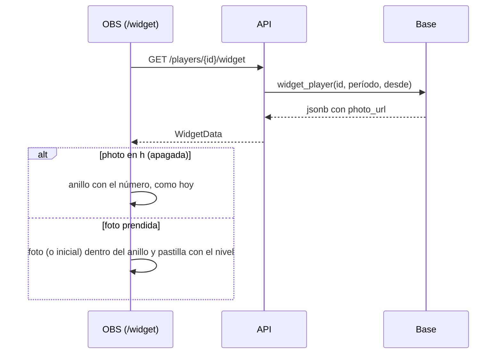

# Plan: foto de perfil en el widget para streamers

> Planeación original. Estado: **aprobada** por Daniel el 2026-11-11, sobre el diseño del canvas "Widget con foto de perfil".

Pedido por Daniel (2026-11-11): el widget para OBS ([`2026-11-10-widget-streamers-en-main`](../2026-11-10-widget-streamers-en-main/)) no muestra la foto del perfil. Se agrega en los seis diseños, con la opción de apagarla. Con la foto apagada, el nivel se ve como hasta ahora.

## Decisiones tomadas

| Tema | Decisión | Por qué |
|---|---|---|
| Diseño | La foto va **dentro del anillo de nivel** y el número del nivel pasa a una pastilla abajo del anillo, del color del nivel. De las tres variantes del canvas (anillo, insignia y aparte) es la que eligió Daniel | Ocupa el mismo lugar que el anillo de hoy: no cambia el tamaño de ningún diseño ni las medidas para OBS |
| Sin foto | Si el jugador no tiene foto, va la inicial del nick en el mismo círculo (como `PlayerAvatar` en el resto de la web). Si la foto no carga, también | El widget no queda con un hueco |
| Apagarla | Una parte nueva, `photo`, en las partes que se pueden ocultar (`h=photo` en la URL). En el personalizador sale sola como "Foto de perfil", junto a "Nick", "Nivel", etc. | Es el mismo mecanismo de las demás partes: no hace falta otro control ni otro parámetro |
| Foto apagada | Se dibuja el anillo con el número adentro, exactamente como hoy | Pedido por Daniel |
| Nivel oculto y foto prendida | Solo la foto, en un círculo del mismo tamaño, sin anillo | Cada parte se oculta por separado |
| URLs que ya están en OBS | Muestran la foto desde el próximo refresco, porque `photo` no está en su `h` | La foto es lo que pidió Daniel por defecto; quien no la quiera la apaga y vuelve a copiar la URL |
| De dónde sale | `widget_player` devuelve `photo_url` de `player_overview` (`coalesce(players.photo_url, profile_details.avatar_url)`, replanteo 69): la misma foto que se ve en el perfil público | No se publica nada nuevo: la foto ya es pública en el perfil y en las salas |
| Base | Replanteo **`111`**: `create or replace` de `widget_player` con la clave nueva `photo_url`. Inversa en `reversas/111_widget_foto.sql`, que vuelve al cuerpo del 110 | La firma no cambia, así que la API vieja sigue andando con la base nueva (ignora la clave) |
| API | `photo_url: string \| null` en `WidgetData` | — |

## 1. El flujo completo

## 2. Base de datos

- `supabase/replanteo/111_widget_foto.sql`: comprueba que exista el 110 y que `player_overview` tenga `photo_url`, y reemplaza `widget_player` con `'photo_url', o.photo_url` en el `jsonb`.
- Inversa: `docs/bitacora/2026-10-14-replanteo-modelo-datos/reversas/111_widget_foto.sql`, con el cuerpo del 110.
- Fila nueva en `supabase/replanteo/README.md`.

## 3. API

- `web/backend/src/schemas/players.ts`: `photo_url` en `WidgetData`.
- Prueba de integración (`test/integration/widget.test.ts`): la respuesta trae `photo_url` (null para una ficha sin foto, y la de la ficha cuando tiene).

## 4. Web

- `features/widget/options.ts`: `photo` en `Part` y en `PART_LABEL` ("Foto de perfil").
- `features/widget/StreamWidget.tsx`: `photo_url` en `WidgetData` y un componente que dibuja el anillo con la foto adentro y la pastilla del nivel. Los seis diseños lo usan donde hoy está `LevelRing`.
- `features/widget/demo.ts`: `photo_url: null` (la demo muestra la inicial).
- `src/api/schema.d.ts`: `photo_url` en `WidgetData`.
- Pruebas: que con `h=photo` se dibuje el anillo de siempre, que sin foto salga la inicial y que `parseOptions` acepte `photo`.

## 5. Documentación

- Manual: `docs/manual/jugador/widget-para-stream.md` (la foto y cómo apagarla).
- Términos y privacidad: revisar lo que dicen del widget; la foto ya es pública.
- `CHANGELOG_DISCORD.txt`, `DOCUMENTACION.md`, `GUIA_IMPLEMENTACION.md`, la fila en `docs/bitacora/README.md` y `docs/PENDIENTES.md`.

## 6. Requisitos antes de empezar

- La Supabase local con el replanteo hasta el 110, para la prueba de integración.

## 7. Orden de implementación

1. Replanteo 111 y su inversa; aplicarlo en la base local.
2. API y su prueba.
3. Web y sus pruebas.
4. Documentación y manual.
5. Desplegar (lo decide Daniel): el 111 en producción, después la API y la web.
