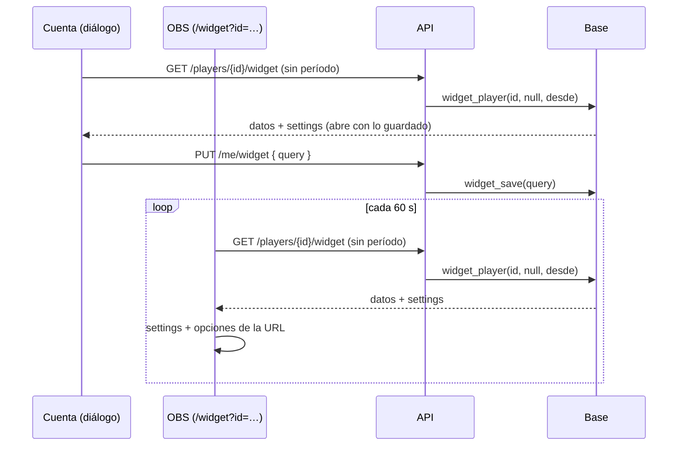

# Guardar el widget para streamers en la cuenta: documentación

## Qué hace

El personalizador del widget (Mi perfil › Cuenta › **Widget para stream**) tiene un botón **Guardar**. Lo que el jugador elige se guarda en su cuenta, y la URL para OBS queda fija: `/widget?id=<ficha>`. Se pega una sola vez en OBS y, cada vez que el jugador guarda, el widget cambia solo en uno o dos minutos (el widget pide cada 60 s y la API cachea 30 s).

Al volver a abrir el personalizador, arranca con lo guardado. Si se cierra con cambios sin guardar, pide confirmación.

## Qué se guarda

Una fila por ficha en `widget_settings`, con las opciones en el mismo formato de la URL del widget, sin el `id`: `d=barra&v=historico&a=00b4ff&f=Hola`. Solo se escribe lo que cambia respecto de los valores de fábrica (`optionsQuery`). Vacío = todo de fábrica.

| Columna | Qué es |
|---|---|
| `player_id` | La ficha (clave). Si se borra la ficha, se borra la fila |
| `query` | Las opciones. Hasta 600 caracteres: letras, números y `=&,_%.+-` |
| `updated_at` | Cuándo se guardó |

La base solo controla el largo y los caracteres. Cada opción la valida la web al leerla (`parseOptions`): una opción inválida usa la de fábrica y no rompe el widget.

## Quién lee y quién escribe

- **Leer:** cualquiera, también sin sesión. `widget_player` devuelve `settings`, y la tabla tiene lectura pública. Es lo mismo que se ve en el stream.
- **Escribir:** solo `widget_save(p_query)`, `security definer`, con la ficha de `auth.uid()`. Sin sesión, `anon` no la puede llamar. Una cuenta sin ficha vinculada recibe "Para guardar tu widget necesitas tu ficha de jugador vinculada". Nadie escribe directo en la tabla.

## Lo guardado y la URL

`/widget` une lo guardado con las opciones de la URL: **cada opción que trae la URL gana** (`mergeOptions`). `id` y `bg` no son opciones.

| URL en OBS | Se ve |
|---|---|
| `/widget?id=…` | Lo guardado (sin nada guardado, todo de fábrica) |
| `/widget?id=…&d=stats` | Lo guardado, pero con el diseño Stats |
| Una URL de antes del 2026-11-11, con todo adentro | Como siempre: sus opciones ganan a todo lo guardado que traiga. Para que tome lo guardado, se reemplaza una vez por la URL fija |

**El período.** Si la URL no trae `v`, la web pide los datos sin período y `widget_player` usa el `v=` guardado (`hoy`, `24h`, `temporada` o `historico`; si no hay, hoy). Con `v` en la URL, se pide ese.

## API

| Ruta | Qué hace |
|---|---|
| `GET /api/v1/players/{id}/widget` | `period` ahora es opcional: sin él, el guardado. `since` vale sin `period` o con `today`. La respuesta trae `settings` (texto o null) |
| `PUT /api/v1/me/widget` | Con sesión. `{ query }` → `{ query, updated_at }`. `400` si el texto no es válido o la cuenta no tiene ficha; `401` sin sesión |

## El diálogo

- Abre con lo guardado. La URL de abajo es la fija y no cambia al tocar opciones.
- **Guardar** se activa cuando hay cambios. Al lado dice "Cambios sin guardar".
- Al guardar: "Guardado. Tu widget en OBS cambia solo en un minuto."
- Cerrar con cambios pide confirmación ("¿Cerrar sin guardar?").
- Un aviso explica que una URL larga (de antes) no toma lo guardado.
- `/demo/widget` sigue armando la URL con todo adentro, porque no tiene cuenta.

## Qué cambia para cada rol

| Rol | Qué cambia | Página del manual |
|---|---|---|
| Jugador | Guarda su widget en la cuenta y la URL de OBS queda fija; para cambiarlo, edita y guarda | [`jugador/widget-para-stream.md`](../../manual/jugador/widget-para-stream.md) |
| Capitán, organizador, moderador, admin, streamer y dueño de un servidor externo | Nada | — |

## Términos y privacidad

- **`/privacidad`** (página y `terms/privacidad.html`): en "Lo que subes o escribes", la configuración del widget si se guarda (diseño, período, stats, colores y la frase), que es pública porque es lo que se ve en el stream. Fecha de actualización: 11 de noviembre de 2026 (también en `/terminos`, que tiene la misma fecha).
- **`/terminos`:** sin cambios de texto.

## Dónde está cada cosa

| Archivo | Qué es |
|---|---|
| `supabase/replanteo/112_widget_guardar.sql` | `widget_settings`, `widget_save` y `widget_player` con `settings` y el período guardado |
| `docs/bitacora/2026-10-14-replanteo-modelo-datos/reversas/112_widget_guardar.sql` | La inversa |
| `web/backend/src/schemas/players.ts` | `WidgetQuery` (`period` opcional), `settings` en `WidgetData`, `WidgetSaveBody` y `WidgetSaved` |
| `web/backend/src/routes/account.ts` | `PUT /api/v1/me/widget` |
| `web/frontend/src/features/widget/options.ts` | `optionsQuery`, `savedWidgetUrl` y `mergeOptions` |
| `web/frontend/src/features/widget/api.ts` | El período `null` (el guardado) y `saveWidget` |
| `web/frontend/src/features/widget/WidgetPage.tsx` | Une lo guardado con la URL |
| `web/frontend/src/features/widget/WidgetCard.tsx` | El diálogo con **Guardar** |
