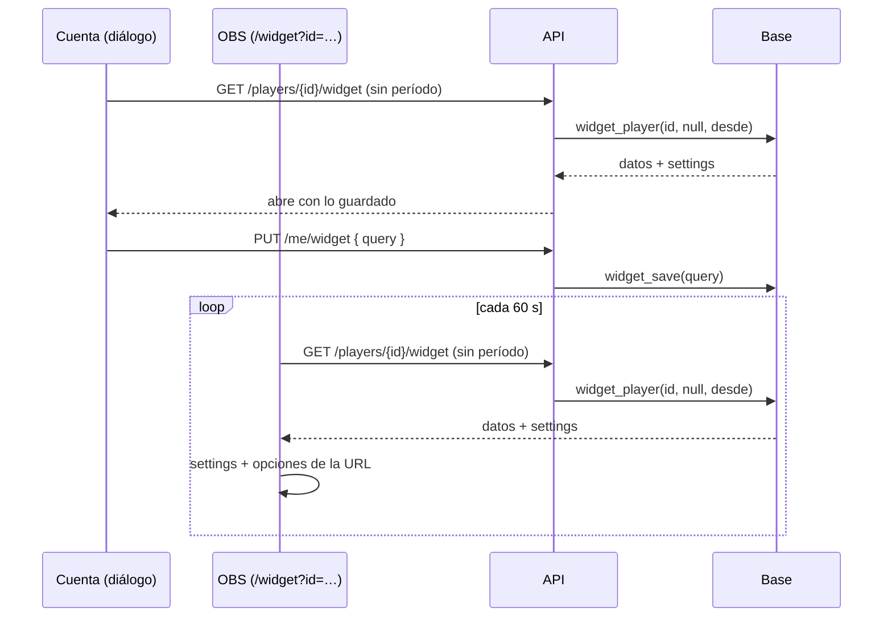

# Plan: guardar el widget para streamers en la cuenta

> Planeación original. Estado: **aprobada** por Daniel el 2026-11-11 (opción A).

Pedido por Daniel (2026-11-11): el personalizador del widget ([`2026-11-10-widget-streamers-en-main`](../2026-11-10-widget-streamers-en-main/)) no tiene botón de guardar. Toda la configuración va en la URL: para cambiar algo hay que rearmar el widget desde los valores de fábrica y reemplazar la URL en OBS. De las tres opciones que se plantearon (guardar en la cuenta, recordar en el navegador y pegar la URL para editarla), Daniel eligió **guardar en la cuenta**.

## Decisiones tomadas

| Tema | Decisión | Por qué |
|---|---|---|
| Qué se guarda | El texto de opciones de la URL, sin el `id` (`d=stats&v=historico&h=photo…`), en una tabla nueva `widget_settings`: una fila por ficha | Es el formato que la web ya lee y valida (`parseOptions`): no hace falta otro esquema ni migrar nada si se suman opciones |
| La URL de OBS | Queda fija: `/widget?id=<ficha>`. El widget lee lo guardado | Se copia una sola vez. Al guardar, OBS lo toma solo |
| URLs viejas con opciones | Las opciones de la URL **ganan** a las guardadas, una por una | Las URLs que ya están en OBS se siguen viendo igual. Para que lo guardado se aplique, se copia una vez la URL nueva (solo con el `id`). Lo dicen el diálogo y el manual |
| El período | Si la URL no trae `v`, la API usa el período guardado (`widget_player` con `p_period` null). Sin nada guardado, "Hoy" | El período cambia la consulta, así que lo tiene que resolver el servidor en la misma llamada |
| Quién guarda | El dueño de la ficha (`players.user_id = auth.uid()`), con una función `widget_save(p_query)` `security definer` | Igual que las demás acciones "mías". Sin ficha vinculada, error claro |
| Quién lo lee | Cualquiera: `widget_player` (sin sesión) devuelve `settings` | OBS no inicia sesión, y es lo mismo que ya se ve en el stream |
| Validación | La base acepta hasta 600 caracteres de URL (letras, números y `=&,_%.+-`). La web vuelve a validar cada opción al leer (`parseOptions`) | Una opción inválida no rompe el widget: usa la de fábrica |
| El diálogo | Abre con lo guardado. Botón **Guardar** (se activa con cambios), aviso "Cambios sin guardar" y la URL fija con **Copiar URL** | Pedido por Daniel |
| Caché | Sigue la de 30 s de la API: OBS ve lo guardado en uno o dos minutos | No vale la pena sacar la caché por esto |
| `/demo/widget` | Sigue armando la URL completa, sin guardar | No tiene sesión |

## 1. El flujo completo

## 2. Base de datos: replanteo `112`

- Tabla `widget_settings (player_id uuid primary key references players on delete cascade, query text not null, updated_at timestamptz)`, con `check` de largo y caracteres, RLS con lectura para todos y sin escritura directa.
- `widget_save(p_query text)`, `security definer`: la ficha de `auth.uid()`, valida y hace el upsert. Devuelve `query` y `updated_at`.
- `widget_player`: `create or replace` con `'settings'` en el `jsonb`. Con `p_period` null usa el `v=` guardado (`hoy`, `24h`, `temporada`, `historico`), y si no hay, `today`.
- Inversa en `reversas/112_widget_guardar.sql`: vuelve `widget_player` al cuerpo del 111 y borra la función y la tabla.

## 3. API

- `GET /api/v1/players/{id}/widget`: `period` opcional (sin él, el guardado); `since` vale sin `period` o con `today`. Respuesta con `settings: string | null`.
- `PUT /api/v1/me/widget` (con sesión): `{ query }` → `{ query, updated_at }`. `400` si no tiene ficha o el texto no es válido.

## 4. Web

- `options.ts`: `optionsQuery(o)` (el texto que se guarda) y `mergeOptions(saved, url)`.
- `api.ts`: el período puede ser `null` (el guardado), y `saveWidget`.
- `WidgetPage`: une lo guardado con la URL.
- `WidgetCard`: abre con lo guardado, **Guardar**, "Cambios sin guardar" y la URL fija.
- `WidgetCustomizer`: el texto de abajo de la URL se puede cambiar.

## 5. Documentación y legales

- Manual `jugador/widget-para-stream.md`: guardar, la URL fija y qué pasa con las URLs viejas.
- `/privacidad` (página y `terms/privacidad.html`): la configuración del widget en "Lo que subes o escribes".
- `DOCUMENTACION.md`, `GUIA_IMPLEMENTACION.md`, `CHANGELOG_DISCORD.txt`, fila en la bitácora y `docs/PENDIENTES.md`.

## 6. Orden de implementación

1. Replanteo `112`, su inversa y la prueba en la base local.
2. API y pruebas.
3. Web y pruebas.
4. Documentación, legales y manual.
5. Desplegar: la `112`, la API y la web.
