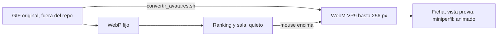

# Avatares animados en la tienda: documentación

> **Reemplazado (Daniel, 2026-11-13):** los 16 avatares son arte de terceros sin permiso y no se publican. En su lugar, cada jugador sube el suyo: [`2026-11-13-avatar-y-fondo-propios`](../2026-11-13-avatar-y-fondo-propios/). Lo de abajo describe lo que se hizo y queda como historia.

## Qué hace

La tienda suma un tipo de cosmético, el **avatar**: una imagen animada que reemplaza la foto de perfil, con el marco encima si hay uno. Es la única forma de tener una imagen de perfil animada. La API no deja subir imágenes animadas: rechazaba los GIF y ahora también los PNG y WebP animados.

Hay 16 avatares, todos VIP, a 1200 monedas VIP cada uno. Se ven animados en la ficha, la vista previa de la Tienda y el miniperfil. En las filas (ranking y sala de Jugar) se ven quietos, y se animan al pasar el mouse.

En el mismo cambio, las filas dejaron de mostrar el **marco**: en una fila de 30 o 36 px quedaba recargado. Ahí queda solo el efecto de nombre, y el avatar si hay uno.

## Archivos

- `web/frontend/public/cosmetics/avatars/<id>.webm` (animación) y `<id>.webp` (imagen fija). Los 16 pesan 1,3 MB en total; los GIF originales pesaban 18 MB.
- Los GIF quedan fuera del repo, en `~/.v34frag/avatares-originales/<id>.gif`.
- Para sumar uno: dejar `avatar-<nombre>.gif` en esa carpeta, correr `pruebas/convertir_avatares.sh avatar-<nombre>`, agregarlo a `catalogo.json` (`kind: "avatar"`, colección `avatares`, `vip_only`, `vip_price`) y regenerar la carga de la `113` con `generar_catalogo.py`. Si ya está en producción, un replanteo nuevo con el `insert`.
- La imagen fija es el cuadro del medio del GIF, salvo excepciones anotadas en el script (el perrito usa el primero).

| Id | Nombre en la tienda |
|---|---|
| `avatar-chica-nieve` | Nieve |
| `avatar-perrito-pixel` | Perrito pixel |
| `avatar-cadenas` | Cadenas |
| `avatar-gato-auriculares` | Gato DJ |
| `avatar-pirata-radio` | Pirata |
| `avatar-chibi-prado` | Prado |
| `avatar-espadachina` | Espadachina |
| `avatar-criatura-oscuridad` | Oscuridad |
| `avatar-chibi-zorro` | Zorrita |
| `avatar-ranas-bosque` | Ranas del bosque |
| `avatar-rana-estrella` | Rana estelar |
| `avatar-bar-pixel` | Bar nocturno |
| `avatar-lata-caminante` | Lata caminante |
| `avatar-mono-abrigo` | Mono con estilo |
| `avatar-chica-ojos-azules` | Ojos azules |
| `avatar-chica-cuernos` | Cuernos |

## Base, API y web

- **Base** (dentro de la `113`, que todavía no salió):
  - `shop_items.kind` acepta `avatar`;
  - `user_cosmetics.avatar`;
  - `set_my_cosmetics`, `admin_item_revoke` y `player_cosmetics_public` con el avatar;
  - los 16 artículos.
- **API:**
  - `avatar` en `Kind`, `Equipped`, `EquipPatch`, `CosmeticsLight` (las filas) y `CosmeticsFull`;
  - `lib/uploads.ts` (`isAnimated`): un PNG con `acTL` antes del `IDAT` o un WebP con `ANIM`, `ANMF` o la marca de animación del `VP8X` dan `400 INVALID_FILE`. Vale para todo lo que pasa por `readImage`: avatar, portada, logos, banners, fotos de mapas e imagen del MVP.
- **Web:**
  - `AvatarMedia` (video en bucle, mudo, con su póster), `FramedAvatar` con `avatar` y `AvatarThumb` (las filas);
  - la pestaña **Avatares** en la Tienda;
  - el avatar en la ficha, el miniperfil y las filas del ranking y de la sala;
  - sin marco en las filas.

## Qué cambia para cada rol

| Rol | Qué cambia | Página del manual |
|---|---|---|
| Jugador | Con VIP, compra avatares animados con monedas VIP; las imágenes que sube no pueden ser animadas; en las filas ya no se ve el marco | [`jugador/tienda-y-cosmeticos.md`](../../manual/jugador/tienda-y-cosmeticos.md) |
| Admin | Los avatares aparecen en el catálogo de Administración › Tienda, con su precio en monedas VIP | [`admin/tienda-y-puntos.md`](../../manual/admin/tienda-y-puntos.md) (sin cambios: el catálogo ya se explica) |
| Los demás | Nada | — |

## Términos y privacidad

- **Términos (sección 13):** los avatares animados en la lista de cosméticos, y que una imagen de perfil animada solo se consigue en la tienda. En la web y en `terms/terminos.html`.
- **Privacidad:** sin cambios. Lo equipado ya figura como público.
