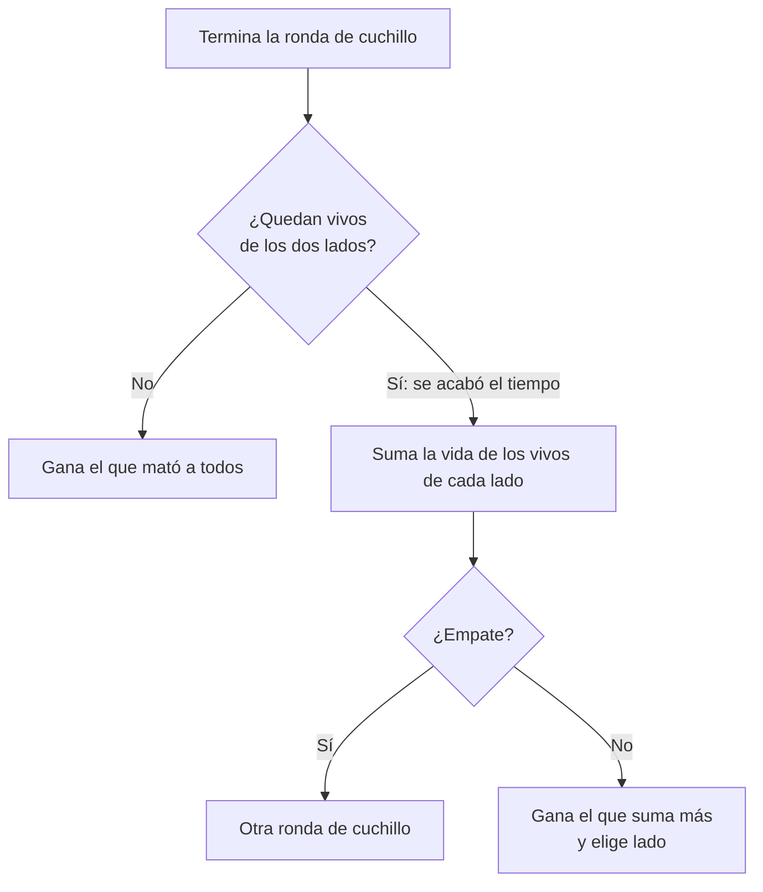
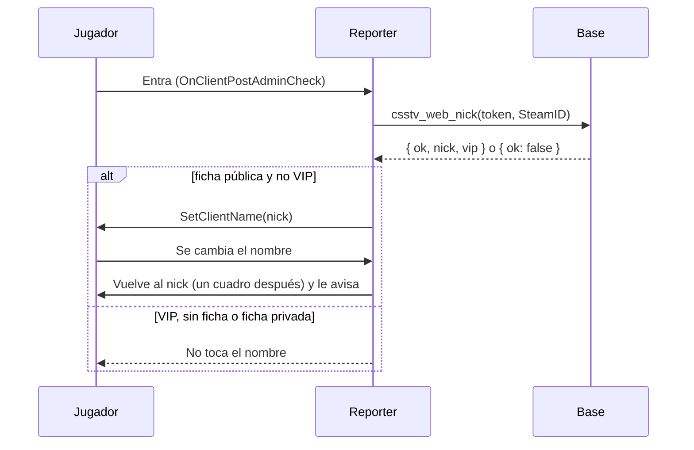

# Ronda de cuchillo por vida y nombre de la web: documentación

## Qué hace

Dos cambios del reporter que salieron de sugerencias de jugadores en Discord (tam y tetr1c, 2026-11-12):

1. **Ronda de cuchillo por vida.** Si la ronda de cuchillo termina porque se acabó el tiempo, la gana el equipo que suma más vida entre sus jugadores vivos, no los CT. Si empatan en vida, se juega otra. Antes, los CT se escondían a esperar el reloj.
2. **Nombre de la web.** A quien tiene su SteamID vinculado a una ficha, el servidor le pone el nick de la ficha al entrar y no lo deja cambiarlo. Los VIP se saltan la regla. Sin ficha, o con la ficha privada, queda el nombre de Steam.

Están en dos versiones del reporter con el mismo código:

| Versión | Sobre qué | Dónde |
|---|---|---|
| **2.10.1** | La 2.10.0 de `main` (la que tenían los servidores) | **Desplegada** en #1, #2 y #3 el 2026-11-12. Binario y parche en `build_2.10.1/` |
| **2.12.0** | La 2.11.0 de `kyan/pruebas` (repetición 2D, sin desplegar) | El código de la rama: `server/addons/sourcemod/scripting/` |

## Ronda de cuchillo (`csstv/knife.inc`)

- `Knife_TimeoutWinner(gameWinner)`, llamada desde `Knife_OnRoundEnd` antes de usar el ganador del juego.
- Se acabó el tiempo si al terminar la ronda hay vivos de los dos lados: en la ronda de cuchillo no hay C4 ni rehenes. No usa el número de `reason` del evento.
- Suma `GetClientHealth` de los vivos de cada lado (sin SourceTV ni espectadores). Gana el que suma más; con la misma vida devuelve 0 y entra por el camino del empate de siempre ("se juega otra").
- Chat: "Se acabó el tiempo: gana el <equipo> por vida (X contra Y)". Al empezar la ronda se avisa la regla.
- Log: `Partida <uid>: ronda de cuchillo por tiempo, vida CT X (n vivos) contra T Y (n vivos).`
- El marcador del juego no se toca: la ronda de cuchillo no cuenta para nada.

## Nombre de la web (`csstv/webnick.inc`)

| Qué | Detalle |
|---|---|
| `csstv_web_names` | 1 por defecto. 0 apaga todo (y olvida los nicks guardados) |
| Cuándo se pide | `OnClientPostAdminCheck` y después de un `!claim` que vincula. No a bots ni a SourceTV. Solo con `csstv_send 1`, System2 y `csstv_api_url` configurada |
| Respuesta | `{ ok: true, nick, vip }` o `{ ok: false }`. Con `vip: true` no se toca el nombre |
| Nombre | Cortado a 31 bytes sin partir UTF-8 (`TruncateUtf8`). `{` pasa a `(`, como en `!whois` |
| Bloqueo | `OnClientSettingsChanged`: si el nombre no es el de la ficha, un cuadro después se vuelve a poner. Aviso en el chat como mucho cada 10 s |
| Si la web falla | Queda con su nombre de Steam; `LogError("csstv_web_nick: …")`. Se vuelve a pedir en el próximo mapa |
| Pruebas | `csstv_webnick_fake <userid> <nick> [vip]` (comando del servidor) |

### Base: `csstv_web_nick(p_token text, p_steam text) returns jsonb` (replanteo `113`)

- `security definer`, ejecutable por `anon`, `authenticated` y `service_role`. `csstv_auth(p_token)` valida el servidor.
- Busca la ficha con `steam_owner(csstv_steam64(p_steam))`: SteamID principal o adicional.
- Devuelve el nick solo si la ficha no es privada (`players.privacy <> 'private'`): así el servidor no muestra a quién pertenece un SteamID de una ficha privada.
- `vip`: `is_vip(players.user_id)`.
- `players.nick` es el alias de la cuenta (`profiles.tag`): el trigger `profiles_alias_nick` de la `09` los mantiene iguales.
- Inversa: `docs/bitacora/2026-10-14-replanteo-modelo-datos/reversas/113_nick_de_la_web.sql`.
- Mientras la `113` no esté en la base, la llamada da 404 y nadie cambia de nombre.

## Qué cambia para cada rol

| Rol | Qué cambia | Página del manual |
|---|---|---|
| Jugador | La ronda de cuchillo por tiempo se gana por vida. Con la ficha vinculada, su nombre en el servidor es su alias y no lo puede cambiar (salvo VIP) | `jugador/jugar-en-el-servidor.md`, `jugador/crear-cuenta.md` |
| Capitán | Elige lado también cuando su equipo gana el cuchillo por vida | `capitan/comandos-en-el-servidor.md` |
| Moderador, admin, organizador, streamer, dueño de un servidor externo | Nada | — |

No hay comandos nuevos para los jugadores. `csstv_webnick_fake` es de pruebas, de la consola del servidor.

## Términos y privacidad

- `/privacidad` (y `terms/privacidad.html`), sección "Qué es público": en los servidores apareces con tu tag si tu SteamID está vinculado y tu perfil no es privado, y no lo puedes cambiar (los VIP sí). Última actualización: 12 de noviembre de 2026 (también en `terms/terminos.html`, porque la web usa una sola fecha para las dos).
- `/terminos`: sin cambios.

## Dónde está cada cosa

| Qué | Dónde |
|---|---|
| Cuchillo por vida | `server/addons/sourcemod/scripting/csstv/knife.inc` (`Knife_TimeoutWinner`) |
| Nombre de la web | `server/addons/sourcemod/scripting/csstv/webnick.inc`, registro en `csstv_reporter.sp` y `csstv/claim.inc` |
| Función de la base | `supabase/replanteo/113_nick_de_la_web.sql` |
| 2.10.1 desplegada | `build_2.10.1/csstv_reporter.smx` (md5 `8e68bf20c0b04b180b54bac875a595f7`) y `build_2.10.1/sobre_main_2.10.0.patch` |
| Subida a los servidores | `pruebas/subir_2_10_1.py` |
| Pruebas | `pruebas/RESULTADOS.md` |
| Changelog | `CHANGELOG_DISCORD.txt` (CMLeague 2.9.33) |
