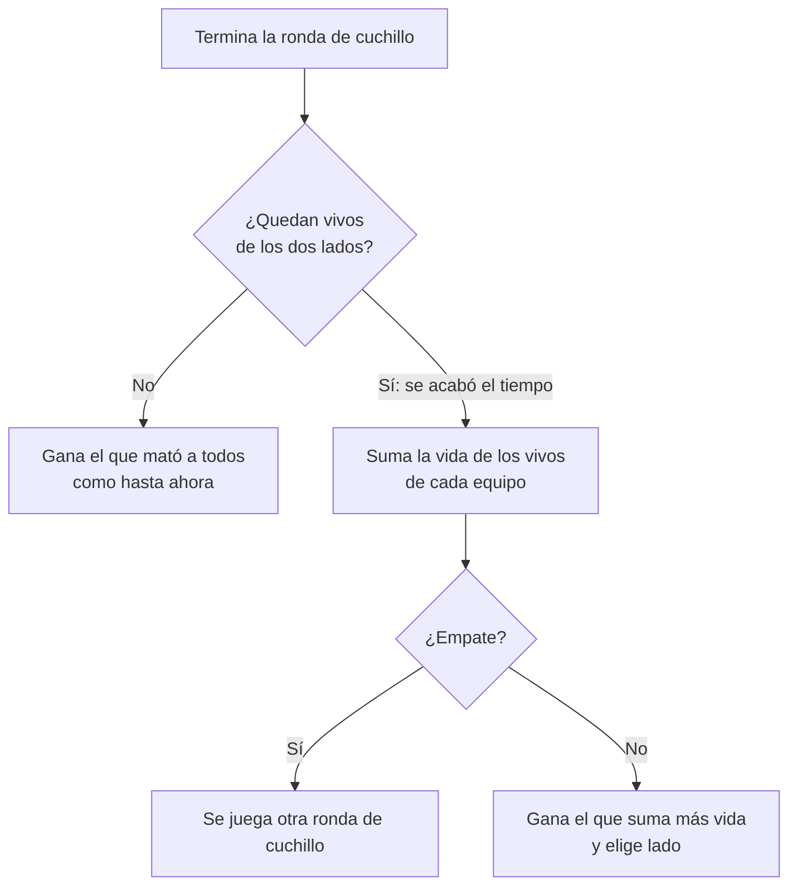
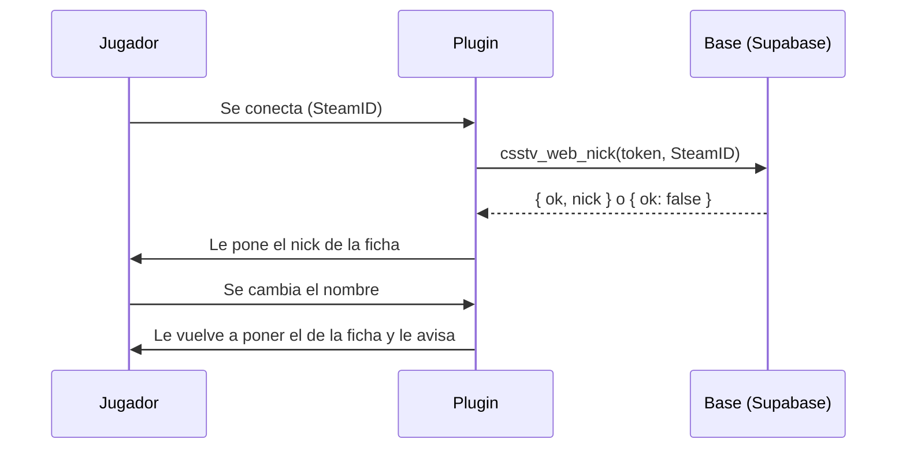

# Plan: ronda de cuchillo por vida y nombre de la web en el servidor

> Planeación original. Estado: **aprobada por Kyan** el 2026-11-12, a partir de dos sugerencias de jugadores en Discord.

Dos sugerencias de la comunidad, el mismo día:

1. **tam:** "Estaría bueno implementar un límite de tiempo para los CT en las rondas faka. Muchas veces se quedan esperando para que se termine el tiempo y ganar sin tener que enfrentar a los TT."
2. **tetr1c:** "Sugiero que el tag de los jugadores dentro del server guarde una relación aunque sea con el tag que tiene en la página."

## Decisiones tomadas

| Tema | Decisión | Por qué |
|---|---|---|
| Cuchillo: qué pasa si se acaba el tiempo | Gana el equipo que **sume más vida entre sus jugadores vivos**. Si empatan, se juega otra ronda de cuchillo | Lo eligió Kyan. Hoy el juego le da la ronda a los CT (no hay bomba), y por eso se esconden. Con la vida, esconderse no sirve: el que no pelea no suma |
| Cuchillo: duración | Igual que hoy (`mp_roundtime` del `live.cfg`, 1:45) | Con la regla nueva ya no hace falta acortarla |
| Cuchillo: cómo se detecta que se acabó el tiempo | Al terminar la ronda quedan vivos de los dos lados | En la ronda de cuchillo no hay C4 ni rehenes: si nadie murió del todo, la terminó el reloj. No depende del número de `reason`, que cambia entre versiones |
| Cuchillo: el marcador del juego | No se toca: el juego puede mostrar "ganaron los CT", pero el plugin anuncia y usa el ganador por vida | La ronda de cuchillo no cuenta para el marcador, las estadísticas ni la demo |
| Nombre: qué nombre | El **nick de la ficha** (`players.nick`), el del perfil, el ranking y las partidas | Lo eligió Kyan. Es el que está atado al SteamID |
| Nombre: cuánto se ata | Al entrar, el plugin le pone el nick de la ficha y **no deja cambiarlo** mientras está en el servidor | Lo eligió Kyan ("igual al de la web") |
| Nombre: quién | Solo quien tiene la ficha vinculada a ese SteamID (principal o adicional). Sin ficha, cada uno con su nombre de Steam | No hay otro nombre que ponerle. El `!claim` sigue igual |
| Nombre: siempre o solo en partidas | Siempre, también en el calentamiento | Lo eligió Kyan ("igual al de la web", no "solo en partidas") |
| Nombre: de dónde sale | Una función nueva de la base, `csstv_web_nick(p_token, p_steam)`, que el plugin llama al conectarse cada jugador (como `!whois`) | Los planteles del matchmaking solo traen SteamID; hace falta para cualquier jugador, no solo en salas |
| Nombre: si la web no responde | El jugador queda con su nombre de Steam y se reintenta en el próximo mapa | Que una caída de la web no deje a nadie sin poder jugar |
| Versión | Reporter **2.12.0** | Sobre la 2.11.0 (todavía sin desplegar): se despliegan juntas |

## 1. El flujo completo

## 2. Ronda de cuchillo (`csstv/knife.inc`)

- `Knife_OnRoundEnd` recibe el ganador del juego. Antes de usarlo, cuenta los vivos de cada lado. Si hay vivos de los dos, suma la vida (`GetClientHealth`) de los vivos de cada lado y el ganador es el que suma más.
- Empate de vida: el mismo camino que hoy tiene el empate ("se juega otra").
- Anuncio en el chat: "Se acabó el tiempo: gana el <equipo> por vida (X contra Y)".
- Al empezar la ronda de cuchillo se avisa la regla: "Si se acaba el tiempo, gana el equipo que sume más vida".
- Se anota en el log de la partida.

## 3. Nombre de la web

### Base: replanteo `93_nick_de_la_web.sql`

- `csstv_web_nick(p_token text, p_steam text) returns jsonb`, `security definer`:
  - `csstv_auth(p_token)`, como `csstv_whois`.
  - `csstv_steam64(p_steam)` y `steam_owner()`: la ficha dueña del SteamID, principal o adicional.
  - Devuelve `{ "ok": true, "nick": "<players.nick>" }` o `{ "ok": false }` si no tiene ficha.
- Verificación al principio (que exista `steam_owner` y que no exista ya la función) y su inversa.

### Plugin: `csstv/webnick.inc` (nuevo)

- `csstv_web_names` (1 por defecto): 0 apaga todo.
- Al autorizarse el jugador (no bots ni SourceTV), si el servidor manda a la web (`csstv_send 1`, System2 y la URL configurada), pide su nick.
- Con la respuesta: guarda el nick (cortado a 31 bytes sin romper UTF-8, con `TruncateUtf8`) y, si su nombre es otro, `SetClientName`.
- `OnClientSettingsChanged`: si tiene nick de la web y el nombre cambió, se lo vuelve a poner y le avisa en el chat (una vez cada 10 s): "En este servidor usás el nombre de tu ficha. Para cambiarlo, cambialo en cmleague.lat".
- Al vincular con `!claim` (`Mm_OnClaimLinked` o la respuesta del claim), se vuelve a pedir el nick.
- Comando de pruebas `csstv_webnick_fake <userid> <nick>` (`RegServerCmd`), para probar con bots sin la base.

## 4. Manual, legales y changelog

- Manual: `jugador/jugar-en-el-servidor.md` (la ronda de cuchillo y el nombre) y, si habla del cuchillo, `capitan/comandos-en-el-servidor.md`.
- Privacidad: revisar si dice qué se muestra en el servidor; el nick de la ficha ya es público en la web, así que en principio no cambia nada.
- `CHANGELOG_DISCORD.txt` con el porqué, citando que salió de sugerencias de la comunidad.

## 5. Requisitos antes de empezar

- El servidor local de pruebas (`C:\Users\Agus\Downloads\cssds`) con bots para el cuchillo.
- La base local para probar `csstv_web_nick`. El nombre con un jugador real lo prueba Kyan.

## 6. Orden de implementación

1. Replanteo 93 y su inversa; probarlo en la base local.
2. `knife.inc`: ganador por vida.
3. `webnick.inc` y su registro en `csstv_reporter.sp`; versión 2.12.0.
4. Compilar y probar en el servidor local: cuchillo con bots (tiempo corto) y el nombre con `csstv_webnick_fake`.
5. Kyan prueba entrando con su cuenta.
6. Documentación, manual, legales, changelog y `docs/PENDIENTES.md`.
7. Commit en `kyan/pruebas` y despliegue a #1, #2 y #3 (con la 93 en la base del VPS antes) solo cuando Kyan lo pida.
