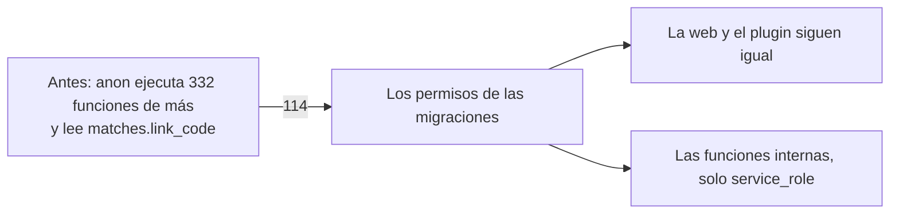

# Permisos de las funciones y tablas de producción: documentación

## Qué hace

El replanteo `114_permisos.sql` deja los permisos de producción como los dicen las migraciones. Desde la mudanza al VPS del 2026-11-03, `anon` (cualquiera, sin sesión, con la clave pública que trae la web) y `authenticated` (cualquier cuenta) tenían permisos de más sobre 407 objetos de `public`. Entre ellos había funciones internas que se podían ejecutar por `https://db.cmleague.lat/rest`, como `season_close_run` (cierra la temporada y reinicia el ELO) y `csstv_after_ingest` (modifica partidas sin el token del servidor).

La `114` solo quita lo que sobra: no da ningún permiso nuevo, salvo en `matches`. Ahí reemplaza el permiso de lectura sobre la tabla entera, que exponía `link_code` (el código secreto de `!match`), por el permiso sobre cada columna menos esa, que era la intención de la `10`.

## Qué pasaba y por qué

| Tipo | Lo que sobraba | Cuántos |
|---|---|---|
| Funciones | `EXECUTE` para `anon` | 332 |
| Funciones | `EXECUTE` para `authenticated` | 175 |
| Tablas | Todos los privilegios (`SELECT` a `MAINTAIN`) para `anon` y `authenticated` | 66 |
| Vistas | Lo mismo | 9 |

- **Por qué:** `deploy/supabase/migrar-vps.sh` cargó el esquema de `public` en un Supabase nuevo. Ahí cada objeto nuevo recibe permisos por defecto para `anon`, `authenticated` y `service_role`. El volcado no traía los `revoke`, porque `pg_dump` los calcula contra los permisos por defecto de Postgres y no contra los de Supabase. La comparación de esa mudanza miraba los datos, no los permisos.
- **Qué quedó expuesto de verdad:**
  - Las funciones que se protegían solo con el `revoke`: `season_close_run`, `csstv_after_ingest`, `elo_recompute_player`, `mm_tick`, `notify_due` y `season_close_due`.
  - La columna `matches.link_code`.
  - Las demás funciones (`csstv_*` con token, `admin_*` con `is_admin()`) se protegen por dentro.
  - Las tablas tienen la RLS prendida, y la única vista que se puede actualizar (`match_clutch_data`) es `security_invoker`.
- **Si alguien las usó:** no se revisó. La base no guarda quién llama a cada función; lo que se puede mirar es si hubo cierres de temporada o cambios de partidas que nadie del staff hizo (los logs de Kong del VPS, si se conservan, tienen las llamadas a `/rest/v1/rpc/`).

## Cómo se decide qué es lo correcto

- **`pruebas/referencia.sh`** arma la base `referencia_permisos` en el contenedor de la Supabase local, sin tocar la copia de producción:
  - copia los esquemas de Supabase;
  - pone los permisos por defecto de un Supabase nuevo;
  - carga lo mismo que `db-local.sh`, hasta la `112`.
- **`pruebas/comparar.sh`** compara dos bases, objeto por objeto y columna por columna: funciones, tablas, vistas, secuencias y columnas, con los permisos de `PUBLIC`, `anon`, `authenticated` y `service_role`. Puede leer producción por el túnel, solo lectura (`comparar.sh local:referencia_permisos prod`).
- **`pruebas/generar_114.py`** escribe la `114` y su inversa desde esa comparación:
  - un `revoke` por objeto con exactamente lo que sobra;
  - los permisos por columna de `ac_devices`, que el `revoke` sobre la tabla también se lleva;
  - el permiso de `matches` calculado al aplicar.

## Datos

| Objeto | Cómo queda |
|---|---|
| `season_close_run`, `csstv_after_ingest`, `elo_recompute_player`, `notify_due` y las demás funciones internas | Solo `postgres` y `service_role` |
| Funciones de la web (`mm_my_state`, `set_my_preferences`…) | `authenticated`, como antes; ya no `anon` |
| Funciones del plugin (`csstv_ingest`, `csstv_mm_poll`…) | `anon`, como antes: el plugin entra con la clave pública y su token |
| Tablas | Lo que dicen las migraciones (casi siempre, nada para `anon` y `authenticated`: la web lee por vistas y funciones) |
| `matches` | `select` sobre todas las columnas menos `link_code`, para `anon` y `authenticated` |
| `ac_devices` | `select` para `authenticated` sobre `id`, `user_id`, `name`, `agent_version`, `last_seen_at`, `revoked_at` y `created_at` (sin los hashes de acceso, la IP ni la clave pública) |

## Qué cambia para cada rol

Nada para los usuarios: la web, el matchmaking, el plugin, los Workers y el render siguen igual. Lo único que cambia es que nadie sin permiso puede llamar a las funciones internas.

## Términos y privacidad

Sin cambios. Arregla un error de permisos; no cambia qué datos se guardan ni quién los ve según los textos.

## Dónde está cada cosa

| Qué | Dónde |
|---|---|
| El arreglo | `supabase/replanteo/114_permisos.sql` |
| La inversa | `docs/bitacora/2026-10-14-replanteo-modelo-datos/reversas/114_permisos.sql` |
| Armar la referencia, comparar, generar y probar | `pruebas/referencia.sh`, `pruebas/comparar.sh`, `pruebas/generar_114.py` y `pruebas/probar_114.sh` |
| Que no se repita en una mudanza | `deploy/supabase/migrar-vps.sh`: carga sin los permisos por defecto y compara también los permisos con el origen |
| La copia de producción en la base local | `web/backend/scripts/copia-produccion.sh` (de la bitácora de la tienda) |
