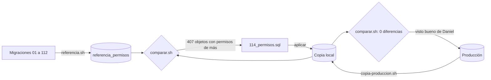

# Plan: permisos de las funciones y tablas de producción

> Planeación original. Estado: **aprobado por Daniel el 2026-11-12** ("primero el arreglo de permisos y luego la tienda").

Mientras se probaba la tienda contra una copia de producción ([`2026-11-11-tienda-de-puntos`](../2026-11-11-tienda-de-puntos/)) apareció que, en producción, `anon` (sin sesión, solo con la clave pública que trae la web) puede ejecutar por `https://db.cmleague.lat/rest` funciones que las migraciones le quitan. Se confirmó con una consulta de solo lectura a producción el 2026-11-12, sin ejecutar ninguna de ellas.

## Qué pasa

Se comparó, objeto por objeto, el esquema `public` de producción con una base armada desde cero con las migraciones (`pruebas/referencia.sh`, hasta la `112`, que es lo que tiene producción):

- **La estructura es la misma.** Las 814 funciones, tablas, vistas y secuencias existen en las dos, y las funciones tienen la misma definición salvo `mm_player_card` (ver "Fuera de este plan").
- **No falta ningún permiso: sobran.** 407 objetos tienen permisos de más para `anon` o `authenticated`:

| Tipo | Permiso de más | Cuántos |
|---|---|---|
| Funciones | `EXECUTE` para `anon` | 332 |
| Funciones | `EXECUTE` para `authenticated` | 175 |
| Tablas | `SELECT`, `INSERT`, `UPDATE`, `DELETE`, `TRUNCATE`, `REFERENCES`, `TRIGGER` y `MAINTAIN` para `anon` y `authenticated` | 66 tablas |
| Vistas | Lo mismo | 9 vistas |

**Lo grave son las funciones.** Muchas se protegen por dentro (las `csstv_*` piden el token del servidor y las `admin_*` comprueban `is_admin()`), pero otras se protegían solo con el `revoke`:

| Función | Qué puede hacer hoy cualquiera |
|---|---|
| `season_close_run` | Cerrar la temporada en curso, con las medallas y el reinicio del ELO |
| `csstv_after_ingest` | Modificar partidas y mixes en vivo, sin el token del servidor |
| `elo_recompute_player` | Recalcular el ELO de un jugador |
| `mm_tick`, `notify_due`, `season_close_due` | Adelantar los procesos automáticos (riesgo bajo: hacen lo que ya tocaba) |

**Las tablas y vistas no abren nada hoy:** todas las tablas de `public` tienen la RLS prendida, y de las vistas solo `match_clutch_data` se puede actualizar, y es `security_invoker`. Igual se quitan: si una tabla quedara sin RLS, esos permisos la dejarían abierta.

## Por qué pasó

`deploy/supabase/migrar-vps.sh` (paso 2, la mudanza al VPS del 2026-11-03) cargó el esquema de `public` como `postgres` en un Supabase nuevo. Ahí cada objeto nuevo recibe permisos para `anon`, `authenticated` y `service_role` (los permisos por defecto de Supabase). El volcado no trae los `revoke` contra esos roles: `pg_dump` compara con los permisos por defecto de Postgres, no con los de Supabase. La comparación del paso 5 miraba los datos, no los permisos. Lo que se creó después de la mudanza (replanteos de la `56` en adelante, más o menos) sí quedó bien, porque cada migración hace sus `revoke`.

## Decisiones tomadas

| Tema | Decisión | Por qué |
|---|---|---|
| Qué es lo correcto | Los permisos de la base armada desde cero con las migraciones | Es lo que dicen las migraciones y contra lo que corren las pruebas |
| Cómo se arregla | Replanteo `114_permisos.sql`: solo `revoke`, de lo que sobra, objeto por objeto, generado desde la comparación | Un cambio chico, revisable y que no toca nada que esté bien. No se dan permisos nuevos |
| Número | `114`, aunque la `113` (tienda) no esté en producción | Las dos no dependen una de la otra. La `114` va primero a producción; la `113`, con la tienda |
| Verificación | Aplicar la `114` en la copia local de producción y volver a comparar con la referencia: tiene que dar 0 diferencias. Después, la suite de integración | La copia tiene los mismos permisos que producción |
| Qué depende hoy de lo que sobra | Nada. De las funciones que llama el código y pierden algo: el plugin, los Workers y el render no están en la lista; las de la API pierden `anon` pero se llaman con sesión; `notify_due` pierde `authenticated` y la llama el timer con la clave de servicio | Revisado en el código antes de planear |
| Despliegue | En producción con el visto bueno de Daniel, por el túnel, en una transacción. Sin reiniciar nada | Es un cambio de permisos, no de datos: no afecta un mix en curso |
| Que no se repita | Se corrige `migrar-vps.sh` (comparar también los permisos) y el chequeo queda como script (`pruebas/comparar.sh`) para correr después de cada despliegue grande | La próxima mudanza o restauración no puede volver a abrirlo |

## 1. El flujo

## 2. Base de datos (`supabase/replanteo/114_permisos.sql`)

- Generado por `pruebas/generar_114.py` desde la comparación (`pruebas/comparar.sh`).
- Al principio comprueba que existan todos los objetos que nombra (si falta uno, aborta).
- Un `revoke` por objeto con exactamente lo que sobra, por ejemplo `revoke execute on function public.season_close_run(uuid, uuid) from anon, authenticated;`.
- Al final comprueba, para algunas funciones clave, que `anon` ya no las pueda ejecutar.
- Inversa (`reversas/114_permisos.sql`): los `grant` de vuelta. Deja producción como estaba, con el agujero: es solo para deshacer si algo se rompe.

## 3. Pruebas

- `pruebas/comparar.sh`: los permisos de dos bases objeto por objeto (por defecto, la referencia y la copia local).
- `pruebas/probar_114.sh`: en la copia, con rollback, aplica la `114`, compara con la referencia (0 diferencias), comprueba que `anon` no pueda llamar a `season_close_run` ni a `csstv_after_ingest` por la API local, aplica la inversa y compara con el estado de antes.
- La suite de integración de la API sobre la copia con la `114` aplicada: las pruebas `ips` y `notify-due`, que hoy fallan por estos permisos, tienen que pasar.

## 4. Requisitos antes de empezar

- La copia de producción cargada en la base local (`web/backend/scripts/copia-produccion.sh`, hecho el 2026-11-12).
- Para producción: el túnel y el visto bueno de Daniel.

## 5. Orden de implementación

1. `referencia.sh` y `comparar.sh`.
2. `generar_114.py`, la `114` y su inversa.
3. `probar_114.sh` en la copia; aplicar la `114` en la copia y correr la suite de integración.
4. Corregir `migrar-vps.sh`.
5. `DOCUMENTACION.md`, `GUIA_IMPLEMENTACION.md`, la fila en el índice, `supabase/replanteo/README.md` y `docs/PENDIENTES.md`.
6. Con el visto bueno de Daniel: respaldo, la `114` en producción y `comparar.sh` contra producción.
7. Commit en `main`, y la `114` también en `feat/frontend-fase-1` y `feat/mm-claim-en-sala` (toca funciones del matchmaking), cuando Daniel lo pida.

## Fuera de este plan

- **`mm_player_card` en `main`:** el replanteo `94` dejó un comentario `-- (replanteo 94)` en el medio de una línea y el resto quedó comentado, así que la ficha de la sala pierde `is_me`, `linked` y `country`. Producción tiene el arreglo (commit `91ede9b2` de `feat/frontend-fase-1`, "replanteo 98" en esa rama), pero `main` no. Hay que traerlo a `main` en otro requerimiento.
- **Los finales de línea:** el worktree de `main` en Windows tiene los `.sql` con CRLF y eso rompe el armado desde cero (`db-local.sh`) en el replanteo `04`. `referencia.sh` los convierte a LF al vuelo; corregir `db-local.sh` va aparte.

## Términos y privacidad

Sin cambios: no cambia qué datos se guardan ni quién los ve según los textos. Arregla un error de permisos.
