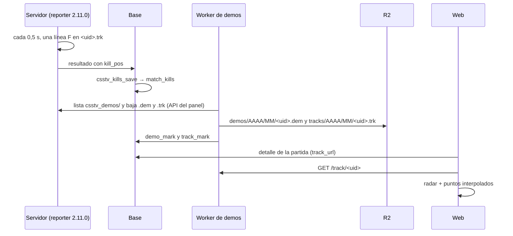

# Repetición 2D y mapa de calor: documentación

## Qué es

Mientras se graba la demo de un mix, el reporter (2.11.0) anota dos veces por segundo dónde está cada jugador vivo, más las kills, la bomba y el fin de cada ronda. Todo va a un archivo de texto, `<uid>.trk`, al lado de la demo. El Worker de demos lo sube a R2 junto con la demo, y la sala de la partida lo dibuja sobre un radar propio de cada mapa:

- **Repetición 2D:** la ronda vista desde arriba, con los jugadores moviéndose, la bomba, las kills y las granadas (el tiro, el humo, la flash con a quién cegó y la HE).
- **Mapa de calor:** desde dónde se mata, dónde se muere o dónde caen las granadas, de todos o de un jugador.

Las kills con posición también llegan en el resultado (`kill_pos`) y quedan en la base (`match_kills`), para el mapa de calor de un jugador sumando sus partidas.

## El archivo `.trk`

Texto, una línea por registro, separada por espacios. Los tiempos son ticks desde el inicio de la grabación de la demo (los mismos que usan los clips).

| Línea | Qué es |
|---|---|
| `V 1 <mapa> <tickrate> <intervalo>` | Encabezado: versión del formato, mapa, tickrate y cada cuántos ticks hay un cuadro |
| `J <slot> <equipo> <steamid> <nick>` | Jugador: se escribe la primera vez y cuando cambia de equipo o de nick. Equipo `2` = T, `3` = CT |
| `R <n> <tick>` | Empieza la ronda `n`. Con `!rr` se repite el mismo `n`: vale la última |
| `Z <tick> <segundos>` | Termina el tiempo de compra, con la duración de la ronda (`mp_roundtime`) |
| `$ <tick> <slot>,<plata>;…` | La plata de cada uno al terminar el tiempo de compra (`m_iAccount`) |
| `F <tick> <slot>,<x>,<y>,<z>,<yaw>,<hp>,<arma>[,b];…` | Cuadro con los vivos: arma en mano sin `weapon_` (`-` si nada), `b` = lleva la bomba. La web también lee el primer formato, sin arma |
| `S <tick> <x>,<y>,<empieza a irse>,<se fue>;…` | Humos en el mapa (`env_particlesmokegrenade`), con cada cuadro, y sus `m_FadeStartTime` y `m_FadeEndTime` (segundos desde que salió). En el v34 son 17 y 22: lleno 17 s y se va del todo a los 22, como lo ve el jugador. La entidad vive unos 28 s, más que el humo visible |
| `H <tick> <atacante> <víctima> <daño> <vida> <arma> <zona>` | Un golpe (`player_hurt`). Zona 1 = cabeza |
| `D <tick> <slot> <kit>` / `A <tick> <slot>` | Empieza a desactivar (con kit `1`) / la deja |
| `K <tick> <mata> <muere> <arma> <hs> <x> <y> <vx> <vy>` | Kill. `mata` 0 y `x y` = `-`: el mundo o un suicidio |
| `B <tick> plant\|defuse\|explode <x> <y> [segundos]` | Bomba. La plantada lleva `mp_c4timer`. Al explotar se usa la posición de la plantada |
| `N <tick> <tipo>,<ent>,<slot>,<x>,<y>;…` | Granadas en el aire, cada 0,1 s. Tipo `he`, `flash` o `smoke`; `ent` es la entidad (une los puntos de un mismo tiro); `slot`, quién la tiró |
| `G <tick> he\|flash\|smoke <slot> <x> <y>` | Dónde explotó una granada (`hegrenade_detonate`, `flashbang_detonate`, `smokegrenade_detonate`) |
| `L <tick> <slot> <segundos>` | Una flash cegó a ese jugador (`player_blind` y `m_flFlashDuration`). La web la une con la `G` de flash del mismo momento (±0,2 s) |
| `E <tick> <ganador> <motivo>` | Fin de ronda. El motivo es el de `round_end` de CS:S (el enum del juego más uno: 1 explotó, 7 desactivada, 8 y 9 por eliminación, 12 se acabó el tiempo) |

- El nombre es el de la demo, en minúsculas (`tv_record` guarda así la demo), para que el Worker los encuentre juntos.
- Un mix de 24 rondas con 10 jugadores pesa alrededor de 1 MB. En la prueba con 6 bots, 8 rondas de 1 minuto y medio pesaron 220 KB.
- Si la partida se descarta sin rondas, el `.trk` se borra con la demo. `csstv_demo_keep` también borra el `.trk` de cada demo vieja.

## Reglas

| Regla | Valor |
|---|---|
| Cuándo se graba | Solo mientras se graba la demo de un mix (`csstv_demo 1` y `tv_enable 1`), con `csstv_track "1"` |
| Frecuencia | Un cuadro cada 0,5 s; la web interpola entre cuadros |
| Kills en el resultado | Solo las de rondas terminadas y con víctima humana; hasta 512 por partida. Si no entran en el JSON, se manda sin ellas (como los clips) |
| Partidas viejas | Sin `.trk` ni `kill_pos`: la sala no muestra la sección |
| Vencimiento | El `.trk` vence con la demo (90 días). `match_kills` queda: es parte de las estadísticas |

## Plugin: `csstv_reporter` 2.11.0 (`csstv/track.inc`)

| Pieza | Qué hace |
|---|---|
| `Track_Start` / `Track_Stop` | Abren y cierran el `.trk` con la demo (`Demo_Start`, `Demo_Stop`) |
| `Timer_TrackFrame` | Cada 0,5 s, una línea `F` con los vivos de CT y T |
| `Track_OnRoundStart` / `Track_OnFreezeEnd` / `Track_OnRoundEnd` | Líneas `R`, `Z` y `E`. Con `!rr`, descarta las kills de la ronda que se vuelve a jugar |
| `Track_OnDeath` | Línea `K` y la kill para `kill_pos` |
| `Track_OnBomb` | Línea `B`. La explosión y la desactivación se anotan aunque la partida ya esté en el medio tiempo |
| `Timer_TrackNades` | Cada 0,1 s, mientras haya granadas en el aire, una línea `N` (`*_projectile`, con `m_hThrower`). Saltea las quietas (`m_vecAbsVelocity` casi 0): el proyectil del humo queda en el piso mientras dura |
| `Event_TrackNade` / `Event_TrackBlind` | Líneas `G` y `L` |
| `Track_OnHurt` / `Event_TrackDefuse` | Líneas `H`, `D` y `A` |
| `Track_OnFreezeEnd` | Líneas `Z` (con la duración de la ronda) y `$` |
| `Track_WriteJson` | `"kill_pos":[[ronda,"mata","muere","arma",hs,x,y,vx,vy],…]` al final del resultado (no en las fotos en vivo) |
| ConVar `csstv_track` | `1` (por defecto) graba; `0` no |

## Base: replanteo `92_repeticion_2d.sql`

| Objeto | Para qué |
|---|---|
| `match_kills` | Cada kill con la posición del que mata (`kx`, `ky`, nula si no hubo) y del que muere (`vx`, `vy`). Guarda el SteamID que mandó el servidor; la ficha se busca al leer, así un SteamID adicional también trae sus kills viejas. Se lee sin sesión |
| `csstv_kills_save(p_match, p)` | Rehace las kills de la partida desde `kill_pos`. Un registro inválido se descarta con un aviso. Un resultado sin `kill_pos` (plugin viejo) no toca nada. La llama `csstv_after_ingest` después de los clips |
| `matches.track_key` | Ruta del `.trk` en R2 (`tracks/AAAA/MM/<uid>.trk`). Se lee sin sesión |
| `track_mark(p_token, p_uid, p_key)` | La marca el Worker, con el mismo token que `demo_mark` |
| `player_heatmap(p_player, p_map, p_kind, p_matches)` | Puntos de un jugador (SteamID principal y adicionales) en un mapa: `kills` (desde dónde mató) o `deaths`, de sus últimas `p_matches` partidas terminadas (30 por defecto, hasta 100) |

## Worker de demos (`cloudflare/demo-worker`)

- El listado de `csstv_demos/` incluye los `.trk`. Al subir una demo, si está su `.trk`, lo sube a `tracks/AAAA/MM/<uid>.trk` y llama a `track_mark`. Si eso falla, la demo queda subida igual (`track_error` en el resultado de `/run`).
- Con `DELETE_AFTER_UPLOAD`, borra el `.trk` del servidor con la demo.
- `GET /track/<uid>`: el `.trk` como texto, con CORS abierto y caché de un día. `410` si la demo venció; `404` si la partida no existe o no tiene repetición.
- La tarea de SFTP del VPS (servidores sin key del panel) todavía no sube el `.trk`.

## API (`web/backend`)

| Ruta | Qué devuelve |
|---|---|
| `GET /api/v1/matches/{id}` | Suma `track_url` (y en cada juego de una serie): `<DEMO_BASE_URL>/track/<uid>` si hay `.trk` y la demo no venció |
| `GET /api/v1/matches/{id}/kills` | `map` y las kills con posición de la partida. Sin sesión |
| `GET /api/v1/players/{id}/heatmap?map=&kind=&matches=` | `points` (`[x, y]`), `matches` (partidas que aportaron) del jugador en ese mapa. Sin sesión |

## Radar (`server/radar/nav_a_svg.py`)

Lee el `.nav` de cada mapa (versión 9, la del v34): las zonas por donde caminan los bots. Dibuja cada zona vista desde arriba en un SVG, más clara cuanto más alta, y guarda los límites en `index.json`. Una posición del juego pasa al dibujo con `px = x - minx` y `py = maxy - y`. Están los 19 mapas `de_` del servidor local, también `de_mirage_rc1`, el mirage del #1. Un mapa nuevo se agrega corriendo el script con su `.nav`.

No se usan los radares de Valve: no vienen en el servidor (solo los `.vmt`), no existen para mapas de la comunidad como `de_season` o `de_tuscan`, y son imágenes de Valve.

## Web (`web/frontend/src/features/replay`)

| Pieza | Qué hace |
|---|---|
| `lib/track.ts` | `parseTrack` (texto a rondas, jugadores, cuadros, kills y bomba), `positionsAt` (interpola) y `END_REASON` |
| `lib/radar.ts` | `radarIndexOptions`, `toRadar`, `radarBox` (no pasa de tres cuartos del alto de la ventana) y los colores de cada lado |
| `RadarStage` | El SVG del radar con una capa encima en sus coordenadas |
| `RoundReplay` | Elige la ronda; play y pausa, ronda anterior y siguiente, velocidad 1×, 2×, 4× u 8×, y atajos (espacio, ← → 5 s, `,` `.` ronda, 1 a 4 velocidad). Arriba: vivos de cada lado y el reloj de la ronda (con el C4 plantado, la cuenta del C4). En el radar: estela de los últimos 2,5 s, nick, raya hacia donde mira, barrita de vida y arma en mano de cada jugador; borde rojo al que lleva la bomba; el C4 titilando en rojo cada vez más rápido con la cuenta regresiva; el anillo de la desactivación (5 s con kit, 10 sin); las cruces de las muertes; los golpes (el punto se pone rojo y el daño sube, en rojo si fue a la cabeza); las granadas en el aire con su recorrido punteado; el humo con su duración real (lleno hasta `m_FadeStartTime` y se desvanece hasta `m_FadeEndTime`; sin esos datos, hasta la última línea `S`, y sin líneas `S`, 22 s); el destello de la flash y el anillo de la HE; y el ojo blanco sobre el cegado, que se desvanece en el último segundo y medio. Tocar un jugador (en el radar o en la lista) lo sigue y apaga a los demás. Al costado: los jugadores de cada lado con vida, arma, plata al empezar y daño en la ronda, y lo que pasó (kills, flashes con a quién cegaron, daño de cada HE, el C4 y las desactivaciones). La línea de tiempo marca las kills y la plantada, la desactivación y la explosión del C4 |
| `Heatmap` / `TrackHeatmap` | Densidad en un `canvas` (azul a rojo); "Desde dónde mata", "Dónde muere" o "Granadas" (todas, humos, flashes o HE), de todos o de un jugador |
| `MatchReplay` | La sección debajo de la sala (`/match/$id`, mix y partida del matchmaking). Sin `track_url` no muestra nada |
| `/demo/repeticion` | Solo en `pnpm dev`: abre un `.trk` de la PC o `public/demo-replay/partida.trk` (no se versiona) |

El mapa de calor de un jugador por mapa (`/players/{id}/heatmap`) está en la API, pero todavía no en el perfil: el perfil es de Esteban, que decide dónde va (`Heatmap` recibe los puntos tal como los devuelve la API).

## Qué cambia para cada rol

| Rol | Qué cambia | Página del manual |
|---|---|---|
| Jugador | En la sala de una partida, la repetición 2D de cada ronda y el mapa de calor | [`jugador/repeticion-2d.md`](../../manual/jugador/repeticion-2d.md) (nueva) |
| Capitán, organizador, moderador, admin, streamer, dueño de un servidor externo | Nada distinto del jugador. La ConVar `csstv_track` no es un comando del juego: va en el `csstv_reporter.cfg` | — |

## Términos y privacidad

`/privacidad` y `terms/privacidad.html`, marcado "En preparación" hasta el despliegue:

- Qué registra el servidor: dónde estás en el mapa en cada ronda (dos veces por segundo), hacia dónde miras, tu vida, el arma en la mano, la plata al empezar la ronda, los golpes, las granadas que tiras (por dónde van, dónde explotan y a quién ciega cada flash), y dónde mataste y moriste.
- Plazos: la repetición 2D, 90 días como la demo; dónde mataste y moriste, sin plazo (es parte de las estadísticas).
- Para qué: publicar repeticiones 2D y mapas de calor.
- Cloudflare guarda también las repeticiones 2D.

`/terminos` sin cambios.

## Dónde está cada cosa

| Qué | Archivo |
|---|---|
| Plugin | `server/addons/sourcemod/scripting/csstv/track.inc`; ganchos en `csstv_reporter.sp`, `csstv/qol.inc` (demo) y `csstv/json.inc` |
| Configuración | `server/cfg/sourcemod/csstv_reporter.cfg` (`csstv_track "1"`) |
| Base | `supabase/replanteo/92_repeticion_2d.sql`; inversa y pruebas en `docs/bitacora/2026-10-14-replanteo-modelo-datos/{reversas,pruebas}/92_repeticion_2d.sql` |
| Worker | `cloudflare/demo-worker/src/index.js` |
| API | `web/backend/src/routes/matches.ts`, `routes/players.ts`, `services/matches.ts` (`trackUrl`), `schemas/`; prueba `test/integration/repeticion.test.ts` |
| Radar | `server/radar/nav_a_svg.py` → `web/frontend/public/radar/` |
| Web | `web/frontend/src/features/replay/`, `features/mixes/pages/MixRoomPages.tsx`, `routes/demo.repeticion.tsx` |
| Prueba con bots | `pruebas/bots_track.sh` |
