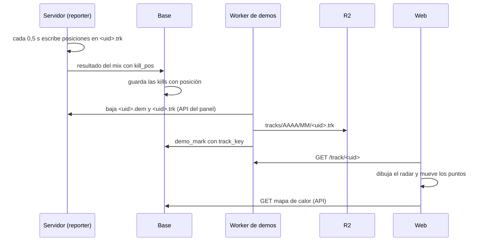

# Plan: repetición 2D ronda a ronda y mapa de calor

> Planeación original. Estado: **propuesta**, pendiente de aprobación de Kyan. Las ideas salen de [`docs/ideas/2026-11-03-ideas-matchmaking-para-daniel.md`](../../ideas/2026-11-03-ideas-matchmaking-para-daniel.md) ("Las que le gustaron a Kyan").

## Decisiones tomadas

| Tema | Decisión | Por qué |
|---|---|---|
| Qué se graba | Posición, mirada, vida y equipo de cada jugador **2 veces por segundo** durante el vivo, más kills, bomba y fin de ronda | Con 2 por segundo y la web interpolando, el movimiento se ve fluido. El archivo de un mix ronda los 600 KB de texto |
| Cómo viaja | El plugin escribe `<uid>.trk` **al lado de la demo** (`/cstrike/csstv_demos`). El Worker de demos lo sube a R2 junto con la demo | El envío por partes del reporter (1400 caracteres por pedido) mandaría unos 450 pedidos por mix. El Worker ya baja archivos del servidor por la API del panel |
| Mapa de calor | Las posiciones de cada kill (del que mata y del que muere) van también en el resultado del mix, a una tabla nueva | Así se puede sumar por jugador y por mapa en la base, sin abrir cada `.trk` |
| Radar | Dibujo propio, sacado del `.nav` de cada mapa (las zonas caminables vistas desde arriba, con un gris según la altura), en SVG | Los radares de Valve no están en el servidor (solo los `.vmt`), no existen para mapas como `de_season` o `de_tuscan`, y son imágenes de Valve. El `.nav` está en todos los servidores y da el mismo sistema de coordenadas |
| Dónde se ve | Repetición 2D: pestaña nueva en la página de la partida (`/match/$id`). Mapa de calor: en la partida (esa partida) y en el perfil del jugador (por mapa, kills o muertes) | El perfil es de Esteban: se arma el componente y la demo; él decide dónde va en el perfil |
| Partidas viejas | Sin repetición ni mapa de calor | No tienen posiciones. La web muestra "Esta partida se jugó antes de la repetición 2D" |

## 1. El flujo completo

## 2. Plugin (`csstv_reporter` 2.10.0, `csstv/track.inc`)

- Solo en partidas en vivo y mientras se graba la demo. Un temporizador de 0,5 s escribe una línea por cuadro. ConVar `csstv_track "1"` para apagarlo.
- Formato de texto, una línea por registro:

| Línea | Qué es |
|---|---|
| `V 1 <mapa> <tickrate>` | Encabezado |
| `J <slot> <steamid> <equipo> <nick>` | Jugador (se repite si cambia de equipo o entra un reemplazo) |
| `R <n> <t>` | Empieza la ronda `n` (t en segundos desde el inicio de la grabación, como los ticks de los clips) |
| `F <t> <slot>,<x>,<y>,<yaw>,<hp>;…` | Cuadro: los vivos, con coordenadas enteras |
| `K <t> <mata> <muere> <arma> <hs> <x> <y> <vx> <vy>` | Kill |
| `B <t> <plant\|defuse\|explode> <x> <y>` | Bomba |
| `E <t> <ganador> <motivo>` | Fin de ronda |

- El resultado del mix suma `kill_pos`: `[ronda, tick, steam_mata, steam_muere, arma, hs, x, y, vx, vy]` por kill.
- Si la partida se cancela, el `.trk` se borra igual que la demo.

## 3. Base (replanteo `92_repeticion_2d.sql`)

- `match_kills`: `match_id`, `round`, `t`, `killer_player_id`, `victim_player_id`, `weapon`, `headshot`, `kx`, `ky`, `vx`, `vy`, `map`. Índices por `(killer_player_id, map)` y `(victim_player_id, map)`.
- `matches.track_key` (texto, nulo).
- La ingesta del resultado llena `match_kills` desde `kill_pos`. `demo_mark` recibe `p_track_key`. `demo_pending` devuelve si se espera `.trk`.
- Inversa y pruebas en `docs/bitacora/2026-10-14-replanteo-modelo-datos/{reversas,pruebas}/92_repeticion_2d.sql`.

## 4. Worker de demos

- Al subir una demo, si existe `<uid>.trk` en la carpeta, lo sube a `tracks/AAAA/MM/<uid>.trk` y lo borra del servidor con la demo (`DELETE_AFTER_UPLOAD`).
- Ruta nueva `GET /track/<uid>`, con CORS para la web y caché larga. Vence con la demo.
- El camino de SFTP del VPS (servidores sin key) hace lo mismo.

## 5. Radar (`server/radar/nav_a_svg.py`)

- Lee el `.nav` (versión 9, la de v34) de cada mapa del pool y genera `web/frontend/public/radar/<mapa>.svg` y `<mapa>.json` (límites x/y para pasar coordenadas del juego al dibujo).
- Las zonas se pintan por altura (más claro = más alto), así se distinguen pisos y túneles.
- Se corre a mano con los `.nav` del #1 cuando entra un mapa nuevo al pool.

## 6. API (`web/backend`)

- `GET /api/v1/matches/:id/kills`: las kills con posición de la partida (para el mapa de calor de la partida y las marcas de la repetición).
- `GET /api/v1/players/:id/heatmap?map=&kind=kills|deaths&limit=`: puntos de las últimas partidas de ese jugador en ese mapa.
- `track_url` en el detalle de la partida cuando hay `.trk`.

## 7. Web (`web/frontend`)

- `features/replay/`: `RadarCanvas` (SVG del radar + canvas para los puntos), `RoundReplay` (selector de ronda, play/pausa, velocidad 1×/2×/4×, línea de tiempo con las kills, nicks al pasar el mouse, la bomba), `Heatmap` (densidad con un degradé, filtro kills/muertes).
- Pestaña **Repetición 2D** en `/match/$id` y **Mapa de calor** al lado.
- Demo `/demo/repeticion` con un `.trk` grabado con bots, para ver todo sin servidor.

## 8. Requisitos antes de empezar

- Servidor local `C:\Users\Agus\Downloads\cssds` con los mapas del pool y sus `.nav`.
- Base local con el replanteo hasta la `91`.
- Para producción: Daniel aplica la `92` en el VPS y despliega el Worker y la API; el plugin va a #1, #2 y #3 en la misma tanda.

## 9. Orden de implementación

1. Plugin: `track.inc`, `kill_pos`, prueba con bots en local (un mix entero, tamaño del `.trk`).
2. Radar: `nav_a_svg.py` y los SVG del pool.
3. Web: repetición y mapa de calor con el `.trk` de la prueba, en `/demo/repeticion`.
4. Base: `92` con inversa y pruebas, en local.
5. API y Worker, probados en local (`wrangler dev`).
6. Página de la partida con datos reales locales.
7. Documentación, manual (`jugador/ver-partida` o la que corresponda), términos y privacidad (se guardan posiciones de juego), changelog.
8. Despliegue: lo coordina Daniel (base, API, Worker) y el plugin a #1, #2 y #3 en la misma tanda, sin mixes en curso.
