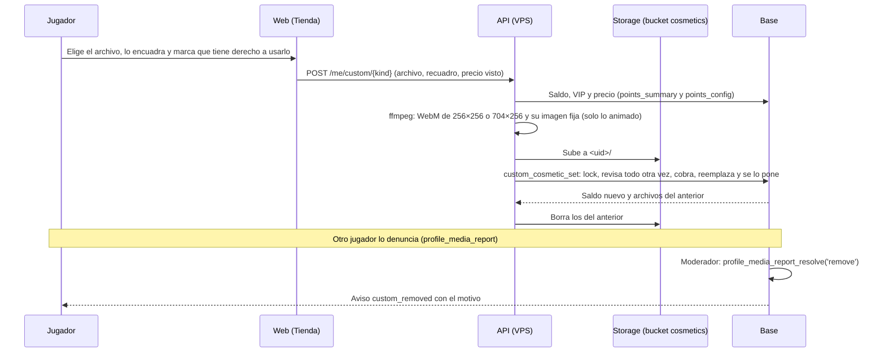

# Avatar animado y fondo de miniperfil propios: documentación

## Qué hace

Cada jugador sube su propia imagen en la Tienda y paga cada vez que sube una:

| Qué | Quién | Moneda | Precio inicial |
|---|---|---|---|
| Fondo fijo (la tarjeta del lobby de Jugar) | Todos | Puntos | 500 (sale con 300: Daniel, 2026-11-14) |
| Fondo animado | Solo VIP | Monedas VIP | 650 |
| Avatar animado (reemplaza la foto) | Solo VIP | Monedas VIP | 550 |

Se ve al instante (revisión «opción A»). Si alguien lo denuncia, un moderador o un admin lo revisa y, si no respeta los derechos de otro o las reglas, lo saca: se borra el archivo, el dueño recibe un aviso con el motivo y no se devuelve lo pagado. También se pueden denunciar las portadas.

**Ninguno de los 16 vuelve (Daniel, 2026-11-14):** primero eligió dejar seis (Nieve, Cadenas, Gato DJ, Oscuridad, Lata caminante y Mono con estilo) y después se arrepintió: siguen afuera, con los demás.

Reemplaza a los 16 avatares animados que iban a venderse en la tienda ([`2026-11-12-avatares-animados`](../2026-11-12-avatares-animados/)), que eran arte de terceros sin permiso. CMLeague pasa a alojar lo que sube cada uno, como Discord o Steam con las fotos de perfil, y quien sube declara que tiene derecho a usar la imagen (el porqué está en el [PLAN](PLAN.md)). En el mismo requerimiento entraron los 24 avatares y 12 fondos originales de Kyan, los precios nuevos de todo el catálogo, la vista previa en ventana, la edición de los artículos desde el panel y las armas redibujadas de los marcos y stickers (ver la documentación de la [tienda](../2026-11-11-tienda-de-puntos/DOCUMENTACION.md)).

## Reglas

- **Se paga cada vez que se sube uno**, también al reemplazar el anterior (que se borra). Ponérselo, sacárselo o borrarlo no cuesta ni devuelve nada.
- **Lo animado es solo VIP** y se paga con monedas VIP. Si el VIP vence, el avatar y el fondo animados quedan guardados pero no se muestran, y vuelven al renovar. El fondo fijo sigue.
- **El precio que vio el jugador** viaja con la subida: si cambió, no se cobra (`El precio cambió: ahora cuesta X`).
- **Antes de convertir** (lo caro), la API revisa ficha, VIP, precio y saldo; la base lo vuelve a revisar al cobrar, con el lock por cuenta de la tienda.
- **Sin ffmpeg en el servidor**, lo animado responde `NOT_AVAILABLE` (501) sin cobrar; el fondo fijo funciona igual.
- **Formatos:**
  - fijo: JPEG, PNG o WebP sin animación, hasta 2 MB, proporción 11:4 (la de la tarjeta del lobby), entre 550×200 y 1760×640. La web lo recorta a 880×320.
  - animado: GIF, PNG o WebP animados, o MP4 o WebM, hasta 8 MB. Se recorta en el servidor con el recuadro que eligió el jugador (cuadrado para el avatar, 11:4 para el fondo), se escala a 256×256 o 704×256, se corta a 10 segundos, sin audio, WebM VP9 de hasta 3 MB, y la imagen fija en WebP.
- **Denuncias:** de la imagen que se ve hoy (avatar o fondo propios, o la portada), una vez por cuenta e imagen, hasta 20 por día. Motivos: derechos de autor, sexual o explícito, ofensivo u otro. Si el dueño la cambia, la denuncia queda sobre la vieja («ya no la tiene puesta»). Sacarla cierra todas las denuncias abiertas de esa imagen.

## Base de datos (dentro de la `113`)

| Objeto | Qué es |
|---|---|
| `points_config.custom_avatar_price`, `custom_bg_animated_price`, `custom_bg_static_price` | Los tres precios (550, 650 y 500). Los cambia el admin con `set_points_config` |
| `custom_cosmetics` | Una fila por subida: tipo, si es animado, `url`, `poster_url`, moneda, precio y fecha. La vigente de cada tipo es la que no tiene `cleared_at`; `cleared_reason`: `replaced`, `deleted` o `removed`. La lee el dueño o un admin |
| `user_cosmetics.avatar_custom`, `background_custom` | Tiene puesto lo propio (en vez de un artículo de la tienda) |
| `profile_media_reports` | Denuncias: de quién es la imagen (`target`), tipo (`avatar`, `background`, `cover`), la `url` denunciada, quién, motivo, nota y estado (`open`, `dismissed`, `removed`). Sin acceso directo: solo por las funciones |
| Bucket `cosmetics` | Público para leer. Cada cuenta escribe y borra en su carpeta `<uid>/`; lo que saca un moderador lo borra la API con la clave de servicio. Hasta 3 MB; JPEG, PNG, WebP y WebM |

| Función | Quién | Qué hace |
|---|---|---|
| `custom_cosmetic_set(kind, animated, url, poster, price)` | El dueño | Cobra, reemplaza el anterior, se lo pone y devuelve el saldo y los archivos viejos |
| `custom_cosmetic_delete(kind)` | El dueño | Lo borra sin devolver; devuelve los archivos |
| `custom_cosmetic_json(user, kind)` | Interna | Lo propio vigente como cosmético (`id: custom`, `url`, `poster_url`); null si es animado y no es VIP |
| `set_my_cosmetics` | El dueño | Acepta `"custom"` en `avatar` y `background` |
| `player_cosmetics_public` | Público | Muestra lo propio puesto |
| `points_totals`, `points_history` | — | Lo pagado cuenta como gastado; el historial lo muestra como `custom` («Avatar propio», «Fondo propio», «Fondo animado propio») |
| `profile_media_report(player, kind, reason, note)` | Con sesión | Denuncia la imagen que se ve hoy |
| `profile_media_reports_admin(...)` | Moderador y admin | Lista paginada, filtrada y ordenada, con `current` (si sigue puesta) |
| `profile_media_report_resolve(report, action)` | Moderador y admin | `dismiss` o `remove` (saca, avisa y devuelve los archivos) |
| `admin_custom_clear(user, kind, reason)` | Admin | Saca lo propio desde Gestionar, con motivo y aviso |

Aviso nuevo: `custom_removed` (categoría `account`), con el tipo y el motivo.

## API

| Ruta | Qué hace |
|---|---|
| `GET /api/v1/me/custom` | Lo propio vigente, los precios y si se pueden subir animaciones (`animated_available`) |
| `POST /api/v1/me/custom/{avatar\|background}` | `multipart/form-data`: `file`, `price`, `rights=true`, `animated` (fondo) y el recorte `crop_x`, `crop_y`, `crop_w`, `crop_h` |
| `DELETE /api/v1/me/custom/{kind}` | Borrarlo |
| `POST /api/v1/players/{id}/media-reports` | Denunciar |
| `GET /api/v1/admin/profile-media-reports` | Moderadores y admins |
| `POST /api/v1/admin/profile-media-reports/{id}/resolve` | Moderadores y admins |
| `GET /api/v1/admin/users/{id}/custom` y `POST .../custom/{kind}/clear` | Admin, desde Gestionar |

La conversión está en `lib/media.ts` (tipos, recorte y filtros) y `lib/media-node.ts` (ffmpeg, una conversión a la vez con 2 hilos, 90 s como mucho: corre dentro del `MemoryMax` de 768 MB de `cmleague-api.service`). Solo existe en Node (`node.ts`, opción `media` de `createApp`); `FFMPEG_PATH` si ffmpeg no está en el PATH.

## Web

- **Tienda:** en **Avatares** y en **Fondos**, arriba del catálogo, el recuadro **Tu avatar animado** o **Tu fondo**: lo que tiene, ponérselo, sacárselo, borrarlo y subir uno nuevo (encuadre con `react-easy-crop`, también para GIF y videos, y la confirmación con el precio y la casilla «Tengo derecho a usar esta imagen»). Sin VIP, el botón de lo animado abre «Cómo ser VIP».
- **Dibujar lo propio:** el cosmético trae `url` y `poster_url` en vez de `file`; `fileUrl` y `posterUrl` los usan. El fondo animado es un `<video>` en la tarjeta del lobby (`CardBackground`).
- **Perfil:** **Denunciar imagen**, si tiene avatar o fondo propios o portada.
- **Administración › Baneos › Imágenes:** las denuncias, con la imagen, para descartar o sacar.
- **Administración › Tienda:** los tres precios en la configuración y, en Gestionar, **Lo que subió** con **Sacar**.

## Qué cambia para cada rol

| Rol | Qué cambia | Página del manual |
|---|---|---|
| Jugador | Sube su fondo fijo (puntos) y, siendo VIP, su avatar y su fondo animados (monedas VIP); denuncia imágenes de otros perfiles | [`jugador/tienda-y-cosmeticos.md`](../../manual/jugador/tienda-y-cosmeticos.md) |
| Moderador | Revisa las imágenes denunciadas y las saca | [`moderador/revisar-imagenes.md`](../../manual/moderador/revisar-imagenes.md) |
| Admin | Lo del moderador, los tres precios y sacar lo propio desde Gestionar | [`admin/tienda-y-puntos.md`](../../manual/admin/tienda-y-puntos.md) |
| Capitán, organizador, streamer y dueño de un servidor externo | Nada distinto de lo del jugador | — |

## Términos y privacidad

- **Términos (sección 13, «Puntos, tienda y misiones»):** se puede subir el fondo propio (puntos) y, siendo VIP, el avatar y el fondo animados (monedas VIP), pagando cada vez; quien sube declara que tiene derecho a usar la imagen y responde si no; cualquiera denuncia el avatar, el fondo o la portada, y un moderador o un admin la saca sin devolver lo pagado. Salió la frase de que la imagen animada solo se conseguía como avatar de la tienda.
- **Privacidad (VIP, puntos y tienda):** el avatar y los fondos subidos (archivo, fecha y pago), que se ven en público mientras están puestos; las denuncias, que ven solo moderadores y admins, sin decirle al denunciado quién fue.
- Fecha: 14 de noviembre de 2026, en la web (`LEGAL_UPDATED`) y en `terms/`.

## Dónde está cada cosa

| Qué | Archivo / ubicación |
|---|---|
| Base | `supabase/replanteo/113_tienda.sql` (secciones 1, 2, 3, 5, 6, 7 y 8) y su inversa `docs/bitacora/2026-10-14-replanteo-modelo-datos/reversas/113_tienda.sql` |
| Prueba de la base | `docs/bitacora/2026-11-11-tienda-de-puntos/pruebas/probar_113.sql` (bloque 13) |
| API | `web/backend/src/routes/custom.ts`, `lib/media.ts`, `lib/media-node.ts`, `schemas/shop.ts`, `routes/shop.ts` (precios y equipado) |
| Pruebas de la API | `web/backend/test/integration/custom.test.ts`, `test/unit/media.test.ts` |
| Web | `features/shop/CustomPanel.tsx`, `features/shop/api.ts`, `features/shop/types.ts`, `features/shop/cosmetics.tsx`, `features/player/components/MediaReportDialog.tsx`, `features/admin/bans/components/MediaReportsPanel.tsx`, `features/shop/AdminShopPage.tsx`, `features/shell/notifications/lib/model.ts` |
| Pruebas de la web | `features/shop/CustomPanel.test.tsx` |
| Los 16 avatares de terceros y su script | Fuera del repo, en `~/.v34frag/avatares-retirados/` de la PC de Daniel (los GIF originales siguen en `~/.v34frag/avatares-originales/`) |
