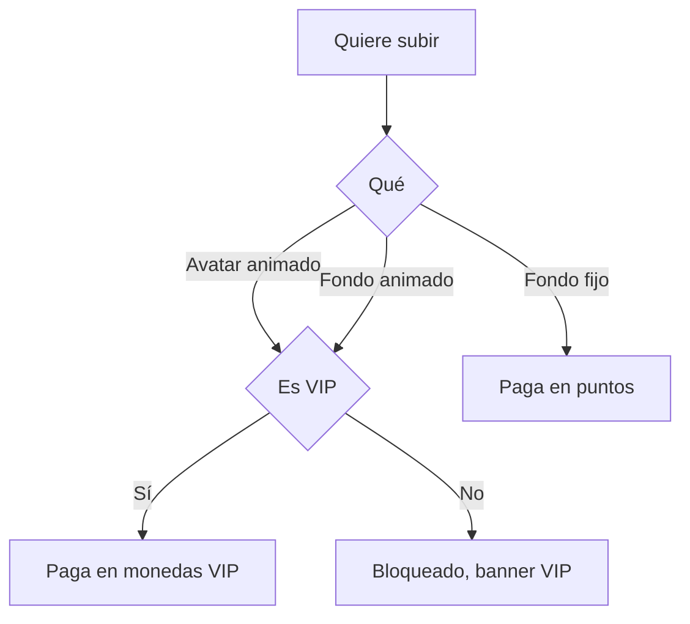

# Plan: avatar animado y fondos de miniperfil propios

> Planeación original. Estado: **aprobado** por Daniel el 2026-11-14. Ya hecho en local: los artículos de Kyan, la vista previa en ventana y los precios nuevos del catálogo. Falta lo de subir lo propio.

## Por qué

Los 16 avatares animados que iban a venderse en la tienda ([`2026-11-12-avatares-animados`](../2026-11-12-avatares-animados/)) son arte de terceros y no hay permiso para publicarlos, y menos para venderlos.

**Qué se buscó (2026-11-12):** ninguna imagen trae autor, licencia ni la página de donde salió.
- **Datos internos de cada GIF:** 12 no tienen nada. Los otros 4 solo nombran el programa con que se editaron: Photoshop CC 2018, ezgif.com, Honeycam 3.36 y un comentario «G44».
- **Marca de descarga de Windows (`Zone.Identifier`):** ninguno la tiene. Puede haberse perdido al moverlos del disco E: al C: durante la conversión.
- **Copias en Descargas, Escritorio e Imágenes:** no queda ninguna.

**De dónde salieron, según Daniel (2026-11-13):**
- **«Nieve»:** una ilustración de Pinterest que Daniel animó. La ilustración sigue siendo de su autor, que no se conoce, y la animación es una obra derivada.
- **Casi todos los demás:** fondos de Wallpaper Engine (Workshop de Steam). Son para usarlos dentro del programa; publicarlos en otro lado pide el permiso de quien lo subió, y muchos ya usan arte ajeno.
- **Agrava el riesgo** que los avatares se vendían con monedas VIP, y el VIP se paga.

**El cambio de enfoque (Daniel, 2026-11-13):** en vez de venderle arte ajeno, cada jugador **sube el suyo** y paga por subirlo. CMLeague pasa a alojar lo que sube cada uno, como Discord o Steam con las fotos de perfil, y quien sube responde por los derechos. En Argentina, quien aloja contenido de otros responde recién cuando le avisan de algo claramente ilícito y no lo saca (Corte Suprema, "Rodríguez, María Belén c/ Google", 2014). No es asesoría legal: es el criterio con el que se diseñó.

## Decisiones tomadas

| Tema | Decisión | Quién y cuándo |
|---|---|---|
| Los 16 avatares de la tienda | Salen de la tienda y del repo. El tipo `avatar` queda para el propio | Consecuencia del cambio de enfoque, 2026-11-13 |
| Avatar animado propio | Solo VIP, con monedas VIP | Daniel, 2026-11-13 |
| Fondo animado propio | Solo VIP, con monedas VIP | Daniel, 2026-11-13 |
| Fondo fijo propio | Cualquiera, con puntos | Daniel, 2026-11-13 |
| Fondo propio: más caro que la tienda | Sí, más caro que comprar uno de la tienda | Daniel, 2026-11-13 |
| Fondos de la tienda | Los animados de la tienda son para todos | Daniel, 2026-11-13 |
| Catálogo de la tienda | **Como lo planteó Kyan:** dos catálogos separados, uno para todos (puntos) y uno VIP (monedas VIP). Los 12 fondos VIP siguen siendo solo VIP. Reemplaza lo que había decidido antes ese día (que también se compraran con puntos, más caros) | Daniel, 2026-11-14 |
| Avatares y fondos de Kyan | Se suman a la tienda los 24 avatares y los 12 fondos originales de Kyan (`kyan/pruebas`, 2026-11-01). Daniel elige en su local cuáles quedan activos para salir a producción | Daniel, 2026-11-14 |
| Precios | **Aprobados:** los de la segunda propuesta (todo dividido por 2,5, redondeado a 50) **y 50 más**, en puntos y en monedas VIP. Lo propio: fondo fijo 500 puntos, avatar animado 550 y fondo animado 650 monedas VIP | Daniel, 2026-11-14 |
| Vista previa en ventana | Una ventana con la vista previa del artículo, en la Tienda y en Administración › Tienda | Daniel, 2026-11-14 |
| Lo propio animado | El avatar y el fondo animados que sube el jugador son exclusivos de los VIP, con monedas VIP. El fondo fijo propio sigue siendo para cualquiera, con puntos | Daniel, 2026-11-14 (confirma lo del 2026-11-13) |
| Cuándo se paga | Cada vez que se sube uno nuevo. Cambiarlo por otro ya cuesta. Volver a ponerse el que ya se subió, o sacárselo, no cuesta | Daniel, 2026-11-13 |
| Precios | Los propone Claude con datos de cuánto se gana; editables por el admin | Daniel, 2026-11-13 |
| Revisión | **Opción A:** se ve apenas se sube; si alguien lo denuncia, un moderador o un admin lo saca | Daniel, 2026-11-13 |
| Si se saca | No se devuelve lo pagado | Propuesto, 2026-11-13 |
| Aviso de derechos | Antes de pagar, la casilla «Tengo derecho a usar esta imagen» | Propuesto, 2026-11-13 |
| Portada | Gratis para todos, como ya está; entra en las denuncias | Propuesto, 2026-11-13 |
| VIP vencido | El avatar y el fondo animado propios quedan guardados pero no se muestran, y vuelven al renovar. El fondo fijo propio sigue | Propuesto, 2026-11-13 |
| Dónde | Dentro de la `113`, que todavía no salió, en `feat/tienda-de-puntos` | Propuesto, 2026-11-13 |

## Pendiente de decidir

Nada. Los precios se aprobaron el 2026-11-14 (ver "Decisiones tomadas").

## Cómo lo había planteado Kyan (revisado el 2026-11-14)

En `kyan/pruebas` (`2026-10-29-tienda-puntos-backend`, `2026-10-29-vip-progresion`, `2026-10-29-cosmeticos-colecciones` y `2026-11-01-avatares-tienda`):

- **Dos catálogos separados, mitad y mitad en cada tipo:** artículos para todos, con puntos, y artículos VIP, con monedas VIP. No es el mismo artículo con dos precios: un artículo VIP no tiene precio en puntos y quien no es VIP no lo puede comprar. El VIP compra de los dos, porque también gana puntos.
- **Primera versión (2026-10-29):** lo VIP no se compraba, se usaba gratis mientras durara el VIP, y el VIP ganaba los puntos ×1,5. El mismo día lo cambió a las monedas VIP: lo VIP se compra con monedas, el multiplicador queda en 1 y solo el Marco Oro VIP viene gratis.
- **Precios VIP de Kyan:** stickers 200, nombres 500, temas 600, marcos y fondos 1000 monedas VIP.
- **Avatares originales de Kyan (2026-11-01):** 24 avatares en SVG dibujados por código, "ningún personaje, logo o símbolo ajeno": 12 fijos para todos (1000 puntos) y 12 animados VIP (1000 monedas VIP), más 12 fondos nuevos (6 y 6). Están en `kyan/pruebas`, `assets/perfil/avatares/` y `catalogo.json` versión 9 (369 artículos). La tienda de la `113` se armó con una versión anterior del catálogo (333) y no los trae.
- **Daniel, 2026-11-14:** primero decidió que los 12 fondos VIP también se compraran con puntos, más caros; al ver este modelo, volvió a los dos catálogos separados de Kyan.

## Saldos al salir la tienda

Copia de producción, sin cuentas de prueba (84 cuentas con mixes). Todos los mixes que suman son del 2026-10-13 al 2026-11-12, así que **lo que tendría cada uno al salir la tienda es lo mismo que gana en un mes**.

| Quiénes | Cuentas | Promedio | La mitad tiene hasta | 3 de cada 4, hasta | 9 de cada 10, hasta | El que más |
|---|---|---|---|---|---|---|
| Puntos, sin VIP | 74 | 200 | 150 | 285 | 520 | 935 |
| Puntos, VIP de hoy | 10 | 458 | 425 | 610 | 635 | 975 |
| Monedas VIP, VIP de hoy | 10 | 291 | 185 | 600 | 610 | 800 |

Los VIP juegan más que el resto. Las monedas VIP son menos que sus puntos porque solo cuentan los mixes jugados siendo VIP: dos de los 10 VIP de hoy todavía no tienen ninguna.

## Precios

**Aprobados (Daniel, 2026-11-14): la segunda propuesta más 50 en cada precio.**

| Tipo | Puntos | Monedas VIP |
|---|---|---|
| Stickers | 100–150 | 150 |
| Efectos de nombre | 200–300 | 250 |
| Temas | 300–350 | 300 |
| Marcos | 400–550 | 450 |
| Fondos | 350–450 | 450 |
| Avatares de Kyan | 450 | 450 |
| Fondo fijo propio | 500 | — |
| Avatar animado propio | — | 550 |
| Fondo animado propio | — | 650 |

Las propuestas de antes, como historia:


**Primera propuesta (2026-11-13, solo lo propio):** avatar animado 600 y fondo animado 1500 (después 1200) monedas VIP, fondo fijo 1200 puntos. Quedó caro: con los precios de Kyan, al salir la tienda casi nadie podía comprar un marco o un fondo (ver la tabla de abajo).

**Segunda propuesta (2026-11-14): todo el catálogo dividido por 2,5**, redondeado a 50, y lo propio más caro que lo de la tienda de su tipo. Puntos y monedas VIP siguen ganándose igual (10 por mix y 5 más si gana).

| Tipo | Puntos hoy → propuesto | Monedas VIP hoy → propuesto |
|---|---|---|
| Stickers | 150–200 → **50–100** | 200 → **100** |
| Efectos de nombre | 400–600 → **150–250** | 500 → **200** |
| Temas | 600–700 → **250–300** | 600 → **250** |
| Marcos | 900–1200 → **350–500** | 1000 → **400** |
| Fondos | 800–1000 → **300–400** | 1000 → **400** |
| Avatares de Kyan | 1000 → **400** | 1000 → **400** |
| Fondo fijo propio | **450** | — |
| Avatar animado propio | — | **500** |
| Fondo animado propio | — | **600** |

**Cuántos podrían comprar al menos uno al salir la tienda** (copia de producción sin cuentas de prueba: 84 con mixes, 10 VIP):

| Tipo | Con puntos, precios de hoy | Con puntos, propuestos | Con monedas VIP, hoy | Con monedas VIP, propuestos |
|---|---|---|---|---|
| Stickers | 46 | 61 | 5 | 7 |
| Efectos de nombre | 18 | 46 | 3 | 5 |
| Temas | 8 | 31 | 3 | 4 |
| Marcos | 2 | 20 | 0 | 3 |
| Fondos | 3 | 26 | 0 | 3 |
| Avatares de Kyan | 0 | 18 | 0 | 3 |
| Lo propio | — | Fondo fijo: 13 | — | Avatar: 3; fondo animado: 3 |

**Cuánto tarda cada uno con los propuestos:** quien juega un mix por día (unos 375 al mes) se compra un sticker por semana, un efecto de nombre o un tema cada 2 o 3 semanas y un marco o un fondo por mes. Quien juega como la mitad de los jugadores (13 mixes al mes, unos 160) tarda el doble o un poco más.

Todo se guarda en la base (`shop_items` y `points_config`) y el admin lo cambia desde Administración › Tienda.

## 1. El flujo completo

```mermaid
sequenceDiagram
  participant J as Jugador
  participant W as Web (Tienda)
  participant A as API
  participant B as Base
  J->>W: Elige la imagen, la recorta y marca que tiene derecho a usarla
  W->>A: POST /me/custom/{tipo} (con el precio que vio)
  A->>A: Revisa tipo, tamaño y duración; ffmpeg si es animada
  A->>B: custom_cosmetic_set (revisa VIP si hace falta, cobra, guarda, equipa)
  B-->>A: Saldo nuevo
  A-->>W: Listo, ya se ve
  Note over J,B: Otro jugador lo denuncia
  B->>B: Un moderador o admin lo saca, sin devolver
  B-->>J: Aviso con el motivo
```



## 2. Base de datos (dentro de la `113`)

- **Sacar** los 16 artículos `avatar-*` de la carga del catálogo.
- **Fondos VIP de la tienda:** sin cambios, siguen solo VIP.
- `points_config`: `custom_avatar_price`, `custom_bg_animated_price` (monedas VIP) y `custom_bg_static_price` (puntos): 550, 650 y 500.
- **`custom_cosmetics`:** uno por cuenta y por tipo (`avatar`, `background`): URL, URL de la imagen fija, si es animado, cuándo se subió, lo que pagó y en qué moneda.
- **Lo que se paga** es un gasto: entra en el saldo de su moneda (`points_totals`) y en el historial ("Avatar propio subido", "Fondo propio subido").
- **`custom_cosmetic_set(kind, animated, url, poster, precio_visto)`:** solo el dueño; VIP si es animado; lock por cuenta; revisa el saldo y que el precio no haya cambiado; cobra, reemplaza el anterior y lo equipa. Devuelve la URL vieja para que la API borre el archivo.
- **Equipar:** `set_my_cosmetics` acepta `custom` en `avatar` y en `background`. `player_cosmetics_public` y `cosmetic_json` lo resuelven a la URL, y ocultan lo animado si el VIP venció.
- **Denuncias:** `profile_media_reports`, como las de comentarios (replanteo `94`):
  - qué se denuncia: `avatar`, `background` o `cover`;
  - motivo: `copyright`, `nsfw`, `offensive` u `other`;
  - nota y estado;
  - funciones para denunciar, listar (paginada, filtrada y ordenada, para moderadores y admins) y resolver (descartar o sacar).
- **Sacar** borra la URL, avisa al dueño con el motivo (`custom_removed`, categoría `account`) y no devuelve nada. Se suma `admin_custom_clear` para sacarlo directo desde Gestionar. `admin_cover_clear` sigue para la portada.

## 3. API

- `POST /api/v1/me/custom/avatar`: GIF, WebP o PNG, hasta 8 MB. Se pasa a WebM VP9 de hasta 256 px y 10 s, con la imagen fija en WebP. Bucket `avatars`, `<uid>/custom-avatar-*`.
- `POST /api/v1/me/custom/background`:
  - **fijo:** JPG, PNG o WebP sin animación, hasta 2 MB;
  - **animado:** GIF, WebP o PNG animado, hasta 8 MB, pasado a WebM con su imagen fija;
  - los dos con la forma de los fondos de la tienda.
- `DELETE /api/v1/me/custom/{kind}`: borrarlo (no devuelve).
- `PUT /me/cosmetics` acepta `custom`.
- **Denuncias:**
  - `POST /api/v1/players/{id}/media-reports`;
  - para moderadores y admins, el listado y resolver.
- `GET /shop/config` trae los tres precios.
- **ffmpeg en el VPS:** la API corre ahí con Node (`cmleague-api.service`). Hay que instalar `ffmpeg` (`sudo apt install ffmpeg`): lo instala Daniel. Si falta, la API responde que la subida animada no está disponible y no cobra nada. En la PC ya está.

## 4. Web

- **Tienda:**
  - la pestaña **Avatares** pasa a ser "Tu avatar animado": subir con recorte cuadrado y vista previa animada, precio, ponérselo y sacárselo;
  - en **Fondos**, arriba del catálogo, "Sube tu fondo": fijo para todos, animado para los VIP.
  - Los que no son VIP ven lo animado bloqueado, con el banner VIP.
- **Antes de pagar:** confirmación con el precio y la casilla «Tengo derecho a usar esta imagen».
- **Ficha del jugador:** "Denunciar imagen" en el menú (avatar, fondo o portada).
- **Moderación:** una pestaña "Imágenes" junto a las denuncias de comentarios.
- **Gestionar** (Administración › Tienda): sacar el avatar o el fondo propio, con motivo.
- Se borran:
  - los 16 `.webm` y `.webp` de `public/cosmetics/avatars/`;
  - sus entradas de `catalogo.json`;
  - el script de conversión.

## 5. Términos y privacidad

- **Términos (sección 13):**
  - se puede subir un fondo fijo propio (puntos) y, siendo VIP, un avatar y un fondo animados (monedas VIP), pagando cada vez;
  - quien sube declara que tiene derecho a usar la imagen, nos permite mostrarla en la web y responde si no era así;
  - cualquiera puede denunciarla; un moderador o admin la saca, sin devolver lo pagado;
  - sale la referencia a los avatares de la tienda.
- **Privacidad:**
  - el avatar y los fondos propios, entre lo que se guarda y se muestra en público;
  - las denuncias, entre lo que ven moderadores y admins.
- La página de la web y su `.html` de `terms/`.

## 6. Manual

- `jugador/tienda-y-cosmeticos.md`: subir el avatar y los fondos, precios, denunciar.
- La página de moderación de denuncias (moderador y admin): la pestaña Imágenes.
- `admin/tienda-y-puntos.md`: los tres precios y sacar desde Gestionar.

## 7. Requisitos antes de empezar

- Que Daniel decida lo de "Pendiente de decidir".
- `ffmpeg` en el VPS antes del despliegue.

## 8. Orden de implementación

1. Base: cambios en la `113` y bloques nuevos en `probar_113.sql`, probados sobre la copia local con `rollback`.
2. API: rutas, conversión con ffmpeg, pruebas unitarias e integración.
3. Web: Tienda, denuncias, moderación y Gestionar, con sus pruebas.
4. Sacar los 16 avatares.
5. Términos, privacidad, manual y changelog de la tienda.
6. Prueba en el navegador con `pruebavip` y con una cuenta sin VIP.
7. `DOCUMENTACION.md`, `GUIA_IMPLEMENTACION.md` y la fila del README como hecha.
