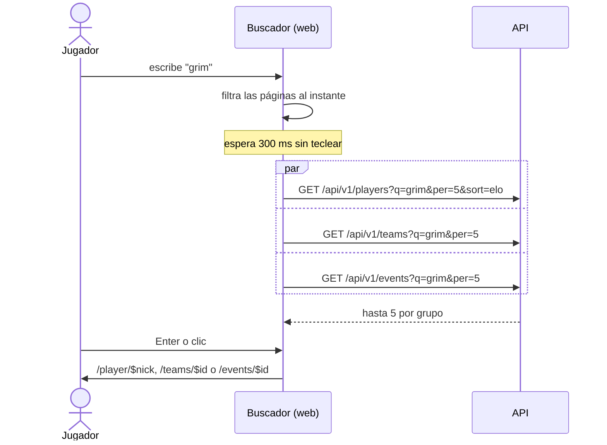

# Buscador con jugadores, equipos y torneos: documentación

## Qué hace

El buscador de arriba a la derecha (**Buscar…**, Ctrl+K) encuentra, además de las páginas de la web, jugadores, equipos y torneos. Antes el texto decía "Escribe un nick, equipo, torneo o página…" pero solo filtraba las páginas.

## Reglas

- **Desde 2 caracteres.** Con uno solo se filtran las páginas y no se pide nada a la API.
- **Cinco por grupo**, en el orden de cada listado: jugadores por ELO, equipos por nombre (solo oficiales) y torneos del que empieza más tarde al más temprano.
- **Lo que busca cada listado lo decide la API:** jugadores por alias y por sus equipos actuales, equipos por nombre y sigla, y torneos por nombre. Sin distinguir mayúsculas ni tildes. Un torneo en testing, pendiente o rechazado solo aparece para quien lo puede ver.
- **Mientras llega una búsqueda nueva** quedan los resultados de la anterior. Si todavía no hay nada que mostrar, sale "Buscando…", y "Sin resultados" solo cuando terminó.
- **Si un listado falla**, ese grupo no aparece y los demás sí.
- **Las páginas se filtran en el componente** con el mismo puntaje de antes (una palabra que empieza con lo escrito gana). cmdk no filtra (`shouldFilter={false}`), porque ocultaría resultados de la API que no contienen lo escrito tal cual (un alias con tildes o el equipo de un jugador).

## Qué cambia para cada rol

| Rol | Cambio |
|---|---|
| Jugador (todas las cuentas) | El buscador encuentra jugadores, equipos y torneos. Página nueva del manual: `jugador/buscador.md` |
| Capitán, organizador, moderador, admin, streamer y dueño de un servidor externo | Lo mismo que el jugador. Organizadores, moderadores y admins ven además los torneos que el listado ya les mostraba (testing, pendientes) |

## Términos y privacidad

Sin cambios: el buscador usa listados que ya eran públicos y no guarda lo que se busca.

## Dónde está cada cosa

| Qué | Dónde |
|---|---|
| Buscador | `web/frontend/src/features/shell/components/CommandMenu.tsx` |
| Consultas (`useGlobalSearch`, `SEARCH_PER`) | `web/frontend/src/features/shell/api/queries.ts` y `keys.ts` |
| Pruebas | `web/frontend/src/features/shell/components/CommandMenu.test.tsx` |
| Manual | `docs/manual/jugador/buscador.md` |
