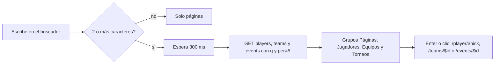

# Plan: buscador de arriba con jugadores, equipos y torneos

Pedido por Daniel el 2026-11-13. El buscador de arriba a la derecha (**Buscar…**, Ctrl+K) dice "Escribe un nick, equipo, torneo o página…", pero solo encuentra páginas de la web.

## Decisiones tomadas

- **Solo frontend.** La API ya busca en los tres listados con `q`: `GET /api/v1/players` (alias y equipos actuales), `GET /api/v1/teams` (nombre y sigla, solo oficiales por defecto) y `GET /api/v1/events` (nombre, y solo los torneos que quien consulta puede ver). No hace falta un `GET /search` nuevo.
- **Cinco resultados por grupo** (`per=5`), con el orden por defecto de cada listado, salvo jugadores, que se ordenan por ELO.
- **Desde 2 caracteres y con 300 ms de espera** (`useDebouncedValue`), para no pedir en cada tecla.
- **Las páginas se filtran en el componente** (`shouldFilter={false}` en cmdk). Si no, cmdk ocultaría los resultados de la API que no contienen lo escrito tal cual (por ejemplo, un alias con tildes).

## 1. El flujo completo

## 2. El componente

`web/frontend/src/features/shell/components/CommandMenu.tsx`:

- Las tres consultas con `useQuery` (con `placeholderData` de la anterior para que la lista no salte mientras llega la nueva).
- Grupos con avatar (`PlayerAvatar`), escudo (`TeamCrest`) y el estado del torneo (`STATUS_LABEL`).
- "Buscando…" mientras cargan y no hay nada que mostrar, y "Sin resultados" solo cuando terminaron.
- Si una de las tres falla, sus resultados no aparecen y las demás siguen.

## 3. Manual

Página nueva `docs/manual/jugador/buscador.md`: qué busca y cómo se abre.

## 4. Requisitos antes de empezar

Ninguno.

## 5. Orden de implementación

1. Componente y pruebas.
2. Manual.
3. Documentación, guía y fila del README.
4. Despliegue de la web (`deploy/vps/desplegar.sh web`) cuando Daniel lo pida.
