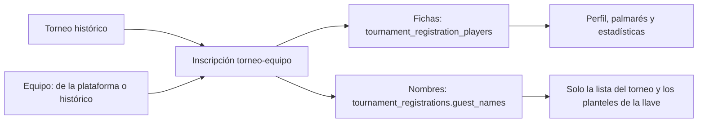

# Chat de la sala con textos largos y jugadores sin ficha en los torneos históricos: documentación

## Qué hace

1. **Chat de la sala:** un mensaje largo sin espacios corta la línea dentro del chat y la sala de la partida queda con su ancho. Vale para el chat de equipo y el general de la sala y para el chat del grupo.
2. **Torneos históricos:** quien gestiona un histórico puede cargar, además de fichas, jugadores que no están en la plataforma, solo con el nombre. El nombre queda en la inscripción torneo-equipo, sirve para equipos de la plataforma y para equipos históricos, y no aparece en el plantel ni en la página del equipo.

## El chat

`1fr` en una grilla es `minmax(auto, 1fr)`: la columna nunca se achica por debajo del ancho mínimo de su contenido. `break-words` (`overflow-wrap: break-word`) corta la palabra al dibujar, pero no baja ese ancho mínimo, así que `qasddddd…` ensanchaba la columna del chat y, con ella, toda la sala.

- `RoomOverview`: la grilla pasa a `minmax(0,1fr) minmax(320px,400px) minmax(0,1fr)` y la columna de cada equipo lleva `min-w-0`.
- `LobbyChat` y `ChatDock`: cada mensaje lleva `wrap-anywhere` (`overflow-wrap: anywhere`), que sí cuenta para el ancho mínimo.

## Jugadores sin ficha

- **Dónde se guarda:** `tournament_registrations.guest_names text[]` (replanteo `113`). Se borra con la inscripción.
- **Reglas** (`event_register_historic`): solo en un histórico y solo quien lo gestiona (`can_manage_event`: admin, moderador u organizador dueño). Cada nombre de 2 a 24 caracteres, con los espacios limpios; sin repetir, sin distinguir mayúsculas; fichas y nombres suman hasta 10. Guarda fichas y nombres en una sola transacción: si algo falla, no cambia nada.
- **API:** `PUT /api/v1/events/{id}/registrations/{teamId}` con `guests` usa la función nueva; sin `guests`, todo sigue como antes. `GET …/registrations` devuelve `guests` en cada inscripción (vacío en los torneos normales). El detalle de una serie de torneo (`GET /api/v1/matches/{id}`) suma los nombres a `roster1`/`roster2` como invitados (`guest: true`, sin `player_id`).
- **La web:** en **Jugadores**, si escribes un nombre aparece **Agregar «nombre» sin ficha** (también con Enter). En la lista va con "· sin ficha" y en la tabla de inscritos como "nombre (sin ficha)".
- **Lo que no tienen:** perfil, palmarés, estadísticas, ni lugar en el plantel del equipo.

## Qué cambia para cada rol

- **Jugador, capitán, streamer, dueño de un servidor externo:** el chat de la sala ya no se desarma con un mensaje largo. En la llave de un torneo histórico pueden ver nombres de jugadores sin ficha en los planteles.
- **Organizador:** en sus torneos históricos carga jugadores que no están en la plataforma solo con el nombre ([`organizador/subir-torneo-historico.md`](../../manual/organizador/subir-torneo-historico.md)).
- **Moderador y admin:** lo mismo, en cualquier histórico.

## Términos y privacidad

- **Privacidad:** se aclara que en un histórico, si el jugador no tiene perfil, se publica solo el nombre que se cargó, en ese torneo (`/privacidad` y `terms/privacidad.html`). Fecha de las dos páginas: 13 de noviembre de 2026.
- **Términos:** sin cambios en el texto (ya decían que se publican los jugadores, si se cargan, y que se puede pedir quitar el nombre); solo la fecha.

## Dónde está cada cosa

| Parte | Archivo |
|---|---|
| Base | `supabase/replanteo/113_historico_jugadores_sin_ficha.sql` (inversa en `docs/bitacora/2026-10-14-replanteo-modelo-datos/reversas/`) |
| API | `web/backend/src/routes/events.ts`, `routes/matches.ts`, `schemas/events.ts`, `schemas/matches.ts`, `db/types.ts` |
| Web | `features/admin/events/components/HistoricRegistrations.tsx`, `features/admin/events/api/queries.ts`; chat: `features/matchmaking/LobbyChat.tsx`, `ChatDock.tsx`, `room/RoomOverview.tsx` |
| Manual | `docs/manual/organizador/subir-torneo-historico.md` |
| Legales | `terms/privacidad.html`, `terms/terminos.html` (fecha), `web/frontend/src/features/legal/` |
