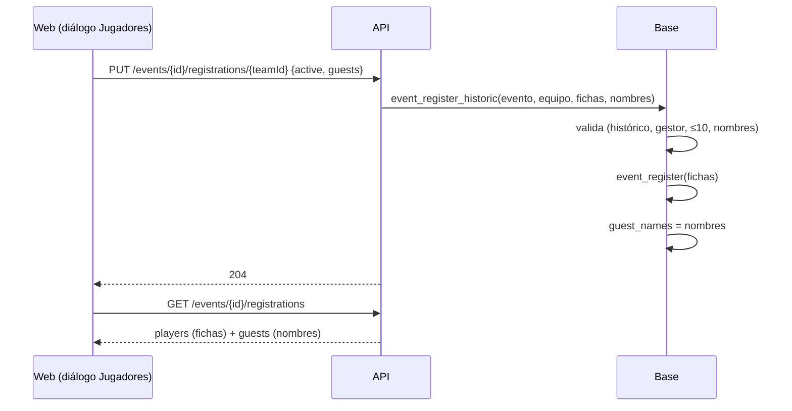

# Plan: chat de la sala con textos largos y jugadores sin ficha en los torneos históricos

> Planeación original. Estado: **aprobada** por Daniel el 2026-11-13 (los jugadores sin ficha van como nombre de texto).

Pedido por Daniel (2026-11-13), dos errores:

1. **Chat de la sala:** un mensaje largo sin espacios (`qasdddd…`) estira la columna del chat y desarma la sala de la partida (la grilla de tres columnas se sale de la pantalla).
2. **Torneos históricos:** el diálogo **Jugadores** de la inscripción solo busca fichas que ya existen, y la base (`event_register`) exige un `player_id`. Un jugador que no está en la plataforma no se puede cargar, ni en un equipo histórico ni en uno de la plataforma.

## Decisiones tomadas

| Tema | Decisión | Por qué |
|---|---|---|
| Chat | Las columnas de la grilla de la sala pasan a `minmax(0,1fr)`, la columna de cada equipo lleva `min-w-0` y cada mensaje corta en cualquier punto (`wrap-anywhere`). Lo mismo en el chat del grupo (`ChatDock`) | `1fr` respeta el ancho mínimo del contenido y `break-words` no lo achica: una palabra sin espacios ensanchaba la columna |
| Jugador sin ficha | **Solo un nombre de texto**, sin crear ficha | Lo carga también un organizador, que no crea fichas. Decidido por Daniel |
| Dónde vive | En la inscripción torneo-equipo: columna nueva `tournament_registrations.guest_names text[]` (replanteo `113`) | La relación es jugador → torneo-equipo. En un equipo de la plataforma no aparece en su plantel ni en su página, solo en los jugadores de ese torneo |
| Límite | Fichas + nombres, hasta 10 por equipo. Cada nombre de 2 a 24 caracteres, sin repetir (sin distinguir mayúsculas) | El mismo tope que ya tenía el histórico |
| Cómo se guarda | Función nueva `event_register_historic(p_event, p_team, p_players, p_names, p_start_stage)`, `security definer`: valida, llama a `event_register` y guarda los nombres, en una sola transacción | No se vuelve a parchear `event_register`, y fichas y nombres quedan juntos o no queda nada |
| Quién | Quien gestiona el torneo (`can_manage_event`), solo en un histórico | Lo mismo que ya pedía `event_register` en un histórico |
| API | `PUT /events/{id}/registrations/{teamId}` acepta `guests` (lista de nombres). Con `guests`, usa la función nueva. `GET …/registrations` devuelve `guests` en cada inscripción | Un solo endpoint, compatible con lo de antes |
| Planteles de la llave | `roster1`/`roster2` del detalle de la serie suman los nombres como invitados (`guest: true`, sin `player_id`) | `RosterPlayer` ya tiene ese caso (invitados de PCW) |
| La web | En el diálogo **Jugadores**: si el buscador no lo encuentra, botón **Agregar «X» sin ficha**. Los nombres se ven como chips con la marca "sin ficha" y también en la tabla de inscritos | |
| Perfil y palmarés | Los nombres no tienen perfil: no suman títulos ni estadísticas | Son solo texto |

## 1. El flujo

## 2. Lo que se toca

- `supabase/replanteo/113_historico_jugadores_sin_ficha.sql` y su inversa en `docs/bitacora/2026-10-14-replanteo-modelo-datos/reversas/`.
- `web/backend`: `schemas/events.ts`, `routes/events.ts`, `routes/matches.ts`, `db/types.ts` y sus pruebas.
- `web/frontend`: `HistoricRegistrations.tsx`, `api/queries.ts`, `schema.d.ts` regenerado, y el chat (`LobbyChat`, `ChatDock`, `RoomOverview`).
- Manual: la página de torneos históricos del organizador y del moderador.
- Términos y privacidad: se guarda un nombre de texto que puede ser de una persona sin cuenta. Se revisa si la política lo cubre.

## 3. Pruebas

- `pruebas/probar_113.sql`: contra la base local, dentro de una transacción que se deshace.
- Unitarias de la API y de la web; recorrido en el navegador con la base local.
