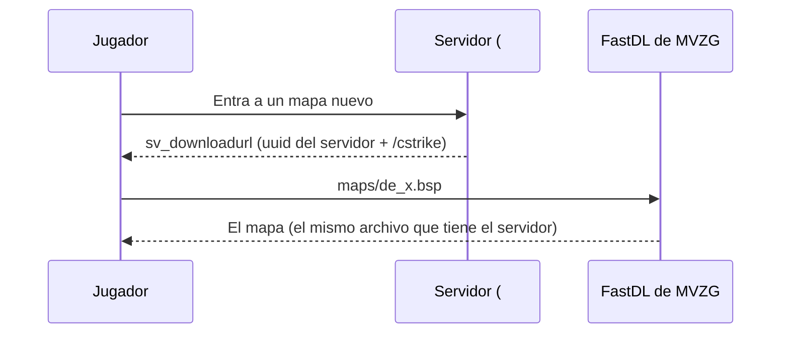

# Mapas nuevos y de_tuscan_ob: documentación

## Qué hace

Suma 9 mapas a los tres servidores (#1, #2 y #3) y a su `mapcycle.txt`: 8 ports de mapas de CS:GO/CS2 arreglados para que anden en v34, y `de_tuscan_ob`, una versión de tuscan sin techo para que las granadas pasen por arriba de todo, como `de_dust2_ob`.

Los ports tiraban abajo el servidor al cargarlos. No dejaban error en SourceMod: el servidor arrancaba de nuevo con el mapa por defecto. La causa es el formato de los props estáticos.

También arregla el FastDL de los tres servidores, que daba 404 para todos los mapas.

## Por qué se caían

| Problema | Mapas | Arreglo |
|---|---|---|
| Props estáticos en la versión 10 (Source 2013/TF2). v34 lee hasta la 5/6 | `de_ancient_css`, `de_anubis_css`, `de_anubis_t5`, `de_cbble_go_t1`, `de_inferno_plus`, `de_nuke_cs2`, `de_train_t5` | Cada prop se recorta a sus primeros 60 bytes, que son exactamente el formato v5 (`server/mapas/sprp_v5.py`) |
| Lo anterior más todo el `.bsp` comprimido con LZMA | `de_strike_mirage` | Se descomprime (lumps, game lumps y pak) y se pasa a v5 (`server/mapas/bsp_unlzma.py`). Pasa de 8 a 23 MB |

El resto del archivo no cambia. Como cambia el archivo, el juego del jugador que tenga la versión vieja le dice "differs from the server's": tiene que reemplazarla por la del servidor.

`de_inferno_csgo` (props v6) quedó afuera por el peso (93 MB).

## de_tuscan_ob

Las granadas chocan con el cielo (`toolsskybox`). En tuscan el cielo está bajo (z 640) y hay bloques de cielo encima de las calles (z 264 a 384).

Sacarle lo sólido al cielo en el `.bsp` no alcanza: la granada sale, pero arriba está el vacío de afuera del mapa, y el juego no manda ni dibuja lo que está ahí. Por eso se recompiló:

1. BSPSource descompila `de_tuscan.bsp` a `.vmf`.
2. `sin_techo_vmf.py` borra los 127 bloques de cielo de la zona de juego y la encierra en una caja de cielo nueva: x −2448..1632, y −2768..2640, z −464..2560. La sala del cielo 3D (`sky_camera`) no se toca.
3. El mismo script arregla los clips: BSPSource los deja como `toolstrigger` en el mundo y vbsp los compila sólidos. Se buscan en el `.bsp` original y quedan como estaban: 111 `toolsclip` y 86 `toolsplayerclip`.
4. `vbsp`, `vvis` y `vrad -both` del CS:S de Steam.
5. `post_ob.py` lo deja para v34: props v5, sin comprimir y con el pak del original (los cubemaps pasan a `materials/maps/de_tuscan_ob/`).

Resultado: los 195 props y las 454 entidades del original, la luz recalculada (LDR y HDR) y el techo a 2560.

## FastDL

| | Antes | Ahora |
|---|---|---|
| `sv_downloadurl` | `http://redirect.comu-mvzg.com:8085/f337a7d9-…` (uuid de flow, que ya no existe) | `http://redirect.comu-mvzg.com:8085/<uuid del servidor>/cstrike` |
| Respuesta | 404 para todos los mapas | Los mapas de ese servidor |

El redirect de MVZG parece servir toda la carpeta `cstrike` del servidor, no solo mapas y materiales: `cstrike/motd.txt` se puede leer. No se comprobó si deja leer `cfg/`. Kyan aprobó ponerlo igual; conviene preguntarle a MVZG.

## Mapcycle

Los tres servidores tienen el mismo `mapcycle.txt`, con 19 mapas: los 11 que había (`de_strike_mirage` ya estaba) más `de_ancient_css`, `de_anubis_css`, `de_anubis_t5`, `de_cbble_go_t1`, `de_inferno_plus`, `de_nuke_cs2`, `de_train_t5` y `de_tuscan_ob`.

## Qué cambia para cada rol

| Rol | Qué cambia | Página del manual |
|---|---|---|
| Jugador | Mapas nuevos en los servidores, que se descargan solos al entrar (o desde el pack de Discord) | Sin cambios: el manual no lista los mapas |
| Admin | Los mapas nuevos se suman al catálogo de la web a mano (nombre y versión), y salen en el `mapcycle` | Sin cambios |
| Capitán, organizador, moderador, streamer, dueño de un servidor externo | Nada | — |

## Términos y privacidad

Sin cambios. El FastDL es del mismo hosting de los servidores (MVZG), que ya ve la conexión de cada jugador.

## Dónde está cada cosa

| Qué | Archivo / ubicación |
|---|---|
| Scripts y guía para mapas | `server/mapas/` (`README.md`) |
| Carpeta de trabajo (BSPSource, `juego\gameinfo.txt`, `de_tuscan\`) | `C:\Users\Agus\Documents\mapas_trabajo\` (fuera del repo) |
| Mapas convertidos | `C:\Users\Agus\Downloads\mapas_convertidos_v5\` y `cstrike/maps/` de cada servidor |
| Respaldos en cada servidor | `cfg/server.cfg.bak_fastdl` y `mapcycle.txt.bak_mapas` |
| Changelog para jugadores | `CHANGELOG_DISCORD.txt` |
