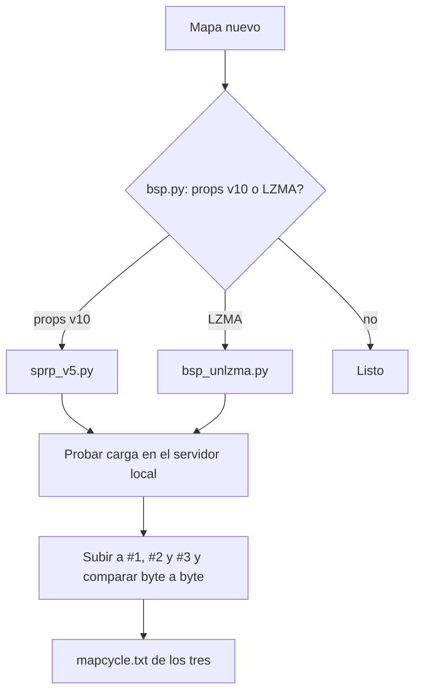

# Plan: mapas nuevos y de_tuscan_ob

> Planeación original. Estado: **aprobado por Kyan** el 2026-11-12/13. Se escribió al cerrar el requerimiento, con lo que se fue decidiendo en el momento (Kyan lo pidió por partes en la misma sesión).

## Decisiones tomadas

| Tema | Decisión | Por qué |
|---|---|---|
| Por qué se caían los mapas | Los props estáticos vienen en la versión 10 (Source 2013/TF2). v34 solo lee hasta la 5/6 y se cae al cargar el mapa | Se vio en el #2 con `de_ancient_css` y se confirmó en el servidor local |
| Cómo arreglarlos | Recortar cada prop a los primeros 60 bytes (formato v5), sin recompilar | Los primeros 60 bytes de la v10 son exactamente la v5 |
| `de_strike_mirage` | Además, descomprimir el LZMA (lumps, game lumps y pak) | v34 tampoco lee mapas comprimidos |
| `de_inferno_csgo` | Queda afuera | Pesa 93 MB (Kyan) |
| Dónde van | Los mismos archivos en #1, #2 y #3, y en el `mapcycle.txt` de los tres | La configuración es igual en todos los servidores |
| FastDL | Apuntarlo al uuid de cada servidor con `/cstrike` al final | El de antes (uuid de flow) daba 404 para todos los mapas. Kyan aprobó ponerlo sabiendo que el redirect de MVZG parece servir toda la carpeta `cstrike` |
| `de_tuscan_ob` | Versión de tuscan sin techo: recompilada con el cielo a 2560 | Si solo se le saca lo sólido al cielo, las granadas pasan pero no se ven mientras están arriba (quedan fuera del mapa) |
| Herramientas | Scripts en `server/mapas/` y carpeta de trabajo `Documents\mapas_trabajo\` | Kyan quiere hacer más mapas "_ob" |

## 1. El flujo completo

## 2. Mapas convertidos

`de_ancient_css`, `de_anubis_css`, `de_anubis_t5`, `de_cbble_go_t1`, `de_inferno_plus`, `de_nuke_cs2`, `de_strike_mirage` y `de_train_t5`.

## 3. de_tuscan_ob

Descompilar con BSPSource, borrar el cielo de la zona de juego, encerrarla en una caja de cielo con el techo a 2560, compilar con las herramientas del CS:S de Steam y dejarlo en formato v34 (props v5, sin comprimir, pak del original).

## 4. Requisitos antes de empezar

- API del panel de MVZG (`SFTP_CSS_API_KEY`).
- Java y BSPSource para descompilar; `vbsp`, `vvis` y `vrad` del CS:S de Steam para compilar.
- Servidor local `Downloads\cssds` para probar la carga.

## 5. Orden de implementación

1. Diagnosticar `de_ancient_css` en el #2.
2. Convertir y probar los 7 mapas restantes.
3. Subirlos a los tres servidores.
4. Changelog.
5. FastDL.
6. `de_tuscan_ob`.
7. `mapcycle.txt`.
