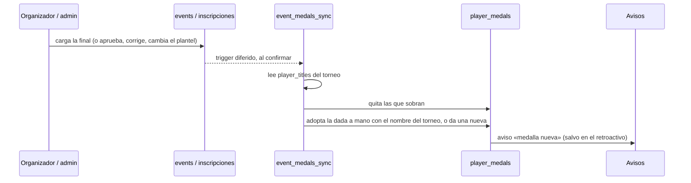
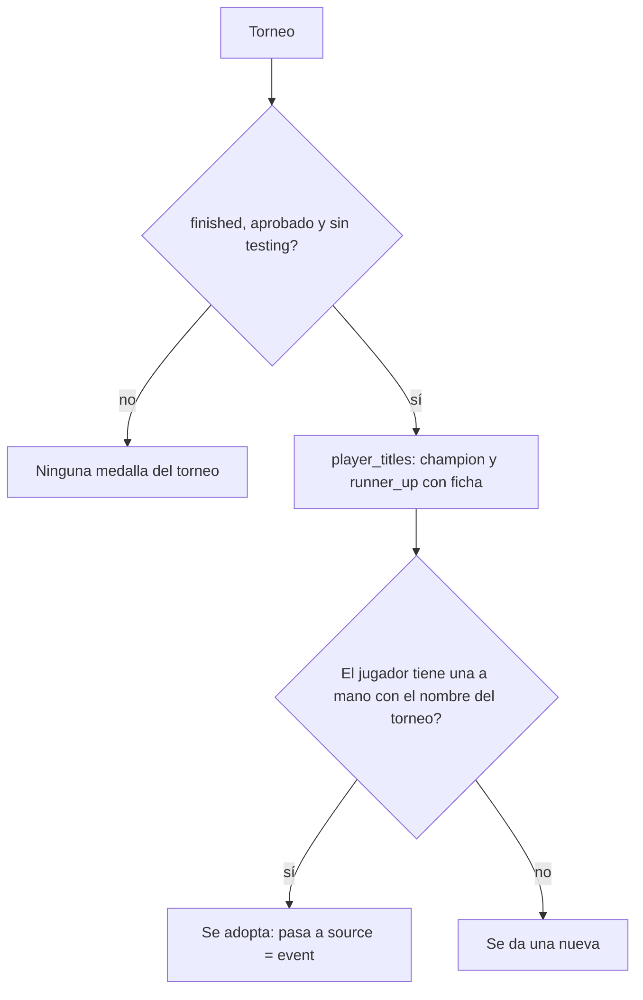

# Medallas de campeón y finalista de torneo automáticas: documentación

## Qué hace

Cuando un torneo termina, los jugadores con ficha del equipo campeón reciben **Campeón de torneo** y los del equipo que perdió la final, **Finalista de torneo**, sin que un admin las dé a mano. El título de cada una lleva el torneo («Campeón · Torneo Mercy 2020»), y en el perfil (Logros) el nombre enlaza al torneo.

Vale para los torneos públicos y los históricos, siempre que estén **aprobados** y no en **testing**. En un histórico, los jugadores cargados solo con el nombre (sin ficha, replanteo 113) no reciben nada, porque no tienen perfil.

Las medallas siguen siempre al palmarés (`player_titles`): si se corrige la final, se reinicia o cancela el torneo, deja de estar aprobado o cambia el plantel de un histórico ya terminado, se quitan las que sobran y se dan las que faltan.

## Cuándo corresponde una medalla

## Datos

| Cambio | Detalle |
|---|---|
| `player_medals.event_id` | El torneo (`on delete cascade`). Solo en `source = 'event'` |
| `player_medals.source` | Admite `event` además de `admin`, `auto` y `season` |
| `player_medals.admin_title` | Si era una medalla dada a mano que el torneo adoptó, su título de antes |
| Índice `player_medals_event` | Único en `(player_id, event_id, definition_id)` para `source = 'event'` |
| `medal_definitions.aggregation` | Admite `event_result`, con `filters.result` = `champion` o `runner_up` |
| `campeon_torneo` y `finalista_torneo` | Pasan a `event_result` con el diseño que ya tenían. El admin sigue editando su diseño |

## Funciones y triggers (replanteo `114`)

- `event_medals_sync(evento)`: deja las medallas del torneo iguales a `player_titles`. `security definer` y no la pueden llamar `anon` ni `authenticated`.
- `medal_title_key(texto)`: normaliza un título para compararlo con el nombre del torneo. Usa mayúsculas, quita las tildes y los signos, y saca el «Campeón» o «Finalista» del principio. «CAMPEON TORNEO TITAN» coincide con «TORNEO TITAN», y «CAMPEON TORNEO TITAN 2» no.
- Triggers `event_medals`, diferidos al confirmar la transacción, en:
  - `events`: cambios de estado, campeón, aprobación, testing y nombre.
  - `tournament_registrations` y `tournament_registration_players`: inscripciones y planteles.

  Por ser diferidos, si un plantel se borra y se vuelve a cargar en la misma transacción, las medallas no se quitan y vuelven a dar.
- El motor (`medals_award`, `medal_progress`, `medal_metric_values` y `medal_preview`) saltea las `event_result`, como hace con las manuales.
- `tg_notify_player_medals` respeta `cmleague.medals_quiet = 'on'`. Así, el retroactivo de la migración no manda avisos.

## Medallas dadas a mano

- El admin puede seguir dando estas dos a mano, para los torneos de fuera de la plataforma (`source = 'admin'`). Esas no se tocan nunca, salvo cuando su título coincide con un torneo de la plataforma: en ese caso se adoptan y no se duplican. Si después dejan de corresponder, vuelven a ser manuales con su título de antes.
- Una medalla de torneo (`source = 'event'`) no se puede quitar desde la ficha: la API responde 400 y el botón está apagado. Se quita sola si cambia el palmarés.

## API y web

- `GET /api/v1/players/{id}/medals` devuelve `source = 'event'` y `event: { id, name }`.
- `POST` de medalla a mano acepta las definiciones `event_result`. `DELETE` rechaza las `source = 'event'`.
- Administración › Medallas muestra el tipo `event_result` como «Se da al terminar un torneo», sin objetivo ni progreso.
- Perfil › Logros: la medalla de torneo enlaza al torneo.

## Qué cambia para cada rol

| Rol | Qué cambia | Página del manual |
|---|---|---|
| Jugador | Recibe la medalla de campeón o finalista sola, con aviso, al terminar el torneo. En Logros, el nombre lleva al torneo | `jugador/logros.md` |
| Capitán | Nada aparte de lo del jugador | — |
| Organizador | Al cargar la final (o al aprobarse el torneo) se dan las medallas. Si corrige un resultado o el plantel de un histórico, las medallas se acomodan solas | `organizador/resultados-y-llave.md`, `organizador/subir-torneo-historico.md` |
| Moderador | Nada | — |
| Admin | Las dos medallas pasan a ser automáticas. Se siguen pudiendo dar a mano para torneos de fuera, y las de un torneo no se quitan desde la ficha | `admin/medallas.md`, `admin/usuarios-y-fichas.md` |
| Streamer, dueño de un servidor externo | Nada | — |

## Términos y privacidad

Sin cambios: las medallas y el palmarés de cada jugador ya eran públicos.

## Dónde está cada cosa

| Parte | Archivo |
|---|---|
| Migración | `supabase/replanteo/114_medallas_de_torneo.sql` |
| Inversa | `docs/bitacora/2026-10-14-replanteo-modelo-datos/reversas/114_medallas_de_torneo.sql` |
| API | `web/backend/src/routes/{players,admin-players,medals}.ts`, `src/schemas/{players,medals}.ts`, `src/db/types.ts` |
| Web | `web/frontend/src/features/admin/medals/`, `features/admin/players/components/FichasTab.tsx`, `features/player/` (Logros), `features/medals/templates.json` |
| Pruebas | `pruebas/probar_114.{sh,sql}`, `web/backend/test/integration/medals.test.ts`, `editor.test.ts`, `achievements.test.ts` |
