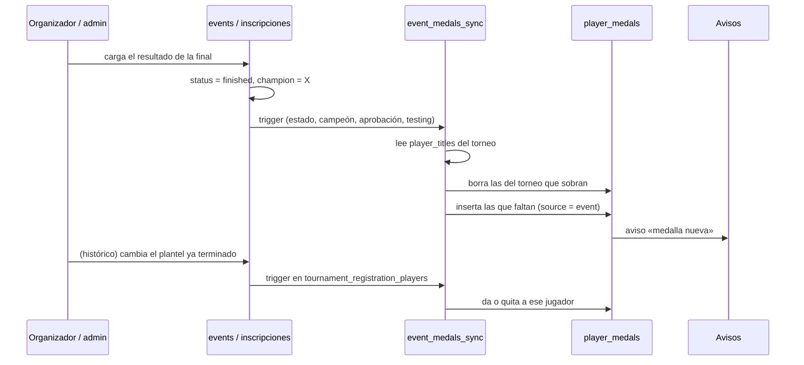

# Plan: medallas de campeón y finalista de torneo automáticas

> Planeación original. Estado: **propuesta**, pendiente de aprobación.

Pedido por Daniel (2026-11-13): cuando un torneo termina, los jugadores del campeón y del finalista reciben su medalla solos, sin que un admin la dé a mano. En un torneo histórico, solo los jugadores con ficha. Las dos medallas usan los diseños por defecto que ya existen («Campeón de torneo», sello oro, y «Finalista de torneo», sello plata), y el admin puede seguir cambiando el diseño desde Administración › Medallas.

## Cómo está hoy

- Un torneo pasa a `finished` y toma su `events.champion` solo, al cargarse el resultado de la final (`10_partidas_torneos.sql`, `event_advance`). Si se corrige ese resultado, el campeón puede cambiar o el torneo puede volver a `in_progress`. También se puede reiniciar a inscripciones (`champion = null`).
- La vista `player_titles` (replanteo 27) ya calcula, por jugador inscrito, quién salió campeón (`champion`) y quién perdió la final (`runner_up`). Lee `tournament_registration_players`, así que los nombres sin ficha de un histórico (`tournament_registrations.guest_names`, replanteo 113) no entran.
- `campeon_torneo` y `finalista_torneo` son definiciones de medalla con `aggregation = 'manual'`: solo las da un admin (`source = 'admin'`) y pueden repetirse.
- El aviso de medalla nueva (`tg_notify_player_medals`) sale con cada `insert` en `player_medals`.

## Decisiones tomadas

| Tema | Decisión | Por qué |
|---|---|---|
| Qué medallas | `campeon_torneo` y `finalista_torneo`, con el diseño por defecto de `templates.json`. Si alguna no existe en la base, la migración la crea | Daniel: "ya existen 2 diseños por defecto"; el admin edita el diseño como cualquier otra |
| Quién la recibe | Los jugadores inscritos con ficha del equipo campeón y del finalista, según `player_titles` | Es el mismo palmarés que ya muestra el perfil; los sin ficha no tienen perfil |
| Qué torneos | Públicos e históricos **aprobados**, sin `testing` y con `approval = 'approved'`. Si uno pasa a aprobado o sale de testing ya terminado, se dan en ese momento | Daniel, 2026-11-13 |
| Correcciones | Las medallas siguen siempre al palmarés: si cambia el campeón, se reinicia el torneo, se cancela, deja de estar aprobado o (en un histórico) se saca a un jugador, se quitan las que sobran y se dan las que faltan | Daniel, 2026-11-13 |
| Retroactivo | Sí, para todos los torneos que ya terminaron, **sin duplicar**: si el jugador ya tiene una «Campeón de torneo» o «Finalista de torneo» dada a mano, se convierte en la del torneo en lugar de darle otra | Daniel, 2026-11-13 |
| Avisos | El jugador recibe el aviso de medalla nueva también en los históricos (el resto de avisos del histórico sigue apagado). Las del retroactivo **no** avisan, para no mandar decenas de avisos viejos de golpe | Daniel, 2026-11-13 (históricos); el retroactivo, propuesta |
| Nombre | El título de cada medalla lleva el torneo: «Campeón · `<torneo>`» y «Finalista · `<torneo>`». El diseño (sello, metal, banda, rótulo) es el de la definición | Un jugador puede ganar varios torneos y tiene que distinguirlos |
| Medallas a mano | El admin puede seguir dando estas dos a mano (para torneos de fuera de la plataforma). Esas no se tocan nunca | No se pierde lo que ya se puede hacer hoy |

## 1. El flujo completo

Cada vez que algo puede cambiar el palmarés de un torneo, se llama a una sola función que deja las medallas iguales a `player_titles`. Así no importa en qué orden pasen las cosas.

## 2. Base de datos (replanteo `114_medallas_de_torneo.sql`)

### Columnas nuevas

- `player_medals.event_id uuid references events(id) on delete cascade`: el torneo de la medalla. Solo lo llevan las de `source = 'event'`.
- `player_medals.source` admite `'event'` además de `admin`, `auto` y `season`.
- Índice único `player_medals_event` en `(player_id, event_id, definition_id) where source = 'event'`: un jugador no puede tener dos veces la misma medalla del mismo torneo.

### Definiciones

- `medal_definitions` acepta `aggregation = 'event_result'`, con `filters = {"result": "champion"}` o `{"result": "runner_up"}`.
- La migración pasa `campeon_torneo` y `finalista_torneo` a `event_result` (si no existen, las crea con el diseño de `templates.json`). El diseño que ya tengan no cambia.
- `medals_award` y `medal_progress` siguen salteándolas, como hoy a `manual` y `season_rank`.

### `event_medals_sync(p_event uuid)`

1. Si el torneo no está `finished`, o está en `testing`, o no está `approved`: borra todas sus medallas `source = 'event'` y termina.
2. Si no: calcula lo que corresponde (`player_titles` del torneo, una fila por jugador y resultado, con la definición de `event_result` que tenga ese `result` y esté activa).
3. Borra las `source = 'event'` del torneo que no están en esa lista.
4. Inserta las que faltan, con el título «Campeón · `<torneo>`» o «Finalista · `<torneo>`».

`security definer`, y no la puede llamar ni `anon` ni `authenticated`.

### Triggers

- En `events`, `after update of status, champion, approval, testing, name`: llama a `event_medals_sync(new.id)`. El nombre también, para que el título de la medalla siga al torneo.
- En `tournament_registration_players`, `after insert or delete or update`: llama a `event_medals_sync` del torneo, solo si está terminado (es lo que deja el replanteo 113 en los históricos).
- En `tournament_registrations`, `after delete`: igual (si se borra la inscripción de un equipo).
- `tg_notify_player_medals` no cambia: avisa con cada insert. Para el retroactivo, la migración apaga el aviso con una variable de sesión (`set local cmleague.medals_quiet = 'on'`) que el trigger respeta.

### Retroactivo sin duplicar

Dentro de la misma migración:

1. Para cada jugador con medallas a mano de `campeon_torneo` (o `finalista_torneo`), se emparejan, de la más vieja a la más nueva, con sus títulos de `player_titles` de ese resultado, ordenados por fecha de la final. Cada par se convierte: `source = 'event'`, `event_id` y el título nuevo. Las que sobran (más medallas a mano que títulos) quedan como están: son de torneos de fuera de la plataforma.
2. Se corre `event_medals_sync` para todos los torneos terminados: da las que faltan.

Antes de aplicarla en producción se saca la lista de lo que se va a convertir y dar (con la copia de producción) y se le muestra a Daniel.

La inversa (`reversas/114_medallas_de_torneo.sql`) vuelve las convertidas a `source = 'admin'`, borra las nuevas, devuelve las dos definiciones a `manual` y saca las columnas y los triggers.

## 3. API (`web/backend`)

- `MEDAL_AGGREGATIONS` suma `event_result`. Una definición `event_result` tiene objetivo 1 y no se puede crear nueva desde el panel (solo existen esas dos); sí se edita su diseño, título y estado.
- Darle a mano una de estas dos sigue funcionando (`source = 'admin'`).
- `player_medals` en el perfil devuelve `event` (`{ id, name }`) cuando la medalla es de un torneo. Los tipos de `db/types.ts` se regeneran.
- Pruebas de integración: terminar un torneo da las medallas; corregir la final las mueve; un histórico no da a los sin ficha; un torneo en testing no da; aprobarlo terminado sí da.

## 4. Web (`web/frontend`)

- Administración › Medallas: el tipo `event_result` se muestra como «Se da al terminar un torneo», sin objetivo ni progreso, y estas dos no aparecen en «Dar medalla a mano» como si fueran del motor (siguen ahí, para torneos de fuera).
- Perfil › Logros: la medalla de torneo lleva el enlace al torneo.
- Pruebas unitarias de `editor.ts` y del perfil.

## 5. Manual, términos y changelog

- Manual: `admin/medallas.md` (las dos medallas son automáticas y qué pasa al corregir un resultado), la página del organizador sobre terminar un torneo y la del jugador sobre medallas, si existe; se revisan al implementar.
- Términos y privacidad: se revisa. En principio sin cambios (las medallas y el palmarés ya son públicos).
- `CHANGELOG_DISCORD.txt` con el anuncio para los jugadores.

## 6. Requisitos antes de empezar

- Túnel a la base de producción (`PG_*`) para sacar la lista del retroactivo y la copia de producción para ensayar.
- Nada nuevo para instalar.

## 7. Orden de implementación

1. Replanteo `114` y su inversa, con pruebas SQL en `pruebas/` (terminar, corregir, reiniciar, testing, aprobar, histórico con y sin ficha, retroactivo con medallas a mano).
2. Ensayo sobre la copia de producción y lista del retroactivo para Daniel.
3. API: esquema, perfil, tipos y pruebas de integración.
4. Web: panel de medallas, perfil y pruebas.
5. Manual, `DOCUMENTACION.md`, `GUIA_IMPLEMENTACION.md`, changelog y fila en `docs/bitacora/README.md`.
6. Despliegue cuando Daniel lo apruebe: la `114` en producción, después la API y la web. No toca los servidores de juego.
