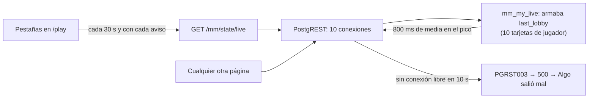

# La base sin conexiones libres en las horas pico: documentación

## Qué hace

Dos cambios para el "Algo salió mal" que aparecía en cualquier página en las horas pico:

1. **El estado del matchmaking ya no arma la última sala en cada consulta** (replanteo `115`). Era dos tercios del tiempo de la base y dejaba a PostgREST sin conexiones libres.
2. **Cuando la base igual no da abasto**, la API responde `503 UNAVAILABLE` y la web dice "El servidor está ocupado. Intenta de nuevo en un momento.", con **Reintentar**, en lugar de "Algo salió mal".

## El problema

- `pg_stat_statements` (del 2026-11-03 al 13): `mm_my_live` sumó 67.551 s de unos 100.000 s de la base, con 807 ms de media y picos de 6 s. Le siguen `match_list` (8.500 s) y `mm_tick` (4.988 s).
- Medido en la base local: unos 50 ms por llamada, de los que casi todo es `mm_lobby_json` de la última sala (`mm_player_card` × 10, cada una con dos `mm_meetings`).
- En el VPS (2 núcleos) y en las horas pico (20:00 a 06:00 UTC), eso llenaba el pool de PostgREST (10 conexiones, el valor por defecto). Hubo ráfagas de 500 en todos los endpoints el 2026-11-09, 10, 11, 12 y 13.

## 1. La última sala aparte

- `mm_my_live()` devuelve `last_lobby_ref`: `{ id, rev }`, o `null` si no jugó. Ya no devuelve `last_lobby`.
- `rev` (`mm_lobby_rev`) es el `md5` de lo que todavía puede cambiar en una sala terminada, para quien mira: estado, motivo, partida, ganador, marcador, la partida hija (cuando llega el resultado), a quién reportó y a quién recomendó.
- `mm_my_last_lobby()` y `GET /api/v1/mm/last-lobby` devuelven la sala como venía en `last_lobby`: `mm_lobby_json` sin `match.stats`.
- La web la pide con la clave `['mm', 'last-lobby', id, rev]` y sin vencimiento (`useLastLobby`). Un aviso del socket o el refresco de 30 s no la vuelven a pedir: solo un `rev` nuevo. Mientras llega, queda la anterior.
- `mm_my_state` (`p_full`, las acciones sociales) no cambia: su `lobby` sigue trayendo la terminada en la última hora, y la web la usa si todavía no llegó la consulta aparte.
- Medido en la base local: `mm_my_live` pasó de unos 50 ms a unos 3 ms.

## 2. Base ocupada

| Código | Qué es | Antes | Ahora |
|---|---|---|---|
| `PGRST003` | PostgREST sin conexión libre en 10 s | `500 INTERNAL` | `503 UNAVAILABLE`, `Retry-After: 5` |
| `57014` | Consulta cortada por `statement_timeout` (8 s para `authenticated`, 3 s para `anon`) | `500 INTERNAL` | `503 UNAVAILABLE`, `Retry-After: 5` |
| 502, 503 o 504 sin cuerpo de la API (Caddy o Kong) | Un reinicio o la API caída | `INTERNAL` | `UNAVAILABLE` |

La web muestra "El servidor está ocupado. Intenta de nuevo en un momento." y `isRetryable` lo da por pasajero (botón **Reintentar** de `QueryState`).

## Qué cambia para cada rol

| Rol | Cambio |
|---|---|
| Todas las cuentas | Menos errores en las horas pico. Si la base está ocupada, el mensaje lo dice y se puede reintentar |
| Jugador del matchmaking | "Tu última partida" se ve igual. Con la web vieja abierta, queda vacía entre la `115` y recargar la página |

Sin cambios en el manual: no cambia ninguna tarea.

## Términos y privacidad

Sin cambios: no se guardan datos nuevos ni cambia qué se publica.

## Dónde está cada cosa

| Qué | Dónde |
|---|---|
| Migración e inversa | `supabase/replanteo/115_mm_ultima_sala_aparte.sql`, `docs/bitacora/2026-10-14-replanteo-modelo-datos/reversas/115_mm_ultima_sala_aparte.sql` |
| Prueba de la base | `pruebas/probar_115.sql` y `probar_115.sh` |
| Ruta | `web/backend/src/routes/mm.ts` (`GET /api/v1/mm/last-lobby`) |
| Errores | `web/backend/src/lib/errors.ts` y `web/frontend/src/api/errors.ts` |
| Web | `web/frontend/src/features/matchmaking/` (`queries.ts`: `lastLobbyOptions` y `useLastLobby`; `source.ts`, `demo.ts`, `types.ts` y `PlayPage.tsx`) |
