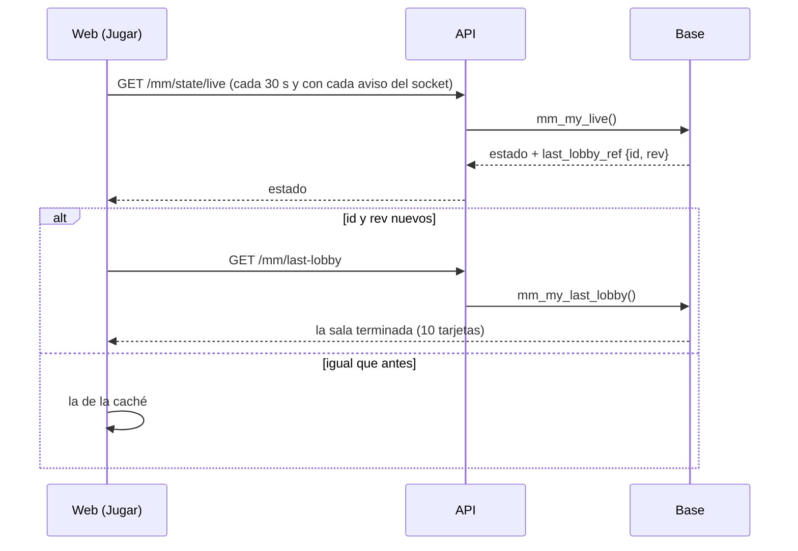

# Plan: la base sin conexiones libres en las horas pico

Pedido por Daniel el 2026-11-13, a partir del "Algo salió mal" que le salió a 1grim al editar su perfil. Aprobados los puntos 1 y 2. El 3 (agrandar el pool de PostgREST y `shared_buffers`) queda afuera.

## Decisiones tomadas

- **La causa (logs del VPS del 2026-11-09 al 13):** en las horas pico (20:00 a 06:00 UTC) PostgREST se queda sin conexiones (`PGRST003`, "Timed out acquiring connection from connection pool", con el pool por defecto de 10). Todo lo que llega en ese momento espera 10 s y la API lo devuelve como `500 INTERNAL`: "Algo salió mal" en cualquier página.
- **Quién ocupa la base:** `mm_my_live` (`GET /api/v1/mm/state/live` y la respuesta de las acciones del matchmaking) se llevó 67.551 s de unos 100.000 desde el 2026-11-03 (`pg_stat_statements`), con 807 ms de media. Casi todo es `last_lobby`: en **cada** llamada arma la última sala terminada del jugador completa, con 10 tarjetas (`mm_player_card`: forma, últimas 30 partidas, mapa favorito y dos `mm_meetings`), aunque no esté jugando.
- **1. `last_lobby` aparte (replanteo `115`):**
  - `mm_my_live` deja de armar `last_lobby` y devuelve `last_lobby_ref`: `{ id, rev }`, o `null`. `rev` es un resumen barato de lo que todavía puede cambiar en una sala terminada (estado, motivo, partida y marcador, si ya llegó el resultado, a quién reporté y a quién recomendé).
  - Función nueva `mm_my_last_lobby()`: la última sala terminada, armada como antes (`mm_lobby_json` sin `match.stats`).
  - Ruta nueva `GET /api/v1/mm/last-lobby`.
  - La web la pide con la clave `['mm', 'last-lobby', id, rev]` y la guarda sin vencimiento: solo vuelve a pedirla cuando cambia `rev`.
  - `mm_my_state` (`p_full`) no cambia: su `lobby` sigue trayendo la terminada en la última hora.
- **2. Base ocupada:** `PGRST003` (sin conexión libre) y `57014` (`statement_timeout`) pasan a `503 UNAVAILABLE`, con "El servidor está ocupado. Intenta de nuevo en un momento.", y la web ofrece **Reintentar**.
- **Sin cambios en los servidores de juego ni en el plugin.**
- **Ramas del matchmaking:** `feat/frontend-fase-1` y `feat/mm-claim-en-sala` se quedaron en la `105`. Se trabaja en `main`, como de la 106 a la 114, y se le pregunta a Daniel si se copia.

## 1. El flujo

## 2. Base (`supabase/replanteo/115_mm_ultima_sala_aparte.sql`)

- `mm_lobby_rev(p_lobby, p_viewer) returns text`, en SQL: `md5` de estado, `end_reason`, `match_id`, `winner_team`, marcador, el id de la partida hija y los reportes y la recomendación de quien mira.
- `mm_my_live`: la misma, con `last_lobby_ref` en lugar de `last_lobby`.
- `mm_my_last_lobby()`: `mm_lobby_json(v_last, auth.uid()) #- '{match,stats}'`, o `null`. Solo `authenticated`.
- Inversa en `docs/bitacora/2026-10-14-replanteo-modelo-datos/reversas/115_mm_ultima_sala_aparte.sql`: vuelve la `mm_my_live` de antes y borra las dos nuevas.
- Prueba `pruebas/probar_115.sql`, en una transacción que se deshace (local y producción).

## 3. API

- `GET /api/v1/mm/last-lobby` en `routes/mm.ts`.
- `lib/errors.ts`: código `UNAVAILABLE` (503) para `PGRST003` y `57014`.

## 4. Web

- `features/matchmaking`: `lastLobbyOptions(source, ref)` y `source.lastLobby()` (también en la demo). `PlayPage` toma la última sala de esa consulta y, si todavía no llegó, de `state.last_lobby` (la que trae `mm_my_state`).
- `api/errors.ts`: mensaje de `UNAVAILABLE` y `isRetryable`.
- `pnpm gen:api`.

## 5. Requisitos antes de empezar

Ninguno.

## 6. Orden

1. Migración, inversa y prueba, contra la base local.
2. API y web, con sus pruebas.
3. Despliegue: la `115` (con `notify pgrst, 'reload schema'`), después la API y la web, sin salas del matchmaking armándose. Entre la `115` y la web nueva, la pestaña "Tu última partida" de quien tenga la web vieja abierta queda vacía hasta que recargue.
4. Medir de nuevo `pg_stat_statements` (reiniciándolo) al día siguiente.
