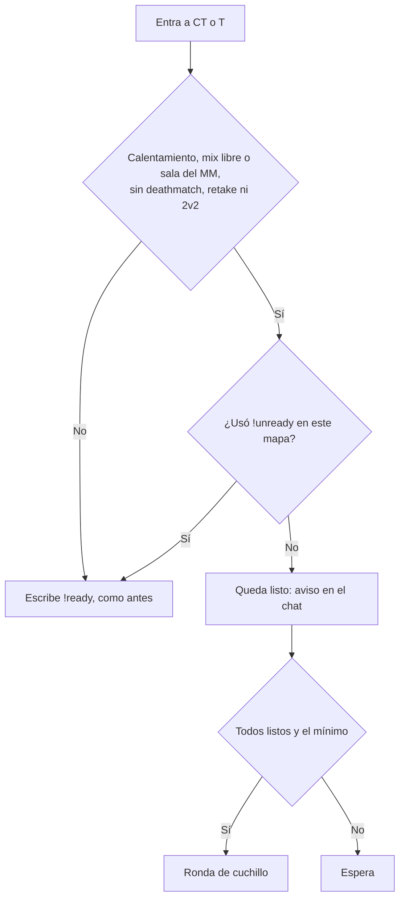

# !ready automático al entrar: documentación

## Qué hace

En el calentamiento de un **mix libre** o de una **sala del matchmaking**, el jugador que entra a CT o T queda listo solo, como si hubiera escrito `!ready`. La partida arranca con la regla de siempre: todos listos, el mínimo de jugadores (8 en un mix) y, en una sala, todo el plantel adentro. En un mix, eso es apenas se llega al mínimo.

Quien necesita un momento escribe `!unready` (o `!notready`). Desde ahí no vuelve a quedar listo solo hasta que escriba `!ready` o cambie el mapa, aunque se cambie de equipo.

En torneos y PCW no cambia nada: cada uno escribe `!ready`.

## Reglas

| Caso | Qué pasa |
|---|---|
| Mix libre (sin vínculo) | Entra listo |
| Sala del matchmaking (vínculo `mm`) | Entra listo. Arranca cuando está todo el plantel |
| Torneo o PCW (vínculo `official`/`pcw`, o `!match` pendiente) | Escribe `!ready` |
| Deathmatch, retake o 2v2 prendido (`sm_dm_on`, `sm_retake_on`, `sm_2v2_on` en 1) | Nada: esos modos bloquean `!ready`. Evita que 8 personas en el deathmatch de `$2000$` arranquen un mix |
| Espectador | No cuenta, como antes |
| Ya estaba en un equipo cuando empezó a valer (por ejemplo, sala tomada sin cambiar de mapa) | Queda listo con el recordatorio del calentamiento (cada 30 segundos) |

## Comandos y ConVars

| Qué | Detalle |
|---|---|
| `csstv_auto_ready` | 1 por defecto. En 0 vuelve el `!ready` manual en todo |
| `!unready` / `!notready` | Quita el listo y apaga el automático para ese jugador hasta `!ready` o el próximo mapa |
| `!ready` | Marca listo y vuelve a prender el automático para ese jugador |
| Recordatorio del calentamiento | Si se entra listo solo, dice "Entrás listo solo; !unready si necesitás un momento" |

## Versiones

| Versión | Sobre | Dónde |
|---|---|---|
| **2.12.1** | 2.12.0 de `kyan/pruebas` | Repo (`server/addons/sourcemod/`) |
| **2.10.2** | 2.10.1 (la desplegada: `main` 2.10.0 más el parche del cuchillo por vida) | #1, #2 y #3; build y parche en `build_2.10.2/` |

## Qué cambia para cada rol

| Rol | Qué cambia | Página del manual |
|---|---|---|
| Jugador | Entra listo en mixes y matchmaking; `!unready` para frenar | [`jugador/jugar-en-el-servidor.md`](../../manual/jugador/jugar-en-el-servidor.md) y [`jugador/comandos-en-el-servidor.md`](../../manual/jugador/comandos-en-el-servidor.md) |
| Capitán | Nada: en torneos y PCW sigue el `!ready` | — |
| Organizador, moderador, admin, streamer, dueño de un servidor externo | Nada | — |

## Términos y privacidad

Sin cambios.

## Dónde está cada cosa

| Qué | Archivo / ubicación |
|---|---|
| Lógica | `server/addons/sourcemod/scripting/csstv/autoready.inc` |
| Enganches | `csstv_reporter.sp` (include, init, `!ready`, `!unready`, recordatorio, reinicio de la partida) |
| Build 2.10.2 y parche | `build_2.10.2/` |
| Changelog | `CHANGELOG_DISCORD.txt` |
