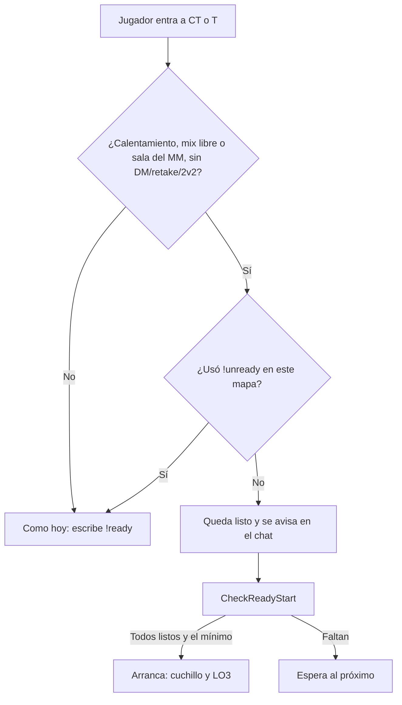

# Plan: !ready automático al entrar

> Planeación original. Estado: **aprobado por Kyan** el 2026-11-13 (alcance: matchmaking y mixes; para frenar, `!unready`).

## Decisiones tomadas

| Tema | Decisión | Por qué |
|---|---|---|
| Dónde | En el calentamiento de una **sala del matchmaking** y de un **mix libre** | Pedido por Kyan. En torneos y PCW se sigue escribiendo `!ready` (ahí está el vínculo con `!match` y los mínimos por equipo) |
| Cuándo | Al entrar a CT o T (evento `player_team`) | Es cuando el jugador cuenta para el `!ready`. Los espectadores no cuentan |
| Arranque | El de siempre: `CheckReadyStart` (todos listos, el mínimo de jugadores y, en una sala, todo el plantel) | No cambia la regla, solo quién marca el listo. En un mix arranca apenas llegan al mínimo (8), como eligió Kyan |
| Frenar | `!unready` (ya existe, también `!notready`). Quien lo usa no vuelve a quedar listo solo hasta que escriba `!ready` o cambie el mapa | Si se cambia de equipo no tiene que volver a marcarse |
| Modos | Nada con el deathmatch, el retake o el 2v2 prendidos (`sm_dm_on`, `sm_retake_on`, `sm_2v2_on`) | Esos modos bloquean `!ready`. Sin esto, 8 personas en el deathmatch de `$2000$` arrancarían un mix |
| Apagarlo | `csstv_auto_ready` (1 por defecto) | Para volver al `!ready` manual sin compilar |
| Versiones | **2.12.1** en `kyan/pruebas` y **2.10.2** (la 2.10.1 desplegada más este cambio) para #1, #2 y #3 | Igual que la 2.10.1: la 2.11 y la 2.12 necesitan cosas que todavía no están en producción |

## 1. El flujo completo

## 2. Cambios en el plugin

- `csstv/autoready.inc` nuevo: la ConVar, el evento `player_team`, la marca de quien usó `!unready` y la condición.
- `csstv_reporter.sp`: incluirlo, iniciarlo, limpiar la marca al entrar y al reiniciar la partida, `!unready` pone la marca y `!ready` la saca, y el recordatorio del calentamiento dice que se entra listo.

## 3. Manual

`jugador/jugar-en-el-servidor.md`: en el calentamiento se entra listo; `!unready` para frenar.

## 4. Requisitos antes de empezar

`spcomp` 1.10 de `C:\Users\Agus\Downloads\cssds` y el servidor local con `csstv_send 0`.

## 5. Orden de implementación

1. 2.12.1 en `kyan/pruebas`.
2. 2.10.2: el parche sobre la 2.10.1.
3. Probar con bots en el servidor local (las dos versiones).
4. Desplegar en #1, #2 y #3 (entra en el próximo cambio de mapa, nunca con una partida en curso).
5. Manual, documentación y changelog.
