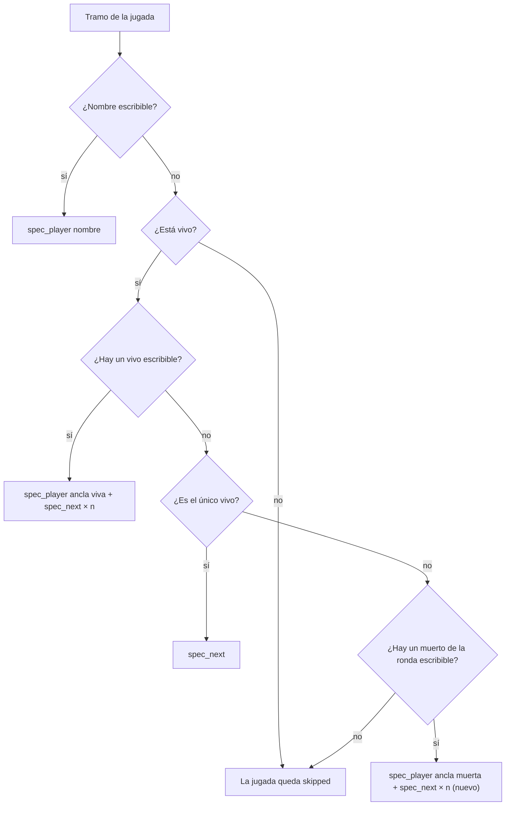

# Clips de clutch perdido y de vivos sin nombre escribible: documentación

## Qué hace

El render de los clips (`render/`, la tarea "CMLeague clips" del portátil) maneja la cámara del juego escribiendo en su consola: `spec_player "<nombre>"` para seguir a un jugador. Cuando el nombre tiene caracteres que no llegan bien a la consola (el `™` de "New™ …", el `漏斗` de "lephyxzz漏斗"), la cámara sigue a otro jugador con nombre escribible (el "ancla") y avanza con `spec_next` hasta llegar a él. Antes de abrir el juego, `check_targets` revisa que eso sea posible en cada tramo, y si no, la jugada queda `skipped`.

Tres errores dejaban fuera clips que sí se podían grabar, y dos más afeaban los que sí se grababan:

1. **Clutch perdido:** el último tramo de una jugada con clutch iba hasta el fin de la ronda, aunque el jugador ya estuviera muerto. Ahora termina en su muerte.
2. **Ningún vivo escribible:** en un 1v1 entre "New™ tam" y "lephyxzz漏斗" no había ancla. Ahora el ancla puede ser un jugador muerto de la ronda.
3. **Jugadores sin equipo conocido:** en una partida cortada antes del medio tiempo, el lector de demos no veía a los jugadores que nunca cambiaron de equipo (y contaba mal los `spec_next`). Ahora cuenta como jugador a todo el que mata o muere en la demo.
4. **El menú del juego encima del video:** cuando el paso que arranca la grabación no entraba en una línea de la consola, la segunda línea volvía a abrir el menú de ClientMod y no lo cerraba. Ahora cada línea lo cierra.
5. **Un tramo suelto al principio de los clutches:** el inicio del clutch (la muerte del último compañero) salía como un tramo aparte en el que no pasa nada. Ahora va solo si cae en el mismo tramo que una kill o el final.

Desde fuera se veía así: la tarea arrancaba y terminaba enseguida, porque tomaba los clips reprocesados, los descartaba sin abrir el juego y no le quedaba nada en la cola.



## El final de un clutch

`procesar.clip_events` arma los eventos de una jugada: las kills y, si tiene clutch, el inicio (la muerte del último compañero) y el final. El final era siempre `end_tick` (el fin de la ronda). Ahora, si el jugador muere entre el inicio del clutch y el fin de la ronda (en la demo, como víctima de una kill o de un suicidio), el final es su muerte. El tramo termina `post_seconds` después, como cualquier kill.

| Clutch | Final de la jugada |
|---|---|
| Ganado, o perdido con el jugador vivo (se acabó el tiempo, explotó la bomba) | El fin de la ronda, como antes |
| Perdido con el jugador muerto | Su muerte (nuevo) |

Le cambia el final también a clutches perdidos de jugadores con nombre escribible, que antes se grababan siguiendo a un muerto hasta el fin de la ronda.

### El inicio del clutch

El inicio (la muerte del último compañero) entra como evento solo si queda a `split_gap_seconds` o menos de otro evento de la jugada (una kill o el final), es decir, si cae en el mismo tramo. Si queda lejos, no se graba: era un tramo de 5 s del jugador caminando, sin nada que ver (el 1v1 de tam empezaba con la muerte de lucybesteN, 40 s antes de la kill). Un clutch sin kills cerca del inicio arranca directamente en su primera kill.

| Inicio del clutch | Antes | Ahora |
|---|---|---|
| A 8 s o menos de una kill o del final | En el mismo tramo | Igual |
| Lejos de todo | Un tramo aparte | No se graba |

## El ancla muerta

`spec_player` del motor busca al jugador por el nombre sin mirar si está vivo, y `spec_next` va al siguiente vivo por número de entidad desde el que sigue la cámara. Con un ancla muerta de número `a`, el primer `spec_next` lleva al primer vivo con número mayor que `a` (dando la vuelta), y desde ahí se cuenta como con un ancla viva:

```
pasos = (posición del objetivo − posición del primer vivo después de a) mod vivos + 1
```

- **Quién puede ser ancla muerta:** los de `leer_demo.in_round_at(d, tick)`, que estaban en T o CT al empezar la ronda y no cambiaron de equipo ni se desconectaron, con nombre escribible y número de entidad.
- **Prioridad:** primero un ancla viva (lo de siempre), después el único vivo con `spec_next` solo y recién después el ancla muerta. Entre anclas muertas, la de menos pasos.
- Probado con el juego: el clutch 1v1 de tam, con `spec_player "BrokoLoco"` (muerto) y un `spec_next`, sale en su primera persona.

## El menú del juego en el video

El script maneja el juego escribiendo en la consola. Cada línea abre la consola con su tecla, y en ClientMod esa tecla también abre el menú (RESUME GAME, la lista de servidores). Por eso cada paso termina con `hideconsole` y `gameui_hide`.

Un paso largo (el ancla con varios `spec_next`) se parte en varias líneas (`console_lines`, desde el 2026-10-30). A las líneas que no tenían `hideconsole` se les agregaba solo ese comando, sin `gameui_hide`. La línea de `startmovie` y `demo_resume` quedaba así, y la grabación arrancaba con el menú abierto. Les pasaba a los clips de jugadores con nombre no escribible cuya ancla quedaba a 2 o más `spec_next`. Ahora toda línea lleva los dos comandos al principio, si no los tiene.

## Los jugadores sin equipo conocido

`leer_demo` no lee las entidades: sabe el equipo de cada jugador por los eventos `player_team`. Como la demo empieza con la partida en vivo, el equipo inicial sale del `oldteam` del primer cambio de equipo, que normalmente es el medio tiempo. Si la partida se corta antes (`srv3-20261112T164548-42dd`, cancelada en la ronda 13), quien nunca cambió de equipo no tenía equipo: en la ronda 1 había 3 vivos de 10.

Ahora, el que no tiene ningún `player_team` en la demo y mató o murió alguna vez cuenta como jugador (un espectador nunca mata ni muere). El que sí tiene algún `player_team` se resuelve como antes. Esto también arregla la cuenta de `spec_next`: con vivos que faltaban en la lista, la cámara podía terminar en otro jugador.

## Qué cambia para cada rol

Nada para los usuarios: salen en video clips que antes quedaban sin video.

## Términos y privacidad

Sin cambios.

## Dónde está cada cosa

| Qué | Archivo |
|---|---|
| El inicio y el final del clutch | `render/procesar.py` (`clip_events`, con el `gap` que le pasa `build_job`) |
| `gameui_hide` en cada línea de la consola | `render/render_clip.py` (`console_lines`) |
| El ancla muerta | `render/render_clip.py` (`spec_target`) |
| Los que juegan la ronda y los vivos | `render/leer_demo.py` (`in_round_at`, `alive_at` y `_round_at`) |
| Revisión de la cámara sin el juego | `pruebas/revisar_camara.py` |
| Devolver los clips a la cola | `pruebas/reprocesar.sql` |
