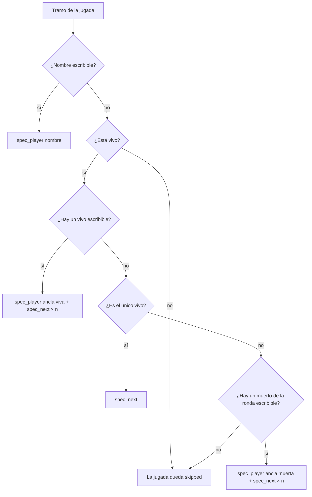
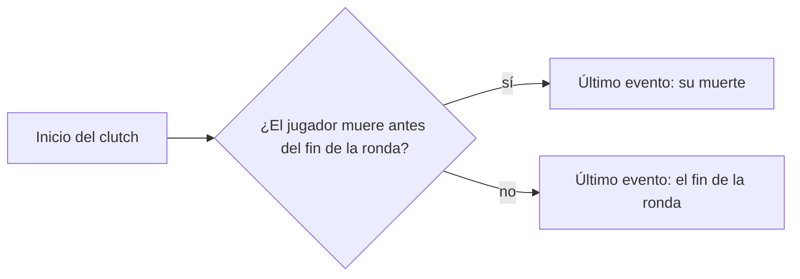

# Plan: clips de clutch perdido y de vivos sin nombre escribible

> Planeación original. Estado: **aprobado** por Daniel el 2026-11-13 ("dale, ármalo con los dos arreglos"), a partir de los dos clips de "New™ tam" que no se grababan aunque los mandara a reprocesar.

## Decisiones tomadas

| Tema | Decisión |
|---|---|
| Lo que se veía | La tarea "CMLeague clips" del portátil arranca y termina enseguida. No es la tarea: toma los clips reprocesados, `check_targets` (antes de abrir el juego) no encuentra cómo llevar la cámara al jugador, los marca `skipped` y no queda nada en la cola |
| Caso 1: clutch perdido | El 3k de tam (mirage, ronda 18, `beb6e58d`) también es un clutch 1v3 que perdió. `procesar.clip_events` agrega siempre el fin de la ronda (`end_tick`) como evento del clutch, y en ese tick tam ya está muerto (lo mata nachinn en el 162288, la ronda termina en el 162842). Arreglo: si el jugador muere entre el inicio del clutch y el fin de la ronda, el último evento es **su muerte** y no el fin de la ronda. Así el clip termina en la muerte (con los `post_seconds` de siempre), que es como terminó el clutch |
| Caso 2: ningún vivo escribible | En el clutch 1v1 de tam (dust2, ronda 26, `c3ec6102`) los dos vivos son "New™ tam" y "lephyxzz漏斗": ninguno se puede escribir en la consola y `spec_target` no tiene ancla. Arreglo: si no hay un **vivo** escribible, el ancla puede ser un jugador **muerto** de la ronda con nombre escribible (en T o CT desde el inicio de la ronda, sin desconectarse ni cambiar de equipo). `spec_player` del motor busca por nombre sin mirar si está vivo, y `spec_next` desde él va al siguiente vivo por número de entidad |
| Cuántos `spec_next` | Desde un ancla viva, como hoy: `(posición del objetivo − posición del ancla) mod vivos`. Desde una muerta: el primer `spec_next` lleva al primer vivo con número mayor que el del ancla (dando la vuelta), y desde ahí se cuenta igual. Se elige el ancla con menos pasos, y a igualdad, una viva |
| Prioridad | Primero las anclas vivas (lo probado desde el 2026-10-24). La muerta solo cuando no hay ninguna viva escribible, y antes que el error |
| El caso del único vivo | Sigue como está (`spec_next` solo), y va antes que el ancla muerta: está probado |
| Riesgo | Que `spec_player` a un muerto funcione dentro de una demo no está probado. Se prueba con el juego antes del despliegue, con el clutch de tam y `probar_jugada.py`. Si no funciona, se descarta el arreglo 2 y queda solo el 1 |
| Clips de lephyxzz | Tres clips de "lephyxzz漏斗" quedaron `skipped` con el mismo error (`9a26c6a1`, `a59dbcee` y `b10f6b10`). Se revisan con las demos y, si pasan, vuelven a la cola con los de tam |
| La base | Sin cambios. Los clips se devuelven a la cola con "Reprocesar" de la web o con `pruebas/reprocesar.sql`, con la confirmación de Daniel |

## 1. El flujo de la cámara

## 2. Los eventos de un clutch

## 3. Cambios

- `render/leer_demo.py`: `in_round_at(d, tick)`, los SteamID que estaban en T o CT al empezar la ronda y siguen en su equipo (vivos o muertos). `alive_at` la usa y le saca los muertos.
- `render/render_clip.py`: `spec_target` con el ancla muerta.
- `render/procesar.py`: `clip_events` corta el clutch en la muerte del jugador.
- `pruebas/revisar_camara.py`: con las demos, imprime los comandos de la cámara de cada tramo de los clips (sin el juego).

## 4. Requisitos

- Las demos de las dos partidas (`srv1-20261112T175117-f517` y `srv1-20261113T211038-37da`), que ya están en el Worker.
- Para la prueba con el juego: la copia de ClientMod de la PC de Daniel (o el portátil), sin usar la máquina mientras graba, y el aviso de UAC.

## 5. Orden

1. Los cambios, y la revisión sin el juego de los clips de tam y de lephyxzz.
2. Que los clips que ya se grababan sigan dando los mismos comandos de cámara (los de las partidas de prueba del 2026-11-08 y otras recientes).
3. La prueba con el juego del clutch de tam (`probar_jugada.py c3ec6102-db25-480a-9be5-38ffbdf37160`): que se vea en su primera persona.
4. Commit (cuando Daniel lo pida), `git pull` en el portátil y devolver los clips a la cola.
