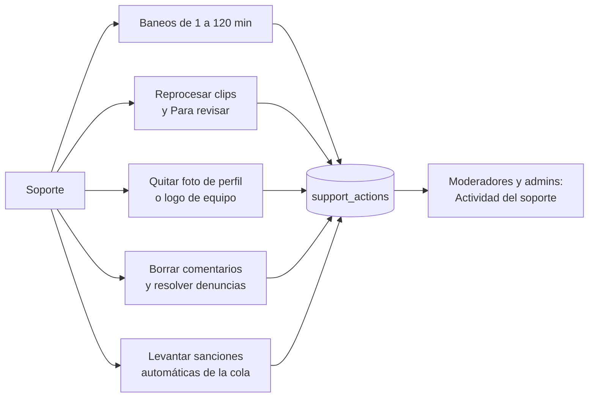
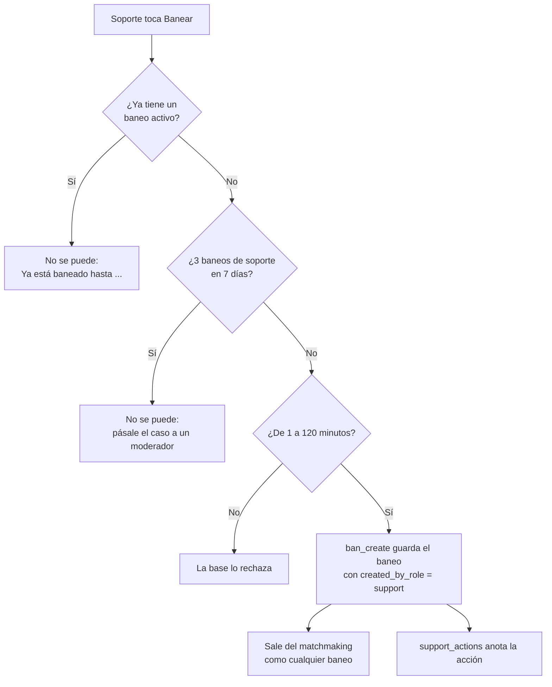

# Rol Soporte: documentación

## Qué hace

Suma un rol de primera línea, **Soporte** (`support` en `profiles.role`), por debajo del moderador. La jerarquía queda `user < support < moderator < admin`: el moderador y el admin pueden todo lo del soporte. El rol lo da un admin desde Administración › Usuarios.

El soporte resuelve lo del día a día sin esperar a un moderador: pone baneos cortos, reprocesa y revisa clips, quita fotos de perfil y logos de equipo, borra comentarios, resuelve denuncias de comentarios y levanta las sanciones automáticas de la cola. Todo lo que hace queda en `support_actions`, y los moderadores y admins lo ven en Baneos › **Actividad del soporte**.

Los límites del soporte los aplica la base, no solo la web: aunque alguien llame a las funciones directo, no se los salta.

## Baneos del soporte

| Regla | Cómo se aplica |
|---|---|
| Duración de 1 a 120 minutos, solo **Minutos** | `ban_create` rechaza más de 121 minutos (uno de margen por el reloj) y recorta a 120. Sin permanente ni fecha |
| No a quien ya está baneado | `ban_active_for` sobre el SteamID de la ficha o el pegado. Sin esta regla, un baneo nuevo reemplazaría a uno largo |
| Hasta 3 baneos de soporte por jugador en 7 días | `ban_support_count`: los `bans` con `created_by_role = 'support'` de esa persona (todos sus SteamID), levantados incluidos. Ventana móvil. Un bloqueo (`pg_advisory_xact_lock`) evita que dos soportes a la vez pasen el límite |
| Solo cambia o levanta los suyos | `ban_update` y `ban_lift` comparan `created_by` con quien llama. Al cambiar, el vencimiento no pasa de `created_at + 120 min` |
| El formulario | `ban_support_quota` (`GET /api/v1/admin/bans/support-quota`) da cuántos le quedan y si ya está baneado: "Le quedan N baneos de soporte de 3 esta semana" |

`bans.created_by_role` guarda el rol de quien lo puso en ese momento, así el límite sigue valiendo aunque después le cambien el rol. Los baneos de antes, los del juego y los importados quedan en `null`.

El soporte banea solo desde Administración › Baneos (no tiene comandos en el servidor ni grupo de SourceMod).

## Clips

- **Reprocesar:** `clip_reprocess` acepta al soporte. El soporte y el moderador mandan hasta 10 por tanda; el admin, hasta 50 (`SUPPORT_REPROCESS_MAX` en la API). `match_clips.video_reprocessed_by` guarda quién lo reprocesó.
- **Para revisar** (Daniel, 2026-11-14, en las pruebas): el soporte y el moderador ven la cola y publican (`clip_review_ok`), reprocesan otra vez y rechazan de a uno (`clip_reject`). El contador del sidebar también les aparece.
- **Solo del admin:** la pestaña Reglas, rechazar varios desde la lista, recuperar rechazados y más de 10 por tanda.

## Fotos y logos

- **Foto de perfil:** `staff_remove_photo(ficha, motivo)` borra `players.photo_url` y `profile_details.avatar_url`, y le avisa al jugador (`avatar_removed`, categoría `account`: "Te quitamos la foto de perfil", con el motivo). La API borra los archivos del bucket con la clave de servicio, porque la política de Storage solo deja borrar al dueño o al admin.
- **Logo:** `team_staff_remove_logo` acepta al soporte, con motivo obligatorio. `team_audit.actor_role` acepta `support`. Al capitán le llega "Alguien de soporte quitó el logo…".

En la web: **Quitar foto** en el perfil del jugador y **Quitar logo** en la página del equipo, los dos con motivo.

## Comentarios y sanciones de la cola

- `profile_comment_delete`, `profile_comment_reports_admin` y `profile_comment_report_resolve` pasan a `is_support()`. El soporte ve la pestaña **Comentarios** de Baneos.
- `mm_admin_lift_penalty` y `mm_admin_lists('penalties')` pasan a `is_support()`. La pestaña **Matchmaking** de Baneos le muestra solo las sanciones de la cola. Las exclusiones (`mm_admin_unban`, `mm_admin_lists('bans')`) y los reportes no cambian.

## El registro: `support_actions`

| Columna | Qué es |
|---|---|
| `actor_id` | Quién lo hizo |
| `action` | `ban`, `ban_update`, `ban_lift`, `clip_reprocess`, `clip_approve`, `clip_reject`, `photo_remove`, `logo_remove`, `comment_delete`, `comment_report` o `penalty_lift` |
| `target` | `jsonb` con el jugador, el equipo, el clip o el comentario |
| `reason` | El motivo, si hay (hasta 300 caracteres) |
| `created_at` | Cuándo |

`support_log()` la escribe desde cada función, solo si quien actúa tiene el rol `support` (lo de moderadores y admins ya queda en cada tabla). Sin políticas de RLS: se lee con `support_actions_list()` (solo `is_moderator()`), paginada, con filtros por soporte, acción y fechas. API: `GET /api/v1/admin/support-actions`.

## Roles y permisos

- `is_support()`: soporte, moderador o admin. `is_moderator()` **no cambia**, porque la usan torneos, equipos, PCW y otras 13 migraciones.
- API: `requireSupport` (soporte, moderador o admin) en las rutas de baneos, clips (lista, reprocesar, Para revisar, publicar y rechazar uno), fotos, logos, comentarios y sanciones de la cola.
- Web (`auth/permissions.ts`): `canSupport`, `isSupportOnly`, `canReviewClips` (soporte, moderador y admin), `canManageClips` (admin) y `canSeeSupportActivity` (moderador y admin). El soporte entra a Administración solo a **Baneos** (su inicio) y **Clips**. Desde este requerimiento, el moderador también entra a **Clips**.
- Manual: la sección `soporte` la ven el soporte, el moderador y el admin, y el soporte abre `/help` en ella.

## Quiénes somos

`staff_public()` suma `supports`. La web junta moderadores y soportes en **Moderación**, ordenados por nick, y cada tarjeta dice **Moderador** o **Soporte**. El contador dice, por ejemplo, "2 moderadores y 1 de soporte". Como desde la `87`, solo aparecen las cuentas con ficha de jugador.

## Qué cambia para cada rol

| Rol | Qué cambia | Página del manual |
|---|---|---|
| Jugador | Un baneo del soporte dura hasta 120 minutos (como mucho 3 en 7 días). Le pueden quitar la foto de perfil, con aviso y motivo. Quiénes somos muestra al soporte en Moderación | `jugador/baneos-y-sanciones.md`, `jugador/quienes-somos.md` |
| Capitán | Le pueden quitar el logo del equipo, con aviso y motivo | `jugador/baneos-y-sanciones.md` |
| Soporte (nuevo) | Todo lo de arriba: baneos cortos, clips, fotos y logos, comentarios y sanciones de la cola | `soporte/banear-jugador.md`, `soporte/clips.md`, `soporte/quitar-fotos-y-logos.md`, `soporte/borrar-comentarios.md`, `soporte/sanciones-matchmaking.md` |
| Moderador | Ve la sección Soporte del manual, entra a Clips (reprocesa hasta 10 y revisa Para revisar), quita fotos y logos, y ve Baneos › Actividad del soporte | `moderador/banear-jugador.md`, `moderador/borrar-comentarios.md`, `moderador/sanciones-matchmaking.md` |
| Admin | El rol Soporte en Usuarios (selector y filtro). Actividad del soporte. El soporte y el moderador también revisan clips | `admin/usuarios-y-fichas.md`, `admin/clips.md` |
| Organizador, streamer, dueño de un servidor externo | Nada | — |

El soporte no tiene comandos en el servidor: `docs/manual/README.md` lo suma a los roles sin comandos.

## Términos y privacidad

- **`/terminos` y `terms/terminos.html`** (sección 7, Moderación y baneos): lo que puede hacer el soporte (baneos de hasta 120 minutos y no más de 3 en 7 días, quitar fotos y logos con aviso, borrar comentarios, levantar sanciones de la cola y revisar clips), y que queda registrado. En comentarios, el soporte también los borra y revisa las denuncias.
- **`/privacidad` y `terms/privacidad.html`:** Quiénes somos publica también el rol Soporte, y la tabla de plazos suma el registro de lo que hace el soporte (sin plazo, como los baneos).

## Dónde está cada cosa

| Qué | Dónde |
|---|---|
| Base | `supabase/replanteo/117_rol_soporte.sql`; inversa en `docs/bitacora/2026-10-14-replanteo-modelo-datos/reversas/117_rol_soporte.sql` |
| Pruebas de la base | `pruebas/probar_117.sh` y `pruebas/probar_117.sql` (con rollback) |
| API | `web/backend/src/lib/auth.ts` (`requireSupport`), `routes/bans.ts`, `routes/clips.ts`, `routes/admin-players.ts`, `routes/admin-teams.ts`, `routes/community.ts`, `routes/mm.ts`, `routes/pcw-play.ts` (rol), `lib/manual.ts`; pruebas en `test/unit/support-routes.test.ts` |
| Web | `auth/permissions.ts`, `auth/roles.ts`, `features/admin/bans/` (`BanDialog`, `BanPanel`, `SupportActivityPanel`, `lib/support.ts`), `features/admin/clips/`, `components/brand/RemoveImageButton.tsx`, `features/staff/` (`moderation.ts`), `features/admin/users/` |
| Manual | `docs/manual/soporte/` y las páginas de la tabla de roles |
| Legales | `web/frontend/src/features/legal/pages/` y `terms/` |
