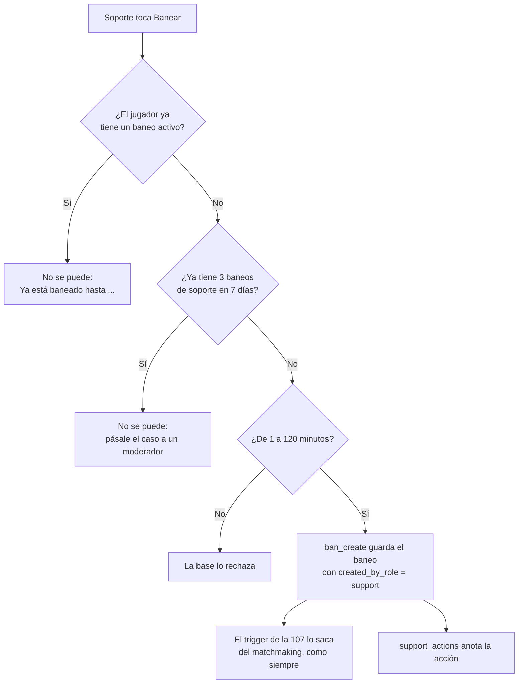
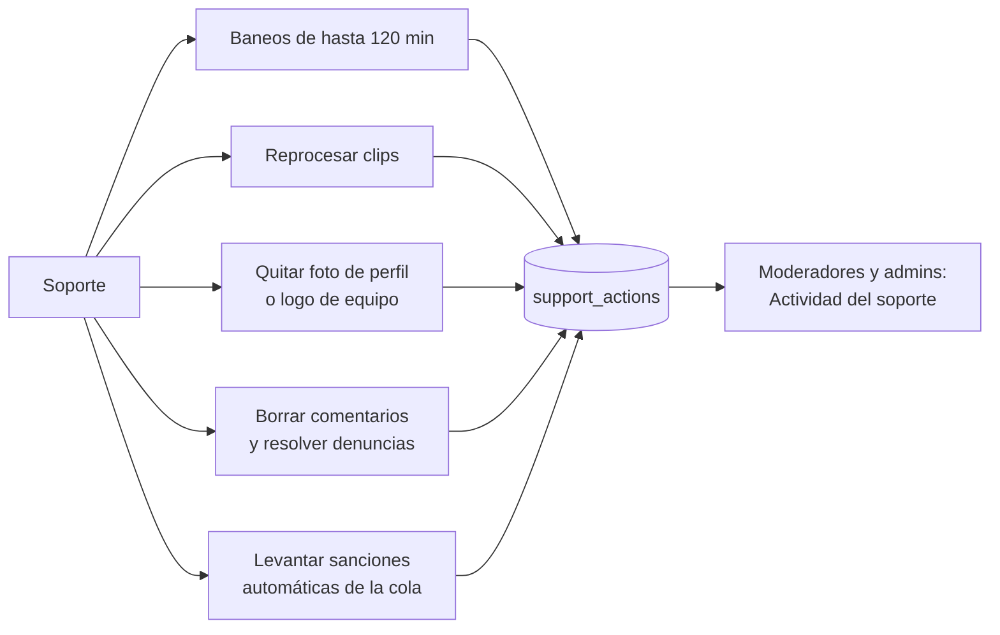

# Plan: rol Soporte

> Planeación original. Estado: **propuesta**, pendiente de aprobación.

Pedido por Daniel (2026-11-13). En Discord se creó un rol "helper" para los pagos del VIP. En la web se suma un rol de primera línea, **Soporte**, por debajo del moderador. Puede poner baneos cortos, reprocesar clips, quitar fotos de perfil y logos de equipo, borrar comentarios y levantar las sanciones automáticas de la cola. Todo lo demás se queda en moderador y admin.

## Decisiones tomadas

| Tema | Decisión | Por qué |
|---|---|---|
| Nombre | **Soporte** en la web; `support` en `profiles.role` | Lo eligió Daniel. Se descartaron "Ayudante", "Árbitro" y "Moderador junior" |
| Lugar en la jerarquía | `user < support < moderator < admin`. Un moderador o un admin puede todo lo del soporte | Con cuatro o cinco roles no hacen falta permisos sueltos por persona |
| `is_moderator()` | **No cambia.** Se crea `is_support()` (soporte, moderador o admin) y se usa solo en las funciones que el soporte puede usar | `is_moderator()` se usa en 13 migraciones (torneos, equipos, PCW…): si incluyera al soporte, le daría todo eso |
| Duración del baneo | De 1 a **120 minutos**. Solo el campo **Minutos**: sin horas, días, fecha ni permanente | Pedido de Daniel |
| Tope en la base | `ban_create` rechaza más de 120 minutos si el rol es `support`, aunque la llamada no venga de la web | Que nadie se lo salte llamando directo a la RPC |
| Jugador ya baneado | El soporte **no puede banear** a quien ya tiene un baneo activo (de quien sea): ve "Ya está baneado hasta …" | Hoy un baneo nuevo reemplaza al activo: sin esta regla, un soporte podría bajar un baneo de un mes a 5 minutos |
| Límite semanal | Máximo **3 baneos de soporte por jugador (por ficha) en los últimos 7 días**, sumando a todos los soportes. Ventana móvil. Los levantados también cuentan. Los de moderadores y admins no cuentan | Que no se encadenen baneos cortos. Si con 3 no alcanza, el caso es de un moderador |
| Cambiar o levantar | El soporte solo cambia o levanta **sus propios** baneos. Al cambiarlo, el vencimiento no puede pasar de 120 minutos desde que **se puso** | Si contara desde ahora, se podría estirar sin fin |
| Baneos en el juego | **Solo en la web.** El soporte no tiene comandos en el servidor ni grupo de SourceMod | Un flag nuevo obligaría a tocar el reporter y la regla de comandos del manual. Se puede sumar después |
| Clips | Solo **Reprocesar**, hasta 10 por tanda (el admin, 50). No aprueba, no rechaza ni recupera | Es de bajo riesgo, pero cada reproceso ocupa el render |
| Fotos y logos | **Quitar** la foto de perfil de un jugador o el logo de un equipo, con motivo. Quedan los de por defecto. Al jugador o al capitán les llega una notificación con el motivo | Reversible (el dueño sube otra) y no borra nada más |
| Comentarios | Borrar comentarios de perfil y resolver sus denuncias (pestaña **Comentarios** de Baneos), como el moderador | Ya lo hace el moderador y queda `deleted_by` |
| Sanciones de la cola | Levantar las **sanciones automáticas** (`mm_admin_lift_penalty`). Las exclusiones del matchmaking (`mm_admin_unban`) siguen siendo del moderador | Es lo más pedido (abandonos por un crash). Una exclusión la decide un moderador |
| Registro | Una tabla `support_actions` con cada acción del soporte (quién, qué, a quién, motivo y cuándo). Los moderadores y admins la ven en Baneos › **Actividad del soporte** | Quitar una foto o reprocesar un clip hoy no dejan registro de quién lo hizo |
| Quiénes somos | Los soportes van en la misma sección que los moderadores, **Moderación**, y cada tarjeta dice "Moderador" o "Soporte" | Pedido de Daniel |
| Notificaciones de Administración | El soporte **no** las recibe en esta versión | Las de torneos y mixes por aprobar no le tocan |
| Pagos del VIP | **Fuera de este requerimiento.** Cuando la tienda llegue a `main`, se suma al soporte | La tienda y el VIP están en `feat/tienda-de-puntos` y `kyan/pruebas`, no en `main` |
| Replanteo | `117_rol_soporte.sql`. El número está libre en todas las ramas y worktrees al 2026-11-13 | La base local es la misma para todos los worktrees |
| Rama | `feat/rol-soporte`, worktree `v34frag-soporte`, desde `main` | Organización de worktrees del 2026-11-13 |

## 1. El flujo completo

## 2. Base de datos (replanteo `117_rol_soporte.sql`)

1. **El rol:** `profiles_role_check` con `support`. `set_user_role` lo acepta (lo sigue dando solo un admin). Se crea `is_support()`, que da verdadero para `support`, `moderator` y `admin`.
2. **`bans.created_by_role`** (`text`, `null` en los del juego y los importados): el rol de quien lo puso desde la web en ese momento. Así, el límite semanal sigue valiendo aunque después le cambien el rol. Los baneos que ya existen quedan en `null`.
3. **`ban_create`:** pasa a `is_support()`. Si quien banea es soporte:
   - `p_expires` es obligatorio y queda entre `now() + 1 min` y `now() + 120 min`.
   - Rechaza si la ficha o el SteamID ya tienen un baneo activo (`ban_active_for` sobre todos sus SteamID).
   - Rechaza si la ficha (o el SteamID sin ficha) ya tiene 3 baneos con `created_by_role = 'support'` y `created_at > now() - interval '7 days'`.
   - Los mensajes son claros, para mostrarlos tal cual en la web.
4. **`ban_update` y `ban_lift`:** pasan a `is_support()`. Un soporte solo cambia o levanta los baneos con `created_by = auth.uid()`, y al cambiarlo, `expires_at <= created_at + 120 min`.
5. **`ban_support_quota(p_player uuid, p_steam text)`:** cuántos baneos de soporte tiene en los últimos 7 días y si tiene un baneo activo. Es para el formulario: "Te quedan 2 de 3 esta semana".
6. **Sanciones de la cola:** `mm_admin_lift_penalty` y `mm_admin_lists('penalties')` pasan a `is_support()`. `mm_admin_unban` y las demás listas no cambian.
7. **Comentarios:** `profile_comment_delete`, `profile_comment_reports_admin` y `profile_comment_report_resolve` pasan a `is_support()`.
8. **Logo de un equipo:** `team_staff_begin` acepta al soporte solo cuando lo llama `team_staff_remove_logo`. Se le suma un parámetro, o se crea `team_support_remove_logo`, según qué quede más simple al implementarlo. `team_audit.actor_role` acepta `support` y `v34.staff_role` lo anota.
9. **Foto de perfil:** `staff_remove_avatar(p_user uuid, p_reason text)` (con `is_support()`) borra `profile_details.avatar_url` y `players.photo_url`, avisa al jugador (`notify`, tipo `avatar_removed`, con el motivo) y devuelve las URLs para que la API borre los archivos del bucket.
10. **Clips:** `match_clips.video_reprocessed_by` (`uuid`). La API la llena al reprocesar.
11. **`support_actions`:** `id`, `actor_id`, `action` (`ban`, `ban_update`, `ban_lift`, `clip_reprocess`, `avatar_remove`, `logo_remove`, `comment_delete`, `comment_report`, `penalty_lift`), `target` (`jsonb`: jugador, equipo, clip o comentario), `reason` y `created_at`. La escriben las mismas funciones cuando el rol es `support`. RLS: la leen solo `is_moderator()`. `support_actions_list(...)` con paginación, filtros (soporte, acción, fechas) y orden.
12. **`staff_public()`:** suma `supports`, con los mismos campos que `moderators`.
13. Antes de aplicar, la migración comprueba que cada función tiene el texto que va a reemplazar (`pg_temp.reemplazar`, como en la 61). Pruebas en `pruebas/probar_117.sql`, con `rollback`.

## 3. API (`web/backend`)

- `lib/auth.ts`: `isSupport()` y `requireSupport` (soporte, moderador o admin). `requireModerator` no cambia.
- `schemas/auth.ts`, `schemas/admin.ts`, `services/account.ts` y `lib/manual.ts`: el rol `support` en los `enum`, en `roleOf` y en las secciones del manual (el soporte ve `jugador` y `soporte`, y abre en `soporte`).
- **Baneos:** las rutas de crear, cambiar, levantar y listar pasan a `requireSupport`. Si el rol es soporte, el cuerpo de crear y de cambiar acepta solo `minutes` (de 1 a 120). La base igual lo vuelve a comprobar. Nueva `GET /api/v1/admin/bans/support-quota`.
- **Clips:** `POST /api/v1/admin/clips/reprocess` y `/{id}/reprocess` pasan a `requireSupport`. Si el rol es soporte, hasta 10 ids. `approve`, `reject` y `restore` siguen con `requireAdmin`. Los dos llenan `video_reprocessed_by` y `support_actions`.
- **Fotos y logos:** `DELETE /api/v1/admin/players/{id}/photo` (nueva) y la de quitar el logo de `admin-teams.ts` pasan a `requireSupport` y borran el archivo del bucket.
- **Comentarios y sanciones de la cola:** las rutas de `community.ts` y las de sanciones del matchmaking pasan a `requireSupport`.
- `GET /api/v1/admin/support-actions` (`requireModerator`): paginada, con filtros y orden en el servidor.
- `GET /api/v1/staff`: devuelve `supports`.
- Pruebas unitarias y de integración para cada ruta: un soporte entra a lo suyo, y a lo demás le da 403.

## 4. Web (`web/frontend`)

- `auth/roles.ts`: `support: "Soporte"`.
- `auth/permissions.ts`:
  - `canSeeAdmin` incluye al soporte.
  - `canAccessAdminSection` le abre `bans` y `clips`, y `homeAdminSection` lo manda a `bans`.
  - Nuevas `canSupport` (banear corto, comentarios, sanciones de la cola, quitar fotos y logos) y `canReprocessClips`. `canModerate` no cambia.
- **Formulario de baneo** (Baneos, el perfil y la sala del matchmaking): para el soporte, solo **Minutos** (de 1 a 120), con el vencimiento debajo y "Te quedan N de 3 esta semana". Si el jugador ya está baneado o no le quedan baneos, el botón queda apagado y se ve el motivo. En el detalle, **Cambiar** y **Levantar** solo aparecen en sus propios baneos.
- **Baneos:** las pestañas **Comentarios** y **Matchmaking** (sanciones de la cola, sin las exclusiones). Para moderadores y admins, una pestaña nueva, **Actividad del soporte**.
- **Clips:** el soporte ve la lista y **Reprocesar** (hasta 10). No ve **Aprobar**, **Rechazar** ni **Recuperar**.
- **Perfil del jugador y página del equipo:** **Quitar foto** y **Quitar logo** en el menú de staff, con motivo.
- **Administración › Usuarios:** **Soporte** en el selector de rol.
- **Quiénes somos (`StaffPage`):** la sección **Moderación** junta `moderators` y `supports`, ordenados por nick. Cada tarjeta dice "Moderador" o "Soporte", y el contador dice "N moderadores y M de soporte" (o el texto que quede mejor).

## 5. Manual, términos y changelog

- Nueva sección `docs/manual/soporte/`, con `banear-jugador.md`, `reprocesar-clips.md`, `quitar-fotos-y-logos.md`, `borrar-comentarios.md` y `sanciones-matchmaking.md`. Lo que es igual que en el moderador se enlaza, no se copia.
- `docs/manual/README.md`: el rol Soporte en la lista de roles (sin comandos en el servidor).
- `moderador/banear-jugador.md`: los baneos de soporte y la pestaña **Actividad del soporte**.
- `admin/usuarios-y-fichas.md`: el rol nuevo. `admin/clips.md`: el soporte también reprocesa.
- `jugador/quienes-somos.md`: Moderación con moderadores y soportes. `jugador/baneos-y-sanciones.md`: un soporte puede banear hasta 120 minutos y quitar la foto con aviso.
- **`/terminos` y `terms/terminos.html`:** donde dice qué pueden hacer los moderadores y los admins (sanciones, comentarios y fotos), sumar al soporte y su límite.
- **`/privacidad` y `terms/privacidad.html`:** se guarda quién de soporte hizo cada acción (`support_actions`), y en Quiénes somos se publica también el rol Soporte.
- `CHANGELOG_DISCORD.txt` con la versión que siga a la del último changelog.

## 6. Ramas del matchmaking

`mm_admin_lift_penalty` y `mm_admin_lists` son del matchmaking. `feat/frontend-fase-1` y `feat/mm-claim-en-sala` siguen en la `105` y no reciben la `115` ni la `116` (Daniel, 2026-11-13). Por eso **tampoco reciben la `117`** hasta que Daniel diga lo contrario. Queda anotado en `docs/PENDIENTES.md`.

## 7. Requisitos antes de empezar

- La aprobación de este plan.
- La base local con la copia de producción (`copia-produccion.sh`), sin borrarla.
- Ninguna credencial nueva. No toca servidores, el Worker ni el render.

## 8. Orden de implementación

1. `117_rol_soporte.sql` y `pruebas/probar_117.sql`, probados en la base local con `rollback`. Después se aplica en local.
2. La API (auth, rutas y esquemas) y sus pruebas. Regenerar `schema.d.ts`.
3. La web (permisos, formulario de baneo, Baneos, Clips, perfil y equipo, Usuarios y Quiénes somos) y sus pruebas.
4. Probar de punta a punta en local con una cuenta de soporte: los tres topes de los baneos, reprocesar, quitar una foto y un logo, borrar un comentario, levantar una sanción y que cada cosa aparezca en Actividad del soporte. También los 403 en lo que no le toca.
5. Manual, términos, privacidad y changelog.
6. `DOCUMENTACION.md`, `GUIA_IMPLEMENTACION.md`, la fila de `docs/bitacora/README.md` y `docs/PENDIENTES.md`.
7. El commit, cuando Daniel lo pida. El despliegue (`probar_117.sql` en producción con `rollback`, la `117`, y la API y la web), con su confirmación.
