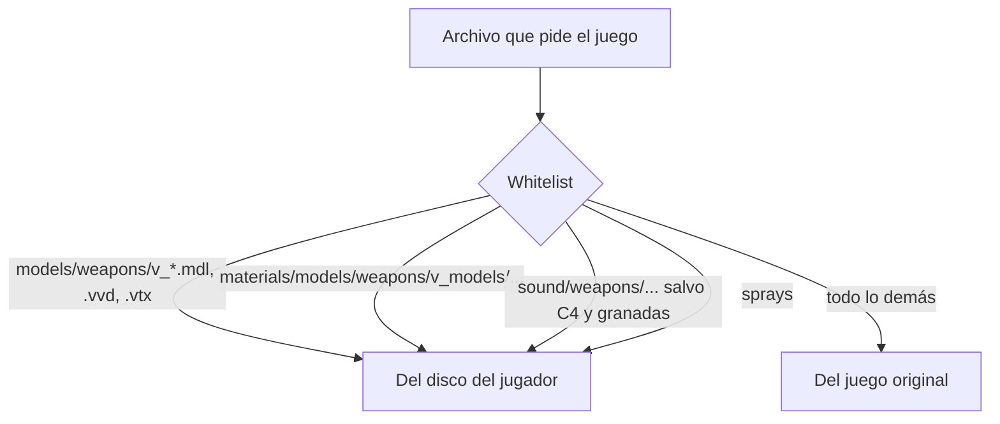

# sv_pure con skins de armas: documentación

## Qué hace

Los servidores pasan de `sv_pure 2` (todo tiene que ser del juego original) a `sv_pure 1` con una lista de excepciones, `pure_server_whitelist.txt`. Esa lista deja que cada jugador use sus propias skins de las armas que ve en primera persona y sus propios sonidos de armas. Todo lo demás lo sigue cargando el juego original: si el jugador tiene otra cosa modificada, el servidor la ignora.

## La whitelist

Está en `server/pure_server_whitelist.txt` y en `cstrike/` de cada servidor (pisa a la del juego, que está en `hl2/`).

| Qué | Entrada | Modo |
|---|---|---|
| Todo | `materials\...`, `models\...`, `sound\...` | `from_steam` (original) |
| Sprays | `materials\temp\...`, `materials\vgui\logos\...` | `allow_from_disk` |
| Texturas de armas en primera persona y manos | `materials\models\weapons\v_models\...` | `allow_from_disk` |
| Modelos de armas en primera persona | `models\weapons\v_<arma>.<ext>`, uno por archivo (29 armas × `mdl`, `vvd`, `dx80.vtx`, `dx90.vtx`, `sw.vtx`, `xbox.vtx`) | `allow_from_disk` |
| Sonidos de armas | `sound\weapons\...` | `allow_from_disk` |
| Sonidos de C4 y granadas | `sound\weapons\c4\...`, `hegrenade`, `flashbang`, `smokegrenade` y `pinpull.wav` | `from_steam` |

- La whitelist no admite comodines por prefijo (`v_*`): por eso cada modelo va por archivo.
- Una entrada más específica pisa a una más general (`sound\weapons\c4\...` gana sobre `sound\weapons\...`).
- No tiene `check_crc`: cada jugador tiene skins distintas y el servidor no las tiene.
- Si aparece un arma nueva con otro nombre de modelo `v_`, hay que sumarla a la lista.

## Qué cambia para cada rol

| Rol | Qué cambia | Página del manual |
|---|---|---|
| Jugador | Puede usar skins de armas en primera persona y sonidos de armas | [`jugador/skins-de-armas.md`](../../manual/jugador/skins-de-armas.md) (nueva) |
| Dueño de un servidor externo | La configuración obligatoria pasa a `sv_pure 1` con la misma whitelist | [`servidor-externo/configuracion-obligatoria.md`](../../manual/servidor-externo/configuracion-obligatoria.md) |
| Capitán, organizador, moderador, admin, streamer | Nada | — |

## Términos y privacidad

`/terminos`, "Juego limpio": se suma que la única excepción a "texturas modificadas" son las skins de armas en primera persona y los sonidos de armas (salvo C4 y granadas). Actualizados `TermsPage.tsx` y `terms/terminos.html`. Privacidad: sin cambios.

## Dónde está cada cosa

| Qué | Archivo / ubicación |
|---|---|
| Whitelist | `server/pure_server_whitelist.txt` y `cstrike/pure_server_whitelist.txt` de #1, #2 y #3 |
| `sv_pure 1` | `cfg/server.cfg`, `cfg/autoexec.cfg` y (#1) `cfg/game.cfg` de cada servidor |
| Respaldos | `cfg/*.cfg.bak_pure` en cada servidor |
| Manual | `docs/manual/jugador/skins-de-armas.md` |
| Changelog | `CHANGELOG_DISCORD.txt` |
