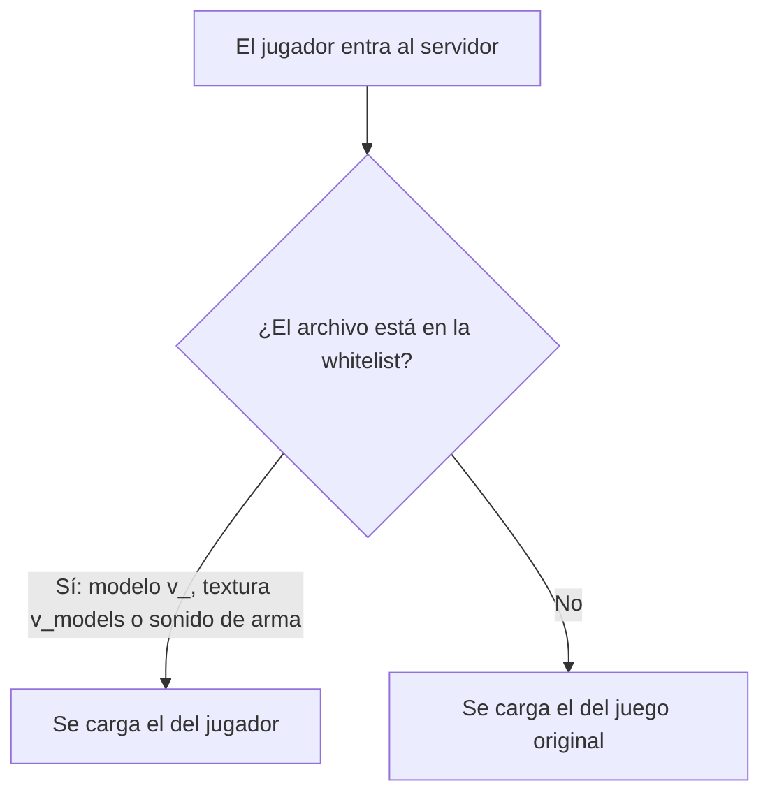

# Plan: sv_pure con skins de armas

> Planeación original. Estado: **aprobado por Kyan** el 2026-11-13.

## Decisiones tomadas

| Tema | Decisión | Por qué |
|---|---|---|
| Qué se permite | Solo las armas en primera persona (modelos `v_`, sus texturas y las manos) y los sonidos de las armas | Pedido por Kyan: ni modelos de jugadores ni texturas del mapa |
| Modo | `sv_pure 1` con `pure_server_whitelist.txt` | Con `sv_pure 2` el juego ignora la whitelist y exige todo original |
| Sonidos bloqueados | C4, HE, flash, smoke y el seguro de las granadas | Un sonido de granada o de C4 más fuerte da ventaja |
| Armas `w_` | Bloqueadas | Son las que se ven en el piso y en otros jugadores: una más visible da ventaja |
| Sprays | Siguen permitidos | Ya lo estaban con la whitelist por defecto del juego |
| Prueba | Sin prueba en el servidor local | Kyan: es solo configuración |

## 1. El flujo completo

## 2. Cambios en los servidores (#1, #2 y #3)

- `cstrike/pure_server_whitelist.txt` nuevo (copia de `server/pure_server_whitelist.txt`).
- `sv_pure 2` → `sv_pure 1` en `cfg/server.cfg`, `cfg/autoexec.cfg` y, en el #1, `cfg/game.cfg`.

## 3. Requisitos antes de empezar

API del panel de MVZG (`SFTP_CSS_API_KEY`).

## 4. Orden de implementación

1. Armar la whitelist en el repo.
2. Subirla y cambiar `sv_pure` en los tres, con respaldo.
3. Manual, términos y configuración obligatoria.
