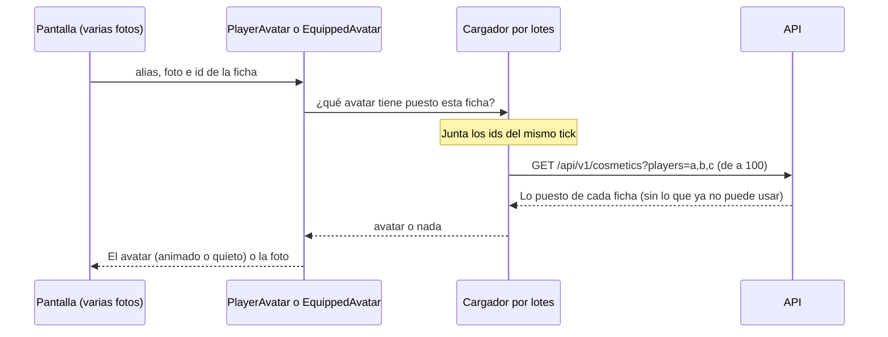

# El avatar puesto reemplaza la foto en toda la web: documentación

## Qué hace

Si un jugador tiene puesto un avatar (uno de la Tienda o uno propio subido), ese avatar se ve **en lugar de su foto en toda la web**: su ficha, el ranking, Quiénes somos, los equipos, los torneos, las PCW, los comentarios, las visitas al perfil, el buscador, Comparar, la sala de la partida (lista, encabezado, MVP y destacados), el feed de Jugar, la portada, el menú de la cuenta y el widget para OBS. Si se lo saca, vuelve la foto.

La excepción es **Mi perfil › Perfil**: ahí sigue la foto normal (la que se cambia en esa pantalla), con un aviso: «Tienes puesto un avatar de la Tienda: se ve en vez de esta foto en toda la web» y un enlace a la Tienda.

Donde la foto mide 48 px o más, el avatar se ve animado; en las fotos chicas de las filas se ve quieto (su imagen fija) y se anima al pasar el mouse.

## Reglas

| Tema | Regla |
|---|---|
| Qué se muestra | El `avatar` de `player_cosmetics_public`: el de la Tienda o el propio, sin lo que la cuenta ya no puede usar (VIP vencido, artículo quitado) |
| Animado | Desde 48 px de ancho (`ANIMATED_FROM`, medido en la pantalla). El menú de la cuenta, el MVP de la sala y el widget, siempre animados |
| Sin avatar o sin id | La foto de siempre, o la inicial |
| Mientras carga o si falla | La foto de siempre; no se reintenta |
| Caché | 1 minuto por ficha. Comprar, equipar, subir o borrar en la Tienda invalida `["shop"]`, que incluye los avatares: el cambio propio se ve al instante; el de otros, al recargar o al vencer la caché |
| El marco | No: solo el avatar (el marco sigue en la ficha y las tarjetas, como antes) |

## Web

| Pieza | Qué es |
|---|---|
| `features/shop/avatars.ts` | El cargador por lotes (`loadPlayerAvatar`, de a 100) y `usePlayerAvatar(id)`, con la clave `["shop", "avatar", id]` |
| `components/brand/PlayerAvatar.tsx` | `playerId` opcional: con avatar puesto dibuja `AvatarMedia` (animado o quieto según el ancho); si no, la foto |
| `features/shop/cosmetics.tsx` › `EquippedAvatar` | Para los `<Avatar>` que no usan `PlayerAvatar` (sala, destacados, feed, menú de la cuenta, widget): el avatar con el redondeo del contenedor, o la foto |
| `components/brand/initial.ts` | `initialOf`, aparte, para que `PlayerAvatar` y `cosmetics.tsx` no se importen en círculo |
| Mi perfil (`ProfileSection.tsx`) | El aviso con el enlace a la Tienda |
| El feed de Jugar (`source.ts`, `types.ts`) | `player_id` en los mejores de la temporada (ya venía del ranking) |
| Los destacados de un mix (`MixHighlights.tsx`) | El id de la ficha junto a la foto |

Sin cambios en la API ni en la base: se usa `GET /api/v1/cosmetics?players=`, que ya existía y es pública.

## Qué cambia para cada rol

| Rol | Qué cambia | Página del manual |
|---|---|---|
| Jugador | Su avatar puesto se ve en lugar de su foto en toda la web; en Mi perfil, la foto con un aviso | [`jugador/tienda-y-cosmeticos.md`](../../manual/jugador/tienda-y-cosmeticos.md) |
| Streamer | El widget para OBS muestra el avatar puesto | [`jugador/tienda-y-cosmeticos.md`](../../manual/jugador/tienda-y-cosmeticos.md) |
| Capitán, organizador, moderador, admin y dueño de un servidor externo | Nada distinto de lo del jugador | — |

## Términos y privacidad

- **Privacidad:** el avatar puesto se ve en público en lugar de la foto en toda la web, y el fondo de miniperfil en el lobby de Jugar (antes decía «en tu perfil, en el lobby de Jugar y en las listas»). En la página y en `terms/privacidad.html`.
- **Términos:** sin cambios.

## Dónde está cada cosa

| Qué | Archivo |
|---|---|
| Cargador y hook | `web/frontend/src/features/shop/avatars.ts` (y `avatars.test.tsx`) |
| La foto común | `web/frontend/src/components/brand/PlayerAvatar.tsx` |
| Dentro de otros `<Avatar>` | `web/frontend/src/features/shop/cosmetics.tsx` (`EquippedAvatar`) |
| Pruebas con React Query | `web/frontend/src/test/render.tsx` (`withQuery`) |
