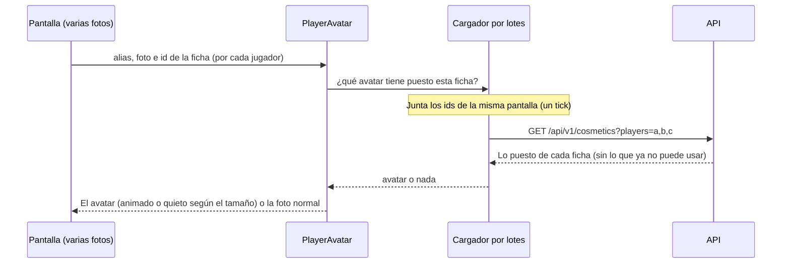

# Plan: el avatar puesto reemplaza la foto en toda la web

> Planeación original. Estado: **propuesta**, pendiente de aprobación.

Pedido por Daniel el 2026-11-14, al probar la tienda en local: en Quiénes somos sigue saliendo la foto normal y no el avatar que subió. Hoy el avatar puesto (uno de la Tienda o uno propio subido) reemplaza la foto solo en la ficha pública, el ranking, la sala de la partida, la tarjeta del grupo en Jugar y la Tienda ([`2026-11-12-avatares-animados`](../2026-11-12-avatares-animados/) y [`2026-11-14-inventario-de-lo-propio`](../2026-11-14-inventario-de-lo-propio/)). En el resto de la web se ve la foto normal.

Daniel quiere que el avatar puesto se vea **en todos los lugares donde se muestra la foto de perfil**, y que al sacárselo vuelva la foto normal. Sale en la misma tanda que la tienda (`119`), que todavía no se desplegó.

## Decisiones tomadas

| Tema | Decisión | Por qué |
|---|---|---|
| Dónde | En todas las fotos de jugadores de la web, salvo Mi perfil › Perfil (Daniel) | Es el pedido |
| Mi perfil › Perfil | Sigue la foto normal (la que se cambia ahí), con un aviso: «Tienes puesto un avatar de la Tienda: se ve en vez de esta foto», y un enlace a la Tienda para sacárselo (Daniel, 2026-11-14) | Ahí se edita la foto; sin el aviso, parece que no cambió nada |
| Animado o quieto | Animado en las fotos de 48 px o más (ficha, Quiénes somos, tarjetas, sala, el menú de la cuenta). En las fotos chicas de las filas (ranking, buscador, visitas, comentarios, plantillas), quieto y se anima al pasar el mouse, como hoy en el ranking (Daniel, 2026-11-14) | Muchos videos a la vez ponen lentas las listas largas |
| Widget para OBS | También muestra el avatar puesto, animado; la opción de apagar la foto sigue igual (Daniel, 2026-11-14) | Es otro lugar donde está la foto |
| Cómo | En la web, en el componente común de la foto (`PlayerAvatar`): recibe el id de la ficha y busca lo que tiene puesto con la ruta que ya existe, `GET /api/v1/cosmetics?players=` (hasta 100 fichas). Los pedidos de una misma pantalla se juntan en uno solo y quedan en caché | Cambiar cada consulta de la base y cada respuesta de la API que trae `photo_url` son decenas de funciones y rutas; la ruta por lotes ya filtra lo que la cuenta no puede usar (VIP vencido, artículo quitado) |
| El marco | **No** en este requerimiento: solo el avatar | Daniel pidió el avatar; el marco en las filas ya se decidió sacar (queda recargado) |
| Al equiparse o sacárselo | Se invalida la caché de la propia ficha: el cambio se ve al instante en la web propia; en la de los demás, al recargar o cuando venza la caché (1 minuto) | No hace falta tiempo real para esto |

## 1. El flujo completo

## 2. Web (`web/frontend`)

- **Cargador por lotes** (`features/shop/avatars.ts`): junta los ids pedidos en el mismo tick, pide de a 100 a `/api/v1/cosmetics?players=` y guarda cada ficha en la caché de React Query (`["player-avatar", id]`, 1 minuto). Las fichas sin nada puesto quedan como «sin avatar» para no volver a pedirlas.
- **`PlayerAvatar`** (`components/brand/PlayerAvatar.tsx`): un `playerId` opcional. Con él, si la ficha tiene un avatar puesto, dibuja `AvatarMedia` (animado) si mide 48 px o más, o `AvatarThumb` (quieto, se anima al pasar el mouse) si es más chico; si no, la foto de siempre. Mientras carga, la foto de siempre.
- **Cada lugar pasa el id de la ficha.** Los que usan `PlayerAvatar` (unos 30: Quiénes somos, equipos, torneos, PCW, comentarios, visitas, buscador, Comparar, fichas del admin…) y los que dibujan la foto por su cuenta (encabezado y estadísticas de la sala, destacados, el feed de Jugar, el widget), que pasan a usar `PlayerAvatar` o la misma lógica. Donde la respuesta de la API no trae el id de la ficha, se agrega (se lista al implementar).
- **El menú de la cuenta** (abajo en la barra lateral): el avatar propio, animado.
- **Mi perfil › Perfil:** la foto normal y el aviso con el enlace a la Tienda.
- **Al equiparse, sacárselo, subir o borrar** (Tienda): se invalida `["player-avatar", <mi ficha>]`.
- **Widget para OBS:** pide su ficha a la misma ruta y muestra el avatar animado dentro del anillo.

Pruebas: el cargador (junta los pedidos, de a 100, guarda los vacíos), `PlayerAvatar` (avatar animado o quieto según el tamaño, la foto sin avatar, sin id como hoy) y el aviso de Mi perfil.

## 3. API y base

Sin cambios previstos: la ruta por lotes ya existe y es pública (`GET /api/v1/cosmetics`). Solo se agrega el id de la ficha en las respuestas que no lo traen, si aparece alguna al implementar.

## 4. Manual, términos y privacidad

- **Manual:** `jugador/tienda-y-cosmeticos.md` (el avatar se ve en toda la web en lugar de la foto, salvo en Mi perfil, donde sigue la foto con un aviso) y la página de Mi perfil del jugador si nombra la foto.
- **Privacidad:** el avatar puesto ya figura como público; se revisa que diga «en lugar de tu foto, en toda la web».
- **Términos:** sin cambios previstos.
- **Changelog:** el de la tienda (2.9.46), una línea.

## 5. Requisitos antes de empezar

- Ninguno. La API y la web locales de `v34frag-mainwt` (rama `feat/tienda-de-puntos`, con `origin/main` mezclado; falta el commit del merge).

## 6. Orden de implementación

1. Terminar el merge de `origin/main` (tipos de la web, typecheck, lint y pruebas) y su commit.
2. El cargador, `PlayerAvatar` y sus pruebas.
3. Pasar el id de la ficha en cada lugar; la sala, los destacados, el feed, el menú de la cuenta, Mi perfil y el widget.
4. Recorrerlo en el navegador con una cuenta con avatar puesto (propio y de la Tienda) y sacárselo.
5. Manual, privacidad, changelog, `DOCUMENTACION.md`, `GUIA_IMPLEMENTACION.md`, la fila del índice y `docs/PENDIENTES.md`.
6. Sale con la tienda: mismo despliegue, cuando Daniel lo pida.
