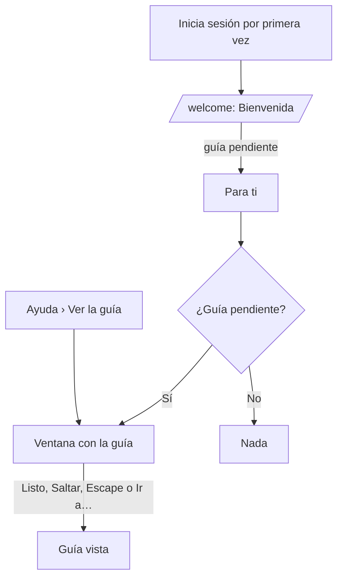

# Guía de la web la primera vez: documentación

## Qué hace

Cuando alguien se registra y entra por primera vez, después de la Bienvenida (`/welcome`, donde completa foto, estilo, contactos y vinculación) llega a **Para ti** y se abre sola una ventana emergente con una guía corta en pasos. **Lo principal (Kyan) es que pueda jugar:** la guía explica qué es **ClientMod**, le pregunta si lo tiene instalado (si no, le muestra cómo y el botón de descarga) y si tiene la **consola** activada (si no, cómo activarla). Después recorre la web: Jugar, la vinculación del SteamID, Partidas y ranking, equipos y torneos, y Ayuda, con un botón para ir a cada sección y otro para leer la página del manual.

Se muestra **una sola vez** por cuenta en ese navegador. Se puede saltar en cualquier momento y volver a abrir desde **Ayuda › Ver la guía**.

## Cuándo se abre sola

La señal de "primera vez" es la Bienvenida: al entrar a `/welcome` la guía queda **pendiente** (`csstv.guide.<userId> = pending` en `localStorage`). La web (`_app`) la abre si está pendiente y, al cerrarla de cualquier forma, la marca **vista** (`seen`).

| Caso | ¿Se abre sola? |
|---|---|
| Cuenta nueva que pasa por la Bienvenida | Sí, una vez |
| Cuenta vieja que ya había visto la Bienvenida | No |
| La misma cuenta en otro navegador | Solo si vuelve a pasar por la Bienvenida (igual que la Bienvenida) |
| Ya la vio y vuelve a entrar a `/welcome` | No |
| Navegador sin `localStorage` | No (se puede abrir desde Ayuda) |

Es provisorio, igual que la marca de la Bienvenida: cuando `/auth/me` traiga el progreso del onboarding, puede pasar a la base.

## Los pasos

| # | Paso | "Ir a" | Manual |
|---|---|---|---|
| 1 | Bienvenido a CM League | — | — |
| 2 | **ClientMod**: qué es y "¿Ya tienes ClientMod instalado?" | — (con "No": pasos y **Descargar ClientMod**, en otra pestaña) | `jugador/instalar-clientmod` |
| 3 | **La consola**: "¿Tienes la consola activada?" | — (con "No": cómo activarla) | `jugador/instalar-clientmod` |
| 4 | Busca partida | `/play` | `jugador/buscar-partida` |
| 5 | Vincula tu SteamID (`!claim`) | `/profile/link` | `jugador/vincular-steamid` |
| 6 | Partidas y ranking | `/matches` | `jugador/elo-y-estadisticas` |
| 7 | Equipos y torneos | `/myteam` | `jugador/equipo` |
| 8 | Administración (solo organizador, moderador y admin) | Su primera sección de Administración | — |
| Último | ¿Dudas? Ayuda | `/help` | — |

Las respuestas a las preguntas no se guardan ni bloquean: sirven para mostrar la ayuda en el momento. El link de descarga está en `CLIENTMOD.downloadUrl` de `src/config/site.ts`.

Se navega con **Empezar/Siguiente**, **Anterior**, los puntos de abajo o las flechas del teclado. **Ir a…** y **Leer en la ayuda** cierran la guía y llevan a esa página.

## Idiomas

La guía está en **español, portugués de Brasil e inglés** (Kyan). Arriba a la derecha de la ventana hay un selector `ES` · `PT` · `EN`. El idioma elegido se recuerda en el navegador (`csstv.guide-lang`). Si nunca eligió, se usa el del navegador (`pt` o `en`), y si no es ninguno de esos, español.

- Solo la guía cambia de idioma: el resto de la web y el manual siguen en español. Por eso, en portugués e inglés, "Leer en la ayuda" avisa "(em espanhol)" / "(in Spanish)", y los nombres de las secciones del menú se dejan en español con la traducción entre paréntesis.
- Los textos están en `src/features/onboarding/lib/guideText.ts`. Un paso nuevo necesita su texto en los tres idiomas (lo controla una prueba).

## Qué cambia para cada rol

| Rol | Qué cambia | Página del manual |
|---|---|---|
| Jugador | La guía al entrar la primera vez y el botón **Ver la guía** en Ayuda | [`jugador/crear-cuenta.md`](../../manual/jugador/crear-cuenta.md) y la página nueva [`jugador/instalar-clientmod.md`](../../manual/jugador/instalar-clientmod.md) |
| Organizador, moderador y admin | Lo mismo, con un paso más que nombra Administración | [`jugador/crear-cuenta.md`](../../manual/jugador/crear-cuenta.md) |
| Capitán, streamer y dueño de un servidor externo | Nada distinto del jugador | — |

## Términos y privacidad

Sin cambios: el link de descarga lleva a la página de ClientMod, que ya figura en los términos como servicio externo. La marca de "guía vista" se guarda solo en el navegador, no en la base, y no se manda a ningún servicio.

## Dónde está cada cosa

| Qué | Archivo |
|---|---|
| Pasos y marcas | `web/frontend/src/features/onboarding/lib/guide.ts` |
| La ventana | `web/frontend/src/features/onboarding/components/GuideDialog.tsx` |
| Apertura automática y "Ver la guía" | `web/frontend/src/features/onboarding/components/FirstVisitGuide.tsx` |
| Montaje en la web | `web/frontend/src/routes/_app.tsx` |
| Marca "pendiente" | `web/frontend/src/features/onboarding/pages/WelcomeFlow.tsx` |
| Botón en Ayuda | `web/frontend/src/features/help/pages/HelpIndex.tsx` y `src/routes/_app/help.index.tsx` |
| Textos en los tres idiomas y selector | `web/frontend/src/features/onboarding/lib/guideText.ts` |
| Prototipo | `web/frontend/src/routes/demo.guia.tsx` (`/demo/guia`, solo en `pnpm dev`) |
