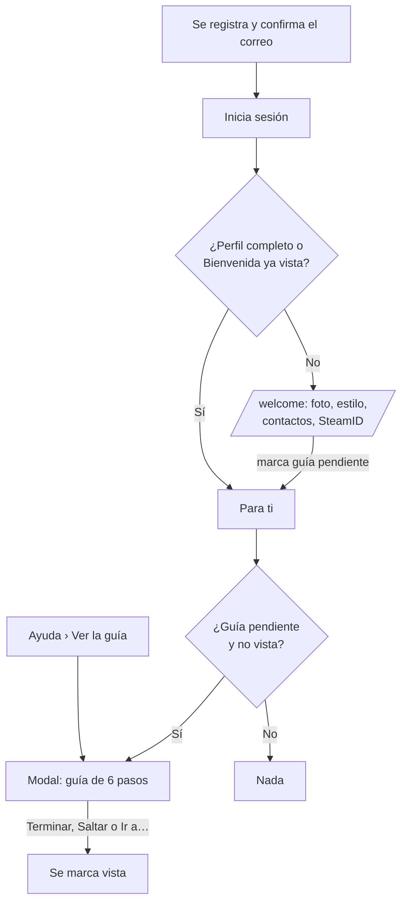

# Plan: guía de la web la primera vez que se entra

> Planeación original. Estado: **propuesta**, pedida por Kyan el 2026-11-14.

## Decisiones tomadas

| Tema | Decisión | Por qué |
|---|---|---|
| Qué es | Una ventana emergente (modal) con pasos, que explica las partes de la web: Jugar, Partidas, Ranking, Equipos y torneos, tu perfil y Ayuda | Lo pidió Kyan: una guía de usuario para el que recién se registra |
| Relación con la Bienvenida | La Bienvenida (`/welcome`, foto, estilo, contactos y SteamID) **no cambia**. La guía aparece después, ya adentro de la web | La Bienvenida arma el perfil; la guía explica dónde está cada cosa. Son cosas distintas y la Bienvenida ya está probada |
| Quién la ve | La cuenta que pasó por la Bienvenida en ese navegador y todavía no vio la guía | La Bienvenida se muestra solo a cuentas nuevas (o sin perfil completo) y se marca vista al entrar: es la señal de "primera vez" sin tocar la base. Las cuentas viejas no la ven de golpe |
| Dónde se guarda que ya se vio | `localStorage`, por cuenta (`csstv.guide.<userId>`), igual que la Bienvenida | Mismo criterio provisorio que `csstv.welcome-seen.*`. Sin base, sin API y sin replanteo |
| Volver a verla | Botón **Ver la guía** en Ayuda (`/help`) | Si la cerró sin leer, que la pueda abrir de nuevo |
| Pasos | 6 pasos, con ícono, texto corto, un botón "Ir" a la sección y un link a la página del manual | Corto: se puede saltar en cualquier momento ("Saltar guía") |
| Roles | La misma guía para todos; si la cuenta tiene una sección de Administración, un paso más que la nombra | El que se registra es jugador; el staff ya conoce la web |
| Prototipo | Ruta `/demo/guia` (solo en `pnpm dev`) que abre la guía sin sesión | Para que Kyan la vea sin crear una cuenta |

## 1. El flujo completo

## 2. La web

- `features/onboarding/lib/guide.ts`: los pasos (título, texto, ícono, ruta, página del manual) y las marcas en `localStorage` (`pendiente` al entrar a la Bienvenida, `vista` al cerrarla).
- `features/onboarding/components/GuideDialog.tsx`: el modal, con el estilo de la web (`Dialog` de shadcn, tarjetas `rounded-xl`), puntos de progreso, "Anterior", "Siguiente", "Saltar guía" y, en cada paso, "Ir a …" y "Leer en la ayuda".
- `routes/_app.tsx`: monta `GuideDialog` cuando la guía está pendiente y no vista.
- `WelcomeFlow.tsx`: al marcar la Bienvenida vista, marca también la guía como pendiente.
- `HelpIndex`: botón "Ver la guía".
- `routes/demo.guia.tsx`: el prototipo.
- Pruebas con Vitest de `guide.ts` y del modal.

## 3. Manual, términos y privacidad

- Manual: `jugador/crear-cuenta.md` (qué pasa al entrar la primera vez) y `jugador/para-ti.md` o la página de Ayuda, nombrando "Ver la guía".
- Términos y privacidad: sin cambios (no se guarda nada nuevo fuera del navegador).

## 4. Requisitos antes de empezar

Ninguno: es solo la web, sin base ni API.

## 5. Orden de implementación

1. `guide.ts` con sus pruebas.
2. `GuideDialog` y el prototipo `/demo/guia`.
3. Montarlo en `_app`, la marca en la Bienvenida y el botón en Ayuda.
4. Probar en el navegador (demo y flujo real en local si hay base).
5. Manual, `DOCUMENTACION.md`, `GUIA_IMPLEMENTACION.md`, changelog y fila en el README.
