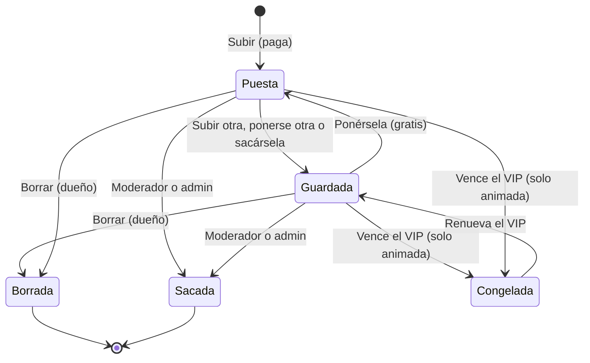

# Lo que sube cada jugador queda guardado, y el encuadre del fondo de miniperfil: documentación

## Qué hace

Cada avatar o fondo de miniperfil que un jugador sube en la Tienda queda **guardado en su cuenta**, también cuando sube otro. Para volver a uno que ya subió, se lo pone desde el mismo recuadro, **sin pagar otra vez**. Se sigue pagando una vez por subida.

Cada cuenta guarda hasta **5 avatares y 5 fondos de miniperfil** (los fijos y los animados juntos). Con el tope lleno no se puede subir otro hasta borrar uno; la base y la API lo rechazan antes de cobrar y antes de convertir el archivo.

El fondo pasa a llamarse **fondo de miniperfil** en toda la web, el manual y los legales, y se encuadra con la forma de la tarjeta del grupo en Jugar en la computadora: **vertical, 1:2** (antes era 11:4, apaisado, y no coincidía con lo que se ve). Las vistas previas de la Tienda muestran esa misma tarjeta.

Es parte de la tienda (replanteo `113`), que todavía no salió: [`2026-11-11-tienda-de-puntos`](../2026-11-11-tienda-de-puntos/) y [`2026-11-13-avatar-y-fondo-propios`](../2026-11-13-avatar-y-fondo-propios/).

## Reglas

| Tema | Regla |
|---|---|
| Pagar | Una vez por subida. Ponerse una guardada, sacársela o cambiar entre ellas no cuesta |
| Subir otra | La nueva se pone sola; las anteriores siguen guardadas, con su archivo |
| Tope | `points_config.custom_max_avatar` y `custom_max_background` (5 y 5, de 1 a 50). Con el tope lleno: «Llegaste a 5 avatares guardados: borra uno para subir otro», sin cobrar. Bajar el tope no borra nada |
| Borrar | De a una, puesta o no. Se borra el archivo; lo pagado no se devuelve |
| Denuncias | De la imagen puesta. Un moderador o un admin puede sacarla aunque el jugador ya se haya puesto otra, mientras siga guardada |
| Sacar (moderador o admin) | Solo esa subida: se borra el archivo, se cierran sus denuncias y se avisa (`custom_removed`). Las demás guardadas siguen |
| VIP vencido | Lo animado guardado no se ve ni se puede poner («Vuelve siendo VIP»); vuelve al renovar. Lo fijo sigue |
| Encuadre del fondo | 1:2 vertical. El fijo se recorta en la web a 480×960 (la API acepta de 240×480 a 960×1920); el animado se recorta en el servidor y se escala a 256×512 |

### Por qué 1:2

La tarjeta del grupo en Jugar ocupa una columna por lugar (5 en 5v5) y mide 260 px de alto como mínimo, y crece con la columna de la derecha. Calculada desde el diseño (barra lateral abierta, `max-w-[1320px]`, columna de 21rem): unos 108×260 a 1280 px de ancho, 140×260 a 1440 y 180×260 a 1920. Queda entre 1:1,45 y 1:2,4; 1:2 es el medio. En el celular la tarjeta propia es apaisada y las demás cuadradas: ahí se ve el centro de la imagen (`object-cover`), igual que con los fondos de la tienda, que son cuadrados.

## Base de datos (dentro de la `113`)

| Objeto | Cambio |
|---|---|
| `points_config` | `custom_max_avatar` y `custom_max_background` (5 y 5) |
| `custom_cosmetics` | Una fila por subida. Sin `cleared_at`: guardada. `cleared_reason` queda en `deleted` o `removed` (se fue `replaced`). Índice `custom_cosmetics_guardadas` en lugar del único por tipo |
| `user_cosmetics.avatar_custom`, `background_custom` | De `boolean` a `uuid` de la subida puesta, con clave foránea a `custom_cosmetics` |
| `custom_cosmetic_json(id)` | Una subida como la dibuja la web (antes recibía cuenta y tipo) |
| `set_my_cosmetics` | `custom:<id>` en `avatar` y `background`: revisa que sea de la cuenta, del tipo, guardada y, si es animada, que la cuenta sea VIP |
| `custom_cosmetic_set` | Revisa el tope antes de cobrar; ya no cierra la anterior. Devuelve el `id` de la subida |
| `custom_cosmetic_delete(id)`, `admin_custom_clear(cuenta, id, motivo)`, `custom_cosmetic_clear(id, …)` | De a una subida, por su id |
| `profile_media_report_resolve` | Saca la subida de la imagen denunciada, no «la vigente del tipo» |
| `points_history` | «Fondo de miniperfil propio» y «Fondo de miniperfil animado propio» |

## API

| Ruta | Qué cambia |
|---|---|
| `GET /api/v1/me/custom` | `avatar` y `background` son listas de subidas, con `id`, `equipped` y `visible`; suma `max` |
| `POST /api/v1/me/custom/{kind}` | No borra nada; revisa el tope antes de convertir; devuelve el `id` nuevo |
| `DELETE /api/v1/me/custom/items/{cid}` | Reemplaza a `DELETE /me/custom/{kind}` |
| `PUT /api/v1/me/cosmetics` y `GET` | `custom:<id>` en lugar de `custom` |
| `GET /api/v1/admin/users/{id}/custom` | Las listas |
| `POST /api/v1/admin/users/{id}/custom/items/{cid}/clear` | Reemplaza a `…/custom/{kind}/clear` |
| `GET /api/v1/shop/config`, `GET` y `PUT /api/v1/admin/points/config` | `custom_max_avatar` y `custom_max_background` |

Contrato: [`docs/frontend/contrato/tienda.md`](../../frontend/contrato/tienda.md).

## Web

| Pantalla | Qué tiene |
|---|---|
| Tienda › Avatares y Fondos de miniperfil | Recuadro **Tus avatares animados** / **Tus fondos de miniperfil** con el contador («3 de 5»), la galería de lo subido (la puesta dice **Puesto**), **Ponérmelo**, **Sacármelo** y borrar en cada una. Con el tope lleno, los botones de subir se apagan y se explica por qué. El encuadre del fondo es 1:2 |
| Vistas previas de la Tienda (arriba, la ventana del artículo y la miniatura de los fondos del catálogo) | `MiniCard` es ahora la tarjeta vertical del grupo de Jugar |
| Administración › Tienda › Gestionar | Todo lo que subió la cuenta, con **Sacar** en cada una. Los topes, en **Puntos y monedas VIP** |
| En toda la web | «Fondo de miniperfil» en la pestaña, los recuadros, la denuncia, el aviso `custom_removed` y la configuración |

## Qué cambia para cada rol

| Rol | Qué cambia | Página del manual |
|---|---|---|
| Jugador | Lo que sube queda guardado (hasta 5 y 5) y vuelve a uno sin pagar; el fondo de miniperfil se encuadra vertical | [`jugador/tienda-y-cosmeticos.md`](../../manual/jugador/tienda-y-cosmeticos.md) |
| Moderador | Sacar una imagen denunciada saca solo esa; se puede sacar aunque el jugador se haya puesto otra | [`moderador/revisar-imagenes.md`](../../manual/moderador/revisar-imagenes.md) |
| Admin | Gestionar muestra todo lo guardado; los topes en la configuración | [`admin/tienda-y-puntos.md`](../../manual/admin/tienda-y-puntos.md) |
| Capitán, organizador, streamer y dueño de un servidor externo | Nada distinto de lo del jugador | — |

## Términos y privacidad

- **Términos (sección 13):** lo que se sube queda guardado (hasta 5 y 5, el número lo puede cambiar un admin) hasta que se borra; ponerse uno guardado no cuesta; lo animado con el VIP vencido no se puede poner; una denuncia saca solo esa imagen; «fondo de miniperfil».
- **Privacidad:** lo subido se guarda aunque no esté puesto; solo lo puesto es público, lo demás lo ven la cuenta y los admins; fila nueva en «Cuánto tiempo los guardamos» (hasta que se borra, se saca por una denuncia o se borra la cuenta; el registro del pago, mientras exista la cuenta).
- En la página de la web y en su `.html` de `terms/`, con la fecha del 2026-11-14.

## Dónde está cada cosa

| Qué | Archivo |
|---|---|
| Base | `supabase/replanteo/113_tienda.sql` (secciones 1, 2, 3, 5, 6 y 8) y su inversa `docs/bitacora/2026-10-14-replanteo-modelo-datos/reversas/113_tienda.sql` |
| Prueba de la base | `docs/bitacora/2026-11-11-tienda-de-puntos/pruebas/probar_113.sql` (bloques 13a a 13e) |
| API | `web/backend/src/routes/custom.ts`, `routes/shop.ts`, `schemas/shop.ts` |
| Web | `web/frontend/src/features/shop/CustomPanel.tsx`, `cosmetics.tsx` (`MiniCard`, `MINI_CARD_ASPECT`), `AdminShopPage.tsx`, `api.ts`, `types.ts`, `ShopPage.tsx`, `ItemPreview.tsx` |
