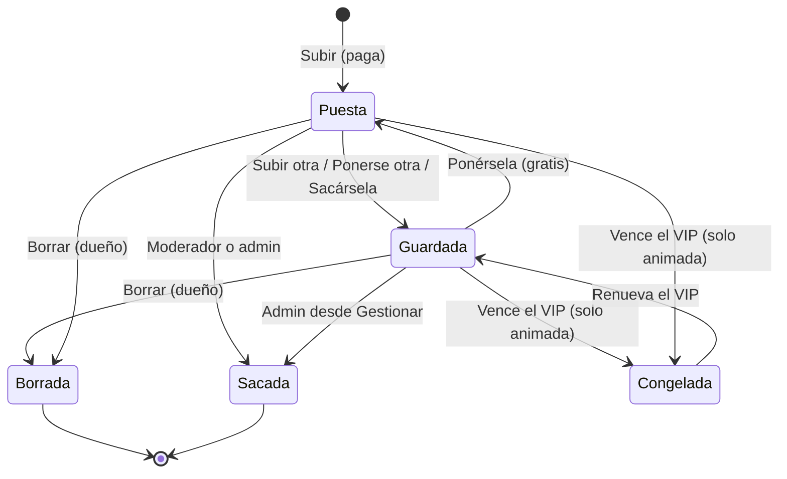

# Plan: lo que sube cada jugador queda guardado, y el encuadre del fondo de miniperfil

> Planeación original. Estado: **propuesta**, pendiente de aprobación.

Pedido por Daniel el 2026-11-14, sobre lo propio de la tienda ([`2026-11-13-avatar-y-fondo-propios`](../2026-11-13-avatar-y-fondo-propios/)), que todavía no salió:

1. **Hoy lo que se sube no queda guardado.** Hay uno vigente por tipo; subir otro cierra la fila (`cleared_reason = 'replaced'`) y la API borra el archivo anterior del bucket (`routes/custom.ts`, `dropFiles` con `old_url` y `old_poster_url`). Para volver a uno anterior hay que subirlo y pagarlo otra vez. Daniel quiere que lo subido quede en el inventario y que ponérselo de nuevo no cueste nada.
2. **El encuadre del fondo no coincide con donde se ve.** La web recorta el fondo a 11:4 (más ancho que alto, `CustomPanel.tsx`, `BG_ASPECT`), pero en Jugar la tarjeta del grupo en escritorio es más alta que ancha (una columna por lugar, `min-h-[260px]`, `GroupSlots.tsx`). Lo que se encuadra no es lo que se ve.

Va dentro de la `113`: la tienda no salió, así que no hace falta una migración aparte ni mover datos de producción.

## Decisiones tomadas

| Tema | Decisión | Por qué |
|---|---|---|
| Qué se guarda | **Cada subida** queda en el inventario de lo propio de la cuenta hasta que el dueño la borre, un moderador o un admin la saque, o se borre la cuenta | Lo pidió Daniel: pagó por subirla |
| Cuánto cuesta | Se sigue pagando **por subida**. Ponerse una subida guardada, sacársela o cambiar entre ellas es gratis | Igual que un artículo comprado |
| Subir uno nuevo | Ya **no borra** el anterior: queda guardado y el nuevo se pone solo | Es el pedido |
| Tope | **5 avatares y 5 fondos** por cuenta (los fondos fijos y animados juntos). Lo eligió Daniel el 2026-11-14 | Cada animado pesa hasta 3 MB en el Storage del VPS: sin tope, alguien con muchas monedas VIP lo llena |
| Al llegar al tope | **No deja subir** hasta borrar uno: el botón de subir dice "Llegaste a 5: borra uno para subir otro" | No borrar en silencio algo que se pagó. Daniel no eligió entre las dos opciones: se toma la que no borra nada |
| Denuncias | Solo la imagen **puesta** (Daniel, 2026-11-14) | Las guardadas solo las ve el dueño |
| Lo que saca un moderador | Se borra **esa** subida (archivo y fila cerrada con `removed`) y no se puede volver a poner. Las demás guardadas siguen | Es la imagen que no respeta las reglas, no la cuenta |
| VIP vencido | Lo animado guardado queda congelado: se ve en el inventario con un candado, no se puede poner. Vuelve al renovar. El fondo fijo sigue | Igual que hoy y que lo VIP comprado |
| Privacidad | Los archivos se guardan hasta que el dueño los borra o se borra la cuenta, no solo mientras están puestos (Daniel, 2026-11-14) | Cambia el plazo: va en `/privacidad` y su `.html` |
| Nombre | El fondo pasa a llamarse **"Fondo de miniperfil"** en toda la web, el manual y los legales (Daniel, 2026-11-14). En la base y la API sigue siendo `background` | Deja libre "Fondo" para un fondo de página, que queda para otra iteración |
| Encuadre del fondo | El de la **tarjeta del grupo en Jugar en escritorio**, vertical. La proporción exacta se mide en el navegador en el paso 1 (con 5 lugares, a 1280, 1440 y 1920 px de ancho) y se redondea a una simple (a ojo, 2:3) | Es donde más se ve. En el celular la tarjeta propia es apaisada y las demás cuadradas: ahí se recorta el centro (`object-cover`), como con los fondos de la tienda, que son cuadrados |
| Punto de foco en el celular | **No** en este requerimiento | Agrega un dato más por subida. Si el recorte del centro queda mal, va en otra iteración |
| "Fondo" de página | **Fuera** de este requerimiento (Daniel) | Otra iteración |

## 1. El flujo completo

- **Subir:** como hoy (revisa ficha, VIP, precio y saldo, convierte con ffmpeg, cobra con el lock por cuenta), más el tope. El nuevo se pone solo y el anterior pasa a guardado, sin borrar el archivo.
- **Ponerse una guardada:** `PUT /me/cosmetics` con el id de la subida. No cobra.
- **Borrar:** de a una subida, con su id. Borra la fila del inventario (`cleared_reason = 'deleted'`) y el archivo.

## 2. Base de datos (dentro de `113_tienda.sql`)

| Objeto | Cambio |
|---|---|
| `custom_cosmetics` | `cleared_at` deja de querer decir "ya no está puesta" y pasa a ser "ya no está en el inventario" (`deleted` o `removed`). Se va `replaced`. Se cambia el índice único `custom_cosmetics_vigente` (uno por tipo) por un índice común `(user_id, kind) where cleared_at is null` |
| `user_cosmetics.avatar_custom`, `background_custom` | De `boolean` a `uuid` que apunta a `custom_cosmetics(id)` (`on delete set null`): cuál subida está puesta. Los `check` de "uno por tipo" siguen igual, con `is not null` |
| `points_config` | `custom_max_avatar` y `custom_max_background` (5 y 5), que cambia el admin con `set_points_config` |
| `custom_cosmetic_set` (subir) | Rechaza si ya hay 5 del tipo ("Llegaste a 5…", antes de cobrar). Ya no cierra la anterior ni devuelve sus archivos. Pone la nueva |
| `set_my_cosmetics` | `avatar` y `background` aceptan `custom:<id>` además de un artículo: revisa que la subida sea de la cuenta, no esté cerrada y, si es animada, que la cuenta sea VIP |
| `custom_cosmetic_delete` | Recibe el id de la subida (no el tipo) y devuelve sus archivos para que la API los borre |
| `custom_cosmetic_clear` y `profile_media_report_resolve('remove')` | Cierran **esa** subida (la de la `url` denunciada), no "la vigente del tipo" |
| `custom_cosmetic_json`, `player_cosmetics_public` | Resuelven la subida puesta por su id |
| `my_custom` (o la que hoy lista lo propio) | Todas las subidas abiertas, con `equipped` y `usable` |
| `points_history` | Sin cambios: cada subida ya es un gasto |

Las pruebas (`probar_113.sql`, bloque 13) suman:
- subir 2 avatares, ponerse el primero gratis y volver al segundo, con el saldo sin cambios;
- el tope de 5 por tipo, sin cobrar al rechazar;
- borrar una guardada sin tocar la puesta;
- que un moderador saque la puesta sin tocar las guardadas;
- que lo animado guardado no se pueda poner con el VIP vencido;
- ponerse una subida de otra cuenta: rechazado.

## 3. API (`web/backend`)

| Ruta | Cambio |
|---|---|
| `GET /api/v1/me/custom` | Devuelve la lista de subidas por tipo (`id`, `animated`, `url`, `poster_url`, `price`, `currency`, `created_at`, `equipped`, `usable`) y el tope |
| `POST /api/v1/me/custom/{kind}` | Ya no borra los archivos anteriores. Nuevo error `BUSINESS_RULE` del tope, antes de convertir |
| `DELETE /api/v1/me/custom/{kind}` | Pasa a `DELETE /api/v1/me/custom/items/{id}` |
| `PUT /api/v1/me/cosmetics` | `avatar` y `background` aceptan `custom:<id>` |
| `GET /api/v1/admin/users/{id}/custom` y `…/custom/{kind}/clear` | La lista completa; sacar pasa a `…/custom/items/{id}/clear` |
| `GET /api/v1/shop/config`, `admin/points/config` | Los dos topes |
| `routes/custom.ts`, `BG_SHAPE` y la conversión | La proporción nueva del fondo: fijo recortado por la web (por ejemplo, 600×900 si queda 2:3) y animado escalado en el servidor (por ejemplo, 256×384). Mínimos y máximos en la misma proporción |

Pruebas: `test/integration/custom.test.ts` (guardar, ponerse sin pagar, tope, borrar uno, sacar uno) y `test/unit/media.test.ts` con la proporción nueva.

## 4. Web (`web/frontend`)

- **`CustomPanel.tsx`:** el recuadro pasa a ser **"Tus avatares"** y **"Tus fondos de miniperfil"**: la galería de lo subido, con la puesta marcada, **Ponértelo**, **Sacártelo** y **Borrar** en cada una, el contador ("3 de 5") y el botón de subir apagado al llegar al tope. Lo animado con el VIP vencido sale con candado.
- **Encuadre:** `BG_ASPECT` pasa a la proporción medida; la vista previa del encuadre muestra la tarjeta de Jugar tal cual.
- **Nombre:** "Fondo de miniperfil" en la pestaña de la Tienda, los recuadros, la vista previa, Gestionar en Administración › Tienda, Baneos › Imágenes, los avisos y los filtros.
- **Administración › Tienda › Gestionar:** la lista de lo subido de la cuenta, con **Sacar** en cada una.
- Pruebas: `CustomPanel.test.tsx` (galería, ponérselo sin pagar, tope, borrar, VIP vencido).

## 5. Manual, términos, privacidad y changelog

- **Manual:**
  - `jugador/tienda-y-cosmeticos.md`: lo subido queda guardado, hasta 5 por tipo, ponérselo gratis y "Fondo de miniperfil";
  - `admin/tienda-y-puntos.md`: Gestionar con la lista y los topes en la configuración;
  - `moderador/revisar-imagenes.md`: sacar una imagen no toca las demás guardadas.
- **Términos:** se paga por subida y lo subido queda guardado hasta borrarlo; "fondo de miniperfil".
- **Privacidad:** el plazo nuevo de lo subido (hasta que el dueño lo borra o se borra la cuenta). En la página de la web y en `terms/privacidad.html`, juntos.
- **Changelog:** el de la tienda (`2026-11-11-tienda-de-puntos/CHANGELOG_DISCORD.txt`), porque sale todo junto.

## 6. Requisitos antes de empezar

- Ninguna credencial nueva.
- La base local con la `113` aplicada. El cambio se prueba revirtiendo la `113` y volviéndola a aplicar dentro de la prueba, como el bloque 13. La base local de Daniel se actualiza aparte, sin perder los cambios del catálogo que todavía no pasaron a `catalogo.json` (activos y los dos avatares que pasaron a "para todos").

## 7. Orden de implementación

1. Medir la tarjeta del grupo en Jugar en el navegador (5 lugares, 1280, 1440 y 1920 px) y fijar la proporción del fondo.
2. La `113`: tabla, funciones, topes y proporción; `probar_113.sql` con los casos nuevos; tipos regenerados.
3. API: rutas, conversión con la proporción nueva y sus pruebas.
4. Web: la galería, el encuadre, el nombre "Fondo de miniperfil" y Gestionar, con pruebas, lint y build.
5. Recorrerlo en el navegador: subir dos, volver al primero sin pagar, el tope, borrar, y el fondo en Jugar en escritorio y en celular.
6. Manual, términos, privacidad, changelog, `DOCUMENTACION.md`, `GUIA_IMPLEMENTACION.md`, la fila del índice y `docs/PENDIENTES.md`.
7. Sale con la tienda: mismo commit y despliegue, cuando Daniel lo pida.
