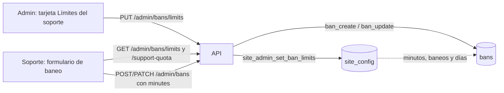

# Límites configurables para los baneos del soporte: documentación

## Qué hace

El rol Soporte ([`2026-11-13-rol-soporte`](../2026-11-13-rol-soporte/), replanteo `117`) banea desde la web con dos límites. Hasta ahora estaban escritos en la base, la API y la web: **120 minutos** por baneo y **3 baneos de soporte por jugador en 7 días**. Ahora están en `site_config`, un admin los cambia desde **Administración › Baneos › Actividad del soporte** (tarjeta **Límites del soporte**), y la base, la API y la web los leen de ahí. Cambiarlos ya no pide migración ni despliegue.

## La base (replanteo `121`)

| Qué | Detalle |
|---|---|
| `site_config.support_ban_max_minutes` | Minutos máximos de un baneo del soporte. Por defecto 120, de 1 a 1440 (`check`) |
| `site_config.support_ban_max_count` | Baneos de soporte por jugador en la ventana. Por defecto 3, de 1 a 20 |
| `site_config.support_ban_window_days` | Días de la ventana. Por defecto 7, de 1 a 90 |
| `site_config.ban_limits_updated_at` y `_by` | Quién hizo el último cambio y cuándo. Sin historial |
| `site_ban_limits()` | Los tres valores, y quién y cuándo los cambió (`updated_by_nick`: el nick de su ficha o su tag). Soporte, moderadores y admins (`is_support()`) |
| `site_admin_set_ban_limits(minutos, baneos, días)` | Solo `is_admin()`. Valida los rangos y devuelve lo guardado |
| `ban_support_count` | La ventana sale de `support_ban_window_days` |
| `ban_support_quota` | `max` y `remaining` salen de `support_ban_max_count`; suma `window_days` y `max_minutes` |
| `ban_create` | El tope (con el minuto de margen por el reloj) y el límite de baneos salen de `site_config`. Los errores llevan los números: "El soporte banea hasta 30 minutos", "Ya tiene 2 baneos de soporte en los últimos 1 días: pásale el caso a un moderador" |
| `ban_update` | El tope "desde que lo puso" sale de `site_config` en el momento del cambio |

Bajar el tope no toca los baneos que ya están puestos: el nuevo vale para los baneos nuevos y para los cambios de duración. Cambiar los días rehace el conteo con la ventana nueva. El moderador y el admin siguen sin estos límites.

## La API

- `GET /api/v1/admin/bans/limits` (soporte, moderadores y admins) y `PUT /api/v1/admin/bans/limits` (solo admin, `requireAdmin`). Esquemas `BanLimits` (`max_minutes`, `max_bans`, `window_days`, `updated_at`, `updated_by: { id, alias }`) y `BanLimitsInput` (los tres números, con los mismos rangos que la base).
- `minutes` (en `BanCreate` y `BanPatch`) acepta de 1 a 1440. El tope de verdad lo pone la base: la API ya no tiene el 120.
- `SupportQuota` suma `window_days` y `max_minutes`.
- Ninguna descripción de la API tiene ya los números fijos.

## La web

- `BanDialog`: con el soporte, pide `/admin/bans/limits` y usa `max_minutes` para el campo **Minutos**, el aviso y el tope "desde que lo pusiste". Mientras no llegan, no deja guardar ("Cargando los límites del soporte…"). El cupo dice "Le quedan 2 baneos de soporte de 3 en los últimos 7 días".
- `AdminBansPage`: el aviso del soporte arriba de la lista dice los límites que valen ("hasta 120 minutos y 3 veces por jugador en los últimos 7 días").
- `SupportLimitsCard` (nuevo), arriba de **Actividad del soporte**: los tres números con sus rangos, **Guardar** (solo el admin; el moderador la ve sin poder cambiarla) y "Último cambio: …, por …".
- `lib/bans.ts`: sin `SUPPORT_BAN_MAX_MINUTES` ni `SUPPORT_WEEKLY_BANS`. `validBanMinutes` y `supportBanLimit` reciben el máximo; `supportQuotaText` recibe el cupo; `windowText`, `minutesText` y `supportLimitsText` nuevos.
- Administración › Usuarios: la descripción del rol Soporte ya no dice "120 minutos".

## Qué cambia para cada rol

| Rol | Qué cambia | Página del manual |
|---|---|---|
| Jugador | Nada en lo que vive. El manual dice que los límites del soporte los fija la administración (hoy, 120 minutos y 3 en 7 días) | `jugador/baneos-y-sanciones.md` |
| Soporte | Sus límites los fija un admin; la web le muestra los que valen, arriba de Baneos y en el formulario | `soporte/banear-jugador.md` |
| Moderador | Ve la tarjeta **Límites del soporte** en Actividad del soporte, sin poder cambiarla | `moderador/banear-jugador.md` |
| Admin | Cambia los límites desde la tarjeta | `admin/limites-del-soporte.md` (nueva), `admin/usuarios-y-fichas.md` |
| Capitán, organizador, streamer, dueño de un servidor externo | Nada | — |

Sin comandos del servidor: no toca ningún plugin.

## Términos y privacidad

- **`/terminos` y `terms/terminos.html`** (sección 7): el soporte banea "con un tope de minutos y de veces por semana que fija la administración (hoy, hasta 120 minutos, y entre todo el soporte no más de 3 veces en 7 días)".
- **`/privacidad`:** sin cambios. No se guarda ningún dato nuevo de los jugadores: solo quién del staff cambió la configuración.

## Dónde está cada cosa

| Qué | Dónde |
|---|---|
| Base | `supabase/replanteo/121_limites_baneo_soporte.sql`; inversa en `docs/bitacora/2026-10-14-replanteo-modelo-datos/reversas/121_limites_baneo_soporte.sql` |
| Pruebas de la base | `pruebas/probar_121.sh` y `pruebas/probar_121.sql` (con rollback) |
| API | `web/backend/src/schemas/bans.ts`, `routes/bans.ts`, `schemas/auth.ts`, `db/types.ts`; pruebas en `test/unit/support-routes.test.ts` |
| Web | `features/admin/bans/` (`components/SupportLimitsCard.tsx`, `BanDialog.tsx`, `SupportActivityPanel.tsx`, `pages/AdminBansPage.tsx`, `lib/bans.ts`, `api/queries.ts`), `features/admin/users/components/AccountsTab.tsx`, `api/schema.d.ts` |
| Manual | `docs/manual/admin/limites-del-soporte.md` y las páginas de la tabla de roles |
| Legales | `web/frontend/src/features/legal/pages/TermsPage.tsx` y `terms/terminos.html` |
