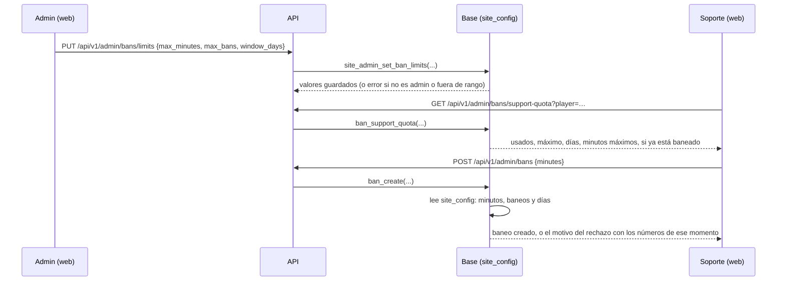

# Plan: Límites configurables para los baneos del soporte

> Planeación original. Estado: **propuesta**, pendiente de aprobación.

Pedido por Daniel (2026-11-14). El rol Soporte ([`2026-11-13-rol-soporte`](../2026-11-13-rol-soporte/), replanteo `117`) banea desde la web con tres límites escritos en el código: **hasta 120 minutos**, y **hasta 3 baneos de soporte por jugador en 7 días**. Hoy, cambiar cualquiera de esos números pide una migración nueva y desplegar de nuevo la API y la web. Con este cambio, un admin los edita desde **Administración › Baneos** y la base, la API y la web los leen de ahí.

## Decisiones tomadas

| Tema | Decisión | Por qué |
|---|---|---|
| Qué se configura | Los tres números: minutos máximos (120), baneos por jugador (3) y días de la ventana (7) | Daniel eligió "minutos y límite"; el límite son dos cifras y van juntas |
| Dónde se guarda | Tres columnas nuevas en `site_config` (la fila única del replanteo `67`), con los valores de hoy por defecto | Ya es la configuración del sitio fuera de un módulo, con RLS cerrada y acceso solo por funciones |
| Quién los ve y quién los cambia | Los lee el soporte, los moderadores y los admins; los cambia **solo un admin** | El soporte necesita los números para su formulario; ponerse sus propios límites no tendría sentido |
| Rangos permitidos | Minutos de 1 a 1440 (un día), baneos de 1 a 20, días de 1 a 90, con `check` en la base | Un baneo de soporte es corto; más de un día ya es trabajo de un moderador |
| Dónde se controla | En la base (`ban_create`, `ban_update`, `ban_support_count`, `ban_support_quota`), como hoy | La base es la única que hace cumplir el límite; la API y la web solo lo muestran |
| La API | Deja de tener el `120` en el esquema: acepta cualquier número de minutos positivo (con un techo técnico de 1440) y la base decide | Si no, bajar o subir el tope pediría desplegar la API |
| Si el admin baja el tope | Los baneos que ya están puestos no cambian. El nuevo tope vale para los baneos nuevos y para los cambios ("desde que lo puso" se mide con el valor de ese momento) | No se tocan baneos en curso por un cambio de configuración |
| El moderador | Sigue sin tope, como hoy | Lo pedido es para el soporte |
| Textos fijos (manual, `/terminos`) | Dicen "el máximo que fija un admin (hoy, 120 minutos y 3 baneos en 7 días)". La web muestra siempre los valores reales | El `.md` del manual y los legales no leen la base |
| Registro del cambio | Sin historial: `site_config` guarda quién hizo el último cambio y cuándo (`ban_limits_updated_by` y `_at`) | Alcanza con saber quién lo cambió por última vez; el historial completo no se pidió |
| Rama y número | `feat/rol-soporte`, replanteo **`118`** | La `117` ya es la del rol Soporte |

## 1. El flujo completo

## 2. La base: replanteo `118_limites_baneo_soporte.sql`

- `site_config`: columnas `support_ban_max_minutes int not null default 120 check (between 1 and 1440)`, `support_ban_max_count int not null default 3 check (between 1 and 20)`, `support_ban_window_days int not null default 7 check (between 1 and 90)`, `ban_limits_updated_at timestamptz` y `ban_limits_updated_by uuid`.
- `site_ban_limits()`: devuelve los tres valores (y quién y cuándo los cambió) a quien sea `is_support()`.
- `site_admin_set_ban_limits(p_max_minutes, p_max_count, p_window_days)`: solo `is_admin()`, `update … where id = 1` (por `pg_safeupdate`), devuelve los valores guardados.
- `ban_support_count`: la ventana sale de `support_ban_window_days`.
- `ban_support_quota`: `max` y `remaining` salen de `support_ban_max_count`; suma `max_minutes` y `window_days` al `jsonb`.
- `ban_create` y `ban_update`: el `120` (y el margen de `121`) salen de `support_ban_max_minutes`; los mensajes de error llevan los números reales ("El soporte banea hasta N minutos", "Ya tiene N baneos de soporte en los últimos D días…").
- Permisos: `revoke` de `public, anon` y `grant` a `authenticated`, como la `117`.
- Reversa en `docs/bitacora/2026-10-14-replanteo-modelo-datos/reversas/118_limites_baneo_soporte.sql`: vuelve a las funciones de la `117` y borra las columnas.
- Pruebas SQL: el soporte con el tope por defecto, con el tope cambiado (más alto y más bajo), un admin que guarda valores fuera de rango, el soporte que intenta cambiarlos, y un baneo de antes de bajar el tope que se cambia después.

## 3. La API (`web/backend`)

- `GET /api/v1/admin/bans/limits` (soporte, moderadores y admins) y `PUT /api/v1/admin/bans/limits` (solo admin, `requireAdmin`), con el esquema `BanLimits`.
- `schemas/bans.ts`: se borra `SUPPORT_BAN_MAX_MINUTES`; `minutes` queda de 1 a 1440 y las descripciones dicen "hasta el máximo de `/admin/bans/limits`".
- `SupportQuota` suma `max_minutes` y `window_days`.
- `routes/bans.ts`: el mensaje de `supportUsesMinutes` sin el número; las descripciones de `create`, `update` y `support-quota` sin cifras fijas.
- `schemas/auth.ts`: la descripción del rol `support` sin "120".
- Pruebas de integración de las dos rutas nuevas y del cupo con los valores cambiados. Se regenera `web/frontend/src/api/schema.d.ts`.

## 4. La web (`web/frontend`)

- `features/admin/bans/api/queries.ts`: `useBanLimits` y `useSaveBanLimits`.
- `lib/bans.ts`: `validBanMinutes(m, max)` y el tope de "desde que lo puso" reciben el máximo en lugar de la constante; se actualizan las pruebas.
- `BanDialog.tsx`: el campo **Minutos** y los avisos usan los valores de `support-quota` / `limits`.
- `AdminBansPage.tsx`: el aviso "Entras como soporte…" con los valores reales, y para el admin una tarjeta **Límites del soporte** con los tres números y **Guardar** (con el "cambiado por … el …").
- `SupportActivityPanel.tsx` y `AccountsTab.tsx`: textos sin "120" o con el valor real.
- `TermsPage.tsx`: ver la sección 6.

## 5. El manual

- `soporte/banear-jugador.md`: los límites "los fija un admin; hoy son 120 minutos y 3 baneos en 7 días, y el formulario te muestra los que valen".
- `moderador/banear-jugador.md`, `jugador/baneos-y-sanciones.md` y `admin/usuarios-y-fichas.md`: lo mismo, sin cifras como regla fija.
- `admin/` nueva página o sección en la de baneos: **Cambiar los límites del soporte** (dónde, rangos permitidos, qué pasa con los baneos ya puestos).

## 6. Términos y privacidad

- `/terminos` (`TermsPage.tsx` y `terms/terminos.html`): "el equipo de soporte puede banearte por un rato, con un tope de minutos y de veces por semana que fija la administración (hoy, hasta 120 minutos y no más de 3 veces en 7 días)".
- `/privacidad`: sin cambios (no se guardan datos nuevos de los jugadores; solo quién cambió la configuración, que es del staff).

## 7. Requisitos antes de empezar

- El worktree `v34frag-soporte` (`feat/rol-soporte`) al día, con la `117` ya aplicada en el VPS.
- La copia local de la base para probar la `118`.

## 8. Orden de implementación

1. La `118`, su reversa y las pruebas SQL, en la copia local.
2. La API, sus pruebas y el `schema.d.ts`.
3. La web y sus pruebas.
4. Manual y `/terminos`.
5. `DOCUMENTACION.md`, `GUIA_IMPLEMENTACION.md` y la fila de `docs/bitacora/README.md`.
6. Commit en `feat/rol-soporte` cuando Daniel lo pida. Desplegar: la `118` en el VPS, y la API y la web.
