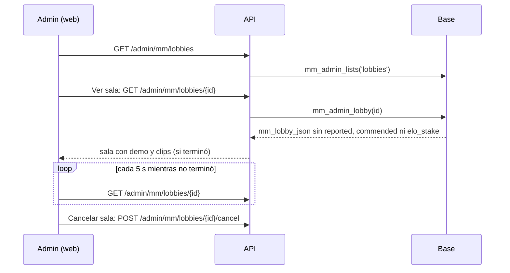

# Ver una sala del matchmaking como admin: documentación

## Qué hace

En Administración › Matchmaking › Salas, cada sala activa tiene un botón **"Ver sala"** a la izquierda de "Cancelar". Abre la sala con la misma pantalla que la pestaña "Tu última partida" de Jugar (`MatchRoom`), pero en un modo `admin`: sin nada que dependa de que quien mira sea un jugador de esa sala, y con una tarjeta de **Administración** arriba del centro.

La sala sale de una función nueva de la base, `mm_admin_lobby` (replanteo `116`), por la ruta `GET /api/v1/admin/mm/lobbies/{id}`. Mientras la sala no terminó, la web la vuelve a pedir cada 5 segundos, porque el admin no recibe los avisos del socket de esa sala.

## La función de la base

`mm_admin_lobby(p_lobby uuid) returns jsonb`, `security definer`, solo para admins (`mm_admin_guard`):

- Devuelve `mm_lobby_json(p_lobby, auth.uid())`, el mismo JSON que ve un jugador.
- Deja `server` (nombre, dirección, contraseña y SourceTV) mientras la sala está asignada, conectando o en vivo.
- Saca `reported`, `commended` y `elo_stake`: son del que mira como jugador. La web los completa con `[]`, `null` y `null`.
- `null` si la sala no existe; la API responde 404 `NOT_FOUND`.

## La pantalla

| Parte | Qué muestra en el modo `admin` |
|---|---|
| Arriba | "Salas" para volver, "Sala de la partida · vista de admin" y las pestañas. Sin "Compartir" |
| Cabecera | Marcador, equipos, probabilidad de ganar, servidor y "Ver en CM League TV" en vivo. Sin "En juego" |
| Jugadores | Lo mismo que ve un jugador (conexión, tendencia, últimas 30 partidas, reemplazos) más el botón **Banear** al lado del ELO. Sin "Encuentros", "Reportar" ni elogiar |
| Centro | Tarjeta **Administración** (ID, conectados, Cancelar sala con confirmación, Copiar ID, Actualizar), estado, veto, Servidor con contraseña y Conectar, mapa, demo. Sin "!claim", "Jugar de nuevo" ni "Volver a Jugar" |
| Chat | No se muestra |

**Banear** abre el `BanDialog` de Administración › Baneos con el jugador fijo y "Permanente" disponible (la sección de Matchmaking es solo de admins).

## Qué cambia para cada rol

| Rol | Qué cambia | Página del manual |
|---|---|---|
| Admin | Botón "Ver sala" en Matchmaking › Salas, con cancelar, servidor, TV y banear desde la sala | `admin/matchmaking.md` |
| Jugador, capitán, organizador, moderador, streamer, dueño de un servidor externo | Nada | — |

## Términos y privacidad

Sin cambios: el admin ya veía las salas activas y las contraseñas de los servidores, y la función no guarda ni publica datos nuevos.

## Dónde está cada cosa

| Archivo | Qué |
|---|---|
| `supabase/replanteo/116_mm_admin_sala.sql` | `mm_admin_lobby` |
| `docs/bitacora/2026-10-14-replanteo-modelo-datos/reversas/116_mm_admin_sala.sql` | Inversa |
| `web/backend/src/routes/mm.ts` | `GET /api/v1/admin/mm/lobbies/{id}` |
| `web/frontend/src/features/matchmaking/admin/LobbiesPanel.tsx` | Botón "Ver sala"; la lista se actualiza cada 10 s |
| `web/frontend/src/features/matchmaking/admin/LobbyRoom.tsx` | La sala en modo `admin`, la tarjeta y el baneo |
| `web/frontend/src/features/matchmaking/room/MatchRoom.tsx`, `RoomOverview.tsx` | Modo `admin` y `playerExtra` |
| `web/frontend/src/features/matchmaking/source.ts`, `demo.ts`, `queries.ts` | `adminLobby` y `adminLobbyOptions` |
| `web/frontend/src/features/matchmaking/admin/AdminMatchmaking.test.tsx` | Prueba de "Ver sala" y "Cancelar sala" |
| `web/backend/test/unit/mm-admin-lobby.test.ts` | Prueba de la ruta: 403 al moderador, la sala, demo y clips, 404 |
