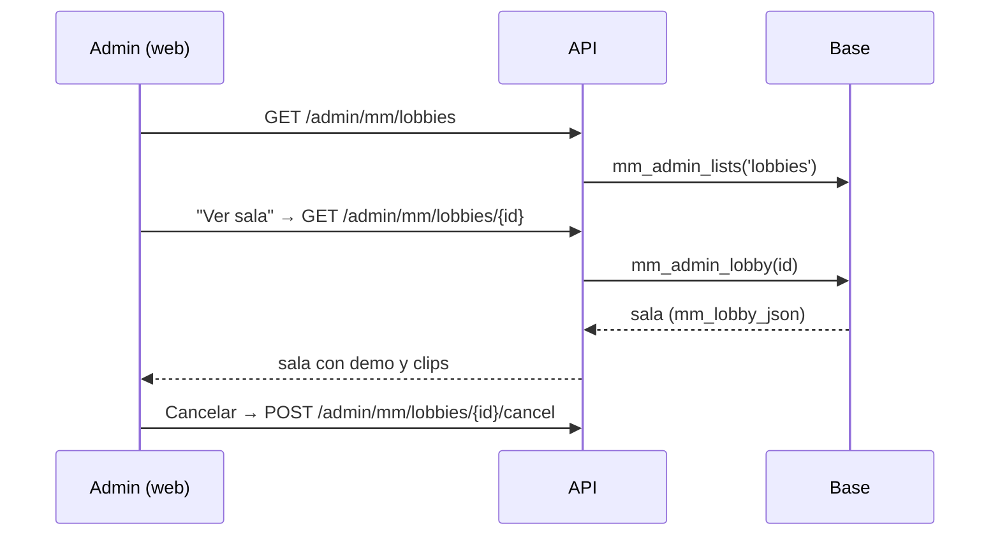

# Plan: ver una sala del matchmaking como admin

> Planeación original. Estado: **aprobado** por Kyan el 2026-11-14 (pedido en el chat).

Pedido de Kyan: en Administración › Matchmaking › Salas, un botón **"Ver sala"** a la izquierda de "Cancelar" que abra la sala en el mismo formato que la pestaña "Tu última partida" de Jugar, con funciones que le sirvan al admin.

## Decisiones tomadas

| Tema | Decisión | Por qué |
|---|---|---|
| De dónde sale la sala | Función nueva `mm_admin_lobby(p_lobby)` (replanteo `116`) que devuelve `mm_lobby_json(p_lobby, auth.uid())` con `mm_admin_guard()` | `mm_lobby_json` ya arma la sala para cualquier `viewer`; la lista de Salas (`mm_admin_lists('lobbies')`) trae solo un resumen |
| Qué se saca | `reported`, `commended` y `elo_stake` | Son del que mira como jugador; el admin no juega en esa sala |
| Qué se deja | `server` (dirección y contraseña) | Al admin le sirve para entrar a moderar |
| Número | `116` | `main` ya usa hasta la `115`, y en `kyan/pruebas` están la `110` y la `113` |
| Ruta | `GET /api/v1/admin/mm/lobbies/{id}` con `requireAdmin`; completa demo y clips igual que `state` | Igual a las otras de Administración |
| La vista | `MatchRoom` con un modo nuevo `admin` | Mismo formato que "Tu última partida"; sin chat, reportes, "!claim", "Jugar de nuevo" ni elogios |
| Funciones del admin | Tarjeta "Administración" en el centro: Cancelar sala (con confirmación), Copiar ID, Actualizar. Por jugador: Banear (el `BanDialog` de Baneos). El bloque Servidor con Conectar y la contraseña, y "Ver en CM League TV" en vivo | Lo que ya existe en la API, sin inventar acciones nuevas en la base |
| Actualización | La sala abierta se vuelve a pedir cada 5 s | El admin no recibe los avisos del socket de esa sala |
| Volver | Botón "Salas" arriba y la X | Vuelve a la lista |
| Términos y privacidad | Sin cambios | El admin ya veía las salas y la contraseña de los servidores |

## 1. El flujo completo

## 2. Base de datos

`supabase/replanteo/116_mm_admin_sala.sql` con su inversa en `reversas/` y una fila en el README.

## 3. API

`web/backend/src/routes/mm.ts`: la ruta nueva.

## 4. Web

- `source.ts` / `demo.ts`: `adminLobby(id)`.
- `queries.ts`: `adminLobbyOptions` con `refetchInterval` de 5 s mientras no terminó.
- `admin/LobbiesPanel.tsx`: botón "Ver sala" y la vista de la sala.
- `room/MatchRoom.tsx` y `room/RoomOverview.tsx`: modo `admin`.

## 5. Requisitos antes de empezar

Ninguno. Para probar contra la base hace falta la copia local de producción (Docker); si no está levantada, se prueba con la fuente demo y las pruebas de Vitest.

## 6. Orden de implementación

1. Replanteo `116` e inversa.
2. Ruta de la API.
3. Web: fuente, consulta, modo `admin`, botón y tarjeta.
4. Pruebas (Vitest) y revisión en el navegador.
5. Documentación, guía, manual del admin (`admin/matchmaking.md`) y fila en la bitácora.
