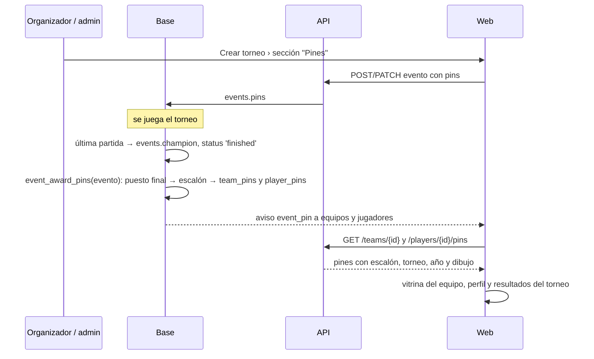
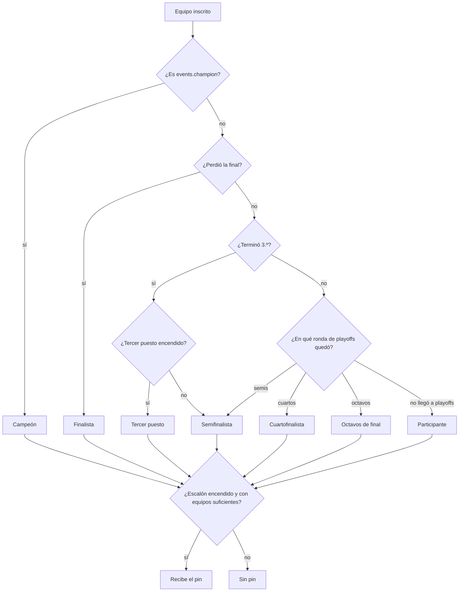

# Plan: pines de torneo

> Planeación original. Estado: **propuesta**, pendiente de aprobación. Incluye lo que se sumó al ver el prototipo (estilos y premios individuales). Prototipo en `/demo/pines` (rama `kyan/recap`). Toca la base y la API, así que **la implementación la toma Daniel**; la web del perfil del jugador es de Killuaz (Esteban).

Kyan lo pidió así (2026-11-14), con los trofeos de los Majors de CS como referencia («Champion at ESL One Cologne 2014», «Finalist at EMS One Katowice 2014», «Quarterfinalist…», «Semifinalist…»): cada torneo reparte **pines** según el puesto en que termina cada equipo. Los pines son **configurables** por torneo, son **opcionales según la cantidad de equipos** y cada equipo recibe **uno solo, el de su mejor resultado**. El campeón recibe el de campeón y no también los de finalista y semifinalista.

## Decisiones tomadas

| Tema | Decisión | Por qué |
|---|---|---|
| Un pin por equipo y torneo | Al cerrar el torneo se calcula el **puesto final** de cada equipo y se le da el pin de ese puesto. No se acumulan los escalones que pasó en el camino | Pedido de Kyan: "si un equipo sale campeón, no recibe el de campeón y el de finalista" |
| Escalones | Siete: **Campeón**, **Finalista**, **Tercer puesto**, **Semifinalista**, **Cuartofinalista**, **Octavos de final** y **Participante** (fase de grupos o suiza). Ver sección 2 | Son los de los Majors, más el tercer puesto (que ya existe en `third_place` y en la doble eliminación) y uno para quien no pasa de la primera fase |
| Configurables | Cada torneo guarda qué escalones reparte y con qué metal (`events.pins`, `jsonb`). Al crear el torneo se cargan los valores por defecto (sección 3) y se cambian en el formulario, sección nueva **"Pines"** | Que el organizador decida sin tocar el código |
| Según la cantidad de equipos | Dos reglas. **Automática:** un escalón existe solo si el bracket tiene esa ronda (con 4 equipos no hay cuartos). **Manual:** cada escalón tiene un **mínimo de equipos** opcional (por defecto, "Participante" desde 8) | Que un torneo de 4 equipos no reparta pines a todos y que nadie reciba el pin de una ronda que no se jugó |
| Escalón apagado | Si el escalón que le toca a un equipo está apagado, **no recibe pin**: no baja a uno menor. Única excepción: con "Tercer puesto" apagado, el 3.º recibe "Semifinalista" | El pin dice dónde terminó el equipo. Darle uno de una ronda menor sería falso; el tercero sí fue semifinalista |
| Texto del pin | El escalón + el nombre del torneo + el año, como en CS: «Campeón · Copa CM League 2026». El año sale de la última partida (o de `ends_on`) | Es lo que hace reconocible al pin en la vitrina |
| Dibujo | Tres formas, como en los Majors: **trofeo** para el campeón, **placa con flecha** para finalista, tercero, semifinalista, cuartos y octavos, y **sello redondo** para participante. El metal cambia por escalón (oro, plata, bronce, acero) y el texto del torneo va en la placa | Kyan mandó las cuatro referencias: el campeón tiene trofeo propio y el resto comparte la placa |
| Estilos | Una familia por torneo. Las ocho primeras (`events.pins.style`), tomando como referencia trofeos de CS 1.6, CS:GO y CS2: **Clásico** (Majors: la copa, la placa con flecha y el sello de arriba), **Cristal** (prisma tallado), **Escudo** (ligas por temporada), **Moneda** (pick'em y festivales LAN), **Estrella** (mundiales de la época de la 1.6), **Globo** (finales mundiales), **Medalla con cinta** (LAN de la 1.6) y **Angular** (circuitos de CS2). Fuera del Clásico, todos los escalones usan la misma pieza y el campeón lleva un adorno propio: rayos, corona, laureles, alas o estrella | Pedido de Kyan: más tipos con esas referencias. Son dibujos propios, **sin logos, nombres ni marcas** de ESL, BLAST, IEM, DreamHack ni Valve |
| Trofeos con volumen | Once estilos más, dibujados como trofeos reales: cromo con brillos, sombra y base laqueada con la placa grabada (escalón, torneo y año), sin el contorno negro de los primeros. Formas tomadas de las referencias que pasó Kyan: **Copa de anillos** (Colonia), **Isotipo CM League** (el logo de la liga en cuatro piezas de metal sobre varillas, pensado para los torneos oficiales), **Rombo partido**, **Orbe con corona** y **Alas en V** (la vitrina de la Superliga), **Jarrón esbelto** (IEM Río), **Torre de bloques** (PGL Estocolmo), **Corona** (sobre almohadón de terciopelo), **Disco con mira**, **Obelisco de cristal** y **Estrella facetada**. Kyan probó y descartó el guante con bala, la llama orgánica, la copa con gema, la llama en espiral, la copa con tapa y la copa de asas altas. El triángulo partido se sacó porque era casi igual al trofeo de BLAST. En estos, todos los escalones usan el mismo trofeo y cambia el metal. **Copa de anillos** pasa a ser el estilo por defecto | Kyan prefirió este acabado a los ocho primeros, que quedan como opción. Son dibujos propios: ningún logo, nombre ni marca de los organizadores |
| Premios individuales | Además del pin del equipo, cada torneo puede dar premios a jugadores: **MVP**, **Top fragger**, **Mejor AWP**, **Rey del clutch**, **Mejor % HS**, **Más daño**, **Entry** y **Jugada del torneo**. Mismo estilo que los pines del torneo; el MVP lleva el adorno del campeón. Ver sección 3.2 | Pedido de Kyan ("y medallas de MVP, etc."), como los MVP de los torneos de HLTV |
| Componente | Se dibuja en la web con `<TournamentPin>` (SVG generado en código, no un archivo por pin) | El texto cambia en cada torneo: un `.svg` fijo por pin no sirve. Las medallas usan plantillas porque su texto es corto y fijo |
| A quién llega | Al **equipo** (tabla nueva `team_pins`) y a los **jugadores** que jugaron al menos un mapa del torneo con ese equipo (`player_pins`). En un torneo histórico, a los jugadores del plantel inscrito (`tournament_registration_players`) | El pin se luce en el equipo y en el perfil de cada jugador. Un suplente que no jugó ningún mapa no lo recibe |
| Qué torneos reparten | Los que terminan (`events.status = 'finished'`) y no están en testing, pendientes ni rechazados (replanteo `80`). Los históricos sí reparten | Las mismas reglas que `match_rankable()`: un torneo de prueba no deja premios |
| Torneos ya terminados | El replanteo reparte los pines de los torneos ya terminados una sola vez, con los valores por defecto | Que la vitrina no arranque vacía |
| Reabrir un torneo | Si un torneo vuelve a la siembra o cambia el campeón (`event_reset`, corrección de un resultado), se borran sus pines y se vuelven a calcular al terminar | El pin tiene que coincidir con el resultado que se ve |
| Cambiar la configuración después | Se puede cambiar `events.pins` con el torneo terminado: se recalculan sus pines en el momento | Un error de configuración se arregla sin tocar la base |
| Aviso | Tipo nuevo `event_pin` (categoría `event`): «Tu equipo terminó Semifinalista en Copa CM League 2026», al equipo y a cada jugador que recibe el pin. Ninguno en torneos históricos | Igual que los otros avisos de torneo |
| Medalla «Campeón de torneo» | Sigue igual. El pin de campeón **no** la reemplaza | Son cosas distintas: la medalla es del sistema de medallas y el pin es del torneo |
| Número de replanteo | El siguiente libre al implementar. Hoy `origin/main` llega a la `120` | Lo decide Daniel según el orden en que entren |

## 1. El flujo completo



## 2. Puesto final y escalón

El puesto se calcula con lo que ya guarda el bracket (`matches.stage`, `round`, `next_win`/`next_lose`) y `events.champion`.



| Formato (`events.template`) | Cómo se saca el puesto |
|---|---|
| `single` (eliminación simple) | Final (`ko`, última ronda): ganador campeón, perdedor finalista. Si hay partido por el tercer puesto (`stage = 'third'`), ganador 3.º y perdedor semifinalista. Sin ese partido, los dos de semis son semifinalistas. Luego, la ronda en que perdió cada uno |
| `double` (doble eliminación) | Gran final (`grand`): campeón y finalista. El que pierde la final de la llave de abajo (`lower`, última ronda) sale 3.º y el de la ronda anterior, semifinalista (4.º). Los que pierden antes en la de abajo: 5.º-8.º = cuartos y 9.º-16.º = octavos |
| `groups` (grupos + playoffs) | Los que no pasan de grupos: participante. Los demás, igual que `single` en la llave `ko` |
| `groups` sin playoffs (todos contra todos) | El campeón es el 1.º de la tabla (`events.champion`), el 2.º es finalista y el 3.º, tercer puesto. El resto, participante |
| `swiss` | Los eliminados en la fase suiza: participante. Los que pasan, igual que `single` en la llave `ko` |

Un W.O. cuenta como partida perdida: el equipo que no se presenta queda en la ronda donde lo eliminaron. Un equipo descalificado o que se dio de baja antes de jugar no recibe pin.

**Qué rondas existen.** Un escalón existe solo si el bracket tiene esa ronda: cuartos con 5 equipos o más en la llave, octavos con 9 o más. "Tercer puesto" existe solo con partido por el 3.º o en doble eliminación. "Participante" existe solo en `groups` y `swiss`, o en eliminación simple si se enciende a mano (entonces lo reciben los que pierden en la primera ronda que no tiene escalón propio).

## 3. Configuración (`events.pins`)

```json
{
  "enabled": true,
  "style": "anillos",
  "awards": { "mvp": true, "top_fragger": true, "awp": true, "clutch": true, "hs": true, "adr": false, "entry": false, "play": true },
  "tiers": {
    "champion":     { "on": true,  "metal": "oro",    "min_teams": null },
    "finalist":     { "on": true,  "metal": "plata",  "min_teams": null },
    "third":        { "on": true,  "metal": "bronce", "min_teams": null },
    "semifinalist": { "on": true,  "metal": "bronce", "min_teams": 4 },
    "quarter":      { "on": true,  "metal": "acero",  "min_teams": 8 },
    "round16":      { "on": false, "metal": "acero",  "min_teams": 16 },
    "participant":  { "on": false, "metal": "acero",  "min_teams": 8 }
  }
}
```

- `enabled: false` apaga todos los pines del torneo (por ejemplo, un torneo amistoso).
- `min_teams` cuenta los equipos que jugaron al menos una partida, no los inscritos.
- Los valores por defecto salen de la cantidad de equipos cuando se genera el fixture y el organizador los puede cambiar hasta que el torneo termine (y después también: sección "Decisiones").
- Un `check` en la base valida las claves, los metales (`oro`, `plata`, `bronce`, `acero`) y que `min_teams` esté entre 2 y 128.

En el formulario (`EventForm`), la sección **"Pines"** va después de "Cómo se juega": un switch general y, por escalón, el pin dibujado, un switch, el metal y el mínimo de equipos. Los escalones que no existen con el formato y la cantidad de equipos actuales se muestran apagados, con la razón ("Con 6 equipos no hay octavos"). Abajo, la vista previa: "Con esta configuración se reparten 4 pines: 1 Campeón, 1 Finalista y 2 Semifinalistas".

### 3.2 Premios individuales

Se calculan al terminar el torneo con las mismas stats de la página del torneo (`2026-10-29-stats-torneo`): solo las partidas del torneo jugadas en el servidor (un histórico sin stats no reparte premios individuales, salvo el MVP y la Jugada a mano).

| Premio | Quién lo gana | Mínimo |
|---|---|---|
| MVP del torneo | Mejor rating del torneo. El organizador lo puede cambiar antes de cerrar (un MVP a mano pisa al calculado) | La mitad de los mapas de su equipo |
| Top fragger | Más kills | La mitad de los mapas de su equipo |
| Mejor AWP | Más kills con AWP (`match_player_extra`) | 10 kills con AWP |
| Rey del clutch | Más clutches ganados | 2 clutches |
| Mejor % HS | Mayor % de headshots | 50 kills |
| Más daño | Mayor ADR | La mitad de los mapas de su equipo |
| Entry del torneo | Más primeras kills de ronda | La mitad de los mapas de su equipo |
| Jugada del torneo | La elige el organizador entre los clips del torneo (`match_clips`); más adelante, por votación | Solo a mano |

- Un empate se rompe con la stat que sigue (kills → ADR → rating) y, si sigue igual, ganan los dos.
- Un jugador puede ganar varios premios en el mismo torneo (MVP y Top fragger, por ejemplo): no es como los pines por puesto.
- Si nadie llega al mínimo, ese premio queda desierto.
- Las cuentas que dependen del reporter 2.7.0 (AWP, clutches, entry) solo cuentan los mapas con `match_player_extra`.

## 4. Base de datos

| Objeto | Qué es |
|---|---|
| `events.pins jsonb` | La configuración de la sección 3. `null` en los torneos viejos = valores por defecto |
| `team_pins` | `id`, `event_id`, `team_id`, `tier`, `place` (1, 2, 3, 4, 5…, el puesto numérico para ordenar), `year`, `awarded_at`. `unique (event_id, team_id)`: uno por equipo y torneo |
| `player_pins` | `id`, `team_pin_id` (`on delete cascade`), `player_id`, `unique (team_pin_id, player_id)` |
| `player_awards` | `id`, `event_id`, `player_id`, `team_id`, `award` (`mvp`, `top_fragger`, `awp`, `clutch`, `hs`, `adr`, `entry`, `play`), `value` (la cifra con la que lo ganó), `manual` (`boolean`), `clip_id` (solo la Jugada), `awarded_at`. `unique (event_id, award, player_id)` |
| `event_award_players(p_event)` | Calcula los premios individuales de la sección 3.2 y respeta los que se pusieron a mano |
| `event_final_places(p_event)` | Devuelve `(team_id, place, tier)` según la sección 2, sin mirar la configuración |
| `event_award_pins(p_event)` | Borra los pines del torneo, aplica la configuración a `event_final_places` e inserta `team_pins` y `player_pins`. Manda el aviso solo la primera vez (no en un recálculo) |
| Disparo | En el mismo lugar donde el torneo pasa a `finished` (las dos ramas de `event_advance` que ponen `champion`), y en `event_reset` para borrarlos |
| RLS | Lectura para todos los que ven el torneo (`event_visible()`); escritura solo con las funciones (`security definer`) |

## 5. API

| Ruta | Cambio |
|---|---|
| `POST` / `PATCH /api/v1/admin/events` (y la del organizador) | Acepta `pins` y lo valida con el mismo esquema de la base |
| `GET /api/v1/events/{id}` | Suma `pins` (la configuración) y `results`: cada equipo con su puesto y su pin |
| `GET /api/v1/teams/{id}` | La vitrina pasa de `titles` (solo campeonatos) a `pins` (todos los pines, ordenados por puesto y fecha). `titles` se mantiene mientras la web vieja lo use |
| `GET /api/v1/players/{id}/pins` | Nueva: los pines del jugador, con el equipo con el que lo ganó, y sus premios individuales |
| `PUT /api/v1/admin/events/{id}/awards/{award}` | Nueva: el organizador elige el MVP o la Jugada del torneo a mano (o borra la elección) |
| `GET /api/v1/events/{id}` | Suma `awards`: cada premio con el jugador, el equipo y la cifra |

## 6. Web

| Lugar | Qué cambia |
|---|---|
| `features/pins/TournamentPin.tsx` | Componente nuevo: dibuja el pin (forma, metal, escalón, torneo y año). Lo trae el prototipo |
| Formulario de torneo | Sección "Pines" (sección 3): el estilo (las 8 familias con su vista previa), los escalones y los premios individuales que reparte. Al terminar el torneo, "Elegir MVP" y "Elegir jugada" |
| Equipo › Vitrina (`Showcase.tsx`) | Muestra los pines en una repisa, primero los campeonatos. Pasando el mouse: escalón, torneo, fecha y el link al torneo. "Todavía no ganó un torneo" pasa a "Todavía no tiene pines" |
| Torneo › Resultados (`EventView`) | Al terminar, el podio con los pines de cada equipo y los premios individuales (MVP primero) |
| Perfil del jugador | Fila de pines con el logo del equipo con el que lo ganó. **Lo hace Killuaz (Esteban)**, que lleva el perfil: se le pasa el componente |
| Avisos | `event_pin` con el pin dibujado |

## 7. Qué cambia para cada rol

| Rol | Qué cambia |
|---|---|
| Jugador | Ve los pines en su perfil y en el de su equipo, y recibe un aviso al terminar un torneo |
| Capitán | Lo mismo, desde la vitrina del equipo |
| Organizador, moderador y admin | Configuran los pines al crear o editar un torneo |

Páginas del manual a crear o actualizar al terminar: `organizador/crear-un-torneo.md` (o la que exista para torneos), `jugador/` (dónde se ven los pines) y `capitan/` (vitrina del equipo).

**Términos y privacidad:** el pin se publica con el nombre del equipo y de los jugadores que lo ganaron, que ya son públicos en los resultados del torneo. A revisar al implementar; en principio, sin cambios.

## 8. Preguntas abiertas

Se resolvieron con la opción más simple; Kyan puede cambiarlas al ver el prototipo.

1. **Tercer puesto:** ¿alcanza con "Tercer puesto" y "Semifinalista", o también hace falta un "Cuarto puesto"? Propuesta: no, el 4.º es semifinalista.
2. **Suplentes:** propuesta: no reciben el pin si no jugaron ningún mapa.
3. **Retroactivo:** propuesta: sí, a los torneos ya terminados, con los valores por defecto.
4. **Medalla "Campeón de torneo":** propuesta: queda como está y no se da sola con el pin.

## 9. Requisitos antes de empezar

- Que Kyan apruebe el plan y el dibujo del prototipo (`/demo/pines`).
- Que Daniel elija el número de replanteo y la rama (base y API en `feat/frontend-fase-1`, según la regla de las ramas).
- Avisarle a Killuaz (Esteban) por el perfil del jugador.

## 10. Orden de implementación

1. Replanteo: `events.pins`, `team_pins`, `player_pins`, `player_awards`, `event_final_places`, `event_award_pins`, `event_award_players` y el disparo al terminar y al reiniciar. Prueba en la copia de producción con un torneo de cada formato.
2. Reparto de los torneos ya terminados (dentro del mismo replanteo) y su inversa.
3. API: `pins` en el evento, `results`, la vitrina del equipo y `/players/{id}/pins`, con pruebas.
4. Web: `TournamentPin` (del prototipo), la sección "Pines" del formulario, la vitrina y los resultados del torneo.
5. Aviso `event_pin`.
6. Perfil del jugador (Killuaz).
7. Manual, `DOCUMENTACION.md`, `GUIA_IMPLEMENTACION.md` y la fila de la bitácora.
