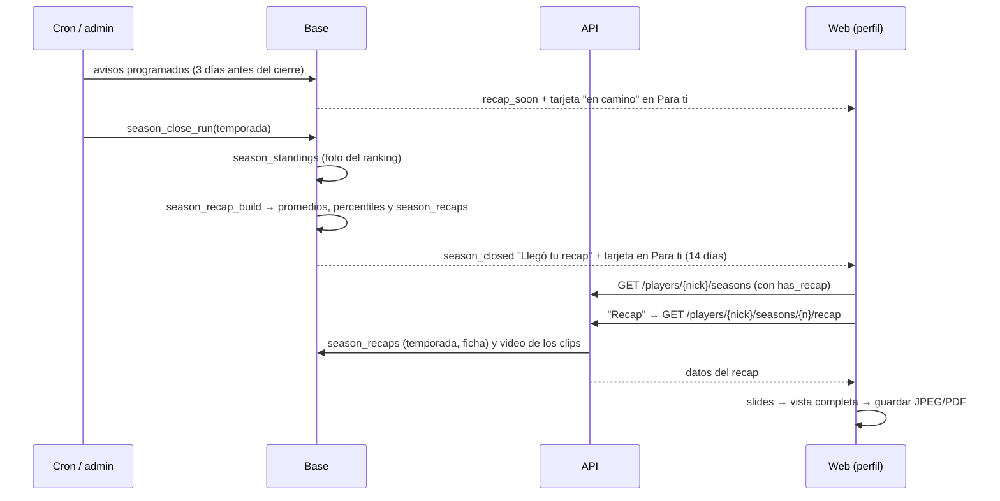

# Plan: recap de fin de temporada

> Planeación original. Estado: **propuesta**, pendiente de aprobación de Kyan. Incluye lo que se sumó al ver el prototipo (`/demo/recap`).

Kyan lo pidió así: al cerrar cada temporada, cada jugador tiene su **recap**, un resumen en formato "historia" (como el Wrapped de Spotify o el recap de FACEIT) que se recorre de a una pantalla. Para verlo: perfil público › **Temporadas** › botón **"Recap"** en la tarjeta de esa temporada. Después de la última slide, la tarjeta se agranda hasta ocupar toda la pantalla y muestra todas las estadísticas, con el fondo de la landing, y se puede guardar como imagen o PDF.

## Decisiones tomadas

| Tema | Decisión | Por qué |
|---|---|---|
| Cuándo se calcula | Al cerrar la temporada, dentro de `season_close_run`, y se guarda en una tabla nueva `season_recaps` (una fila por temporada y ficha, con los datos en `jsonb`) | Es una foto, como `season_standings`: un recálculo posterior del ELO o un mix borrado no la cambia, y verla no cuesta nada |
| Temporadas ya cerradas | El replanteo arma los recaps de las cerradas una sola vez (`season_recap_build(id)` sobre cada una) | Que el botón aparezca también en las temporadas viejas |
| Quién tiene recap | Toda ficha con al menos 1 mix en la temporada (`season_standings.matches > 0`), haya clasificado o no | Es la misma regla que usa el aviso `season_closed` |
| Qué partidas cuentan | Solo los mixes terminados que le movieron el ELO, con el mismo filtro que `season_rank` (`kind = 'mix'`, `status = 'finished'`, `elo_after` no nulo, entre `starts_at` y `closed_at`) | Coincide con los números de la tarjeta de la temporada (mixes, V y D) |
| Promedios y percentiles | Al armar los recaps de una temporada se calcula, por cada cifra, el promedio de todos los que jugaron y el percentil de cada uno. Se guardan en el recap de cada ficha | Cada cifra tiene un globo con "Vos / Promedio" y "Mejor que el N% de los jugadores", y de ahí salen "Tus mejores marcas" |
| Temporada anterior | El recap guarda K/D, ADR, % HS, % de victorias y puesto de la temporada anterior de la ficha (si jugó) | Las flechas "▲ 0,15 vs T2" de la vista completa |
| Clips | Los 3 mejores clips de la ficha en la temporada (`match_clips`), sin los rechazados. Primero los que eligió como destacados (`player_featured_clips`); después, por tipo: ace, 4K, clutch más difícil, 3K | Las jugadas que el jugador ya marcó como suyas pesan más. No hay contador de vistas, así que no se ordena por eso |
| Número de replanteo | `118` | En `origin/main` ya están la `116` y la `117` |
| Ruta de la API | `GET /api/v1/players/{id}/seasons/{number}/recap`, con `optionalUser`, igual a `/players/{id}/seasons`. Completa el video de cada clip igual que `/matches/{id}/clips`. Devuelve 404 si la temporada no está cerrada o si la ficha no tiene recap | Misma visibilidad que las temporadas del perfil |
| Lista de temporadas | `/players/{id}/seasons` suma `has_recap` en cada temporada | La tarjeta muestra el botón solo si hay recap, sin pedirlo antes |
| Ruta de la web | `/player/$nick/recap/$season` (`_app/player.$nick.recap.$season.tsx`), con el número de la temporada | URL propia para compartir el link por Discord |
| Formato | Slides en formato historia: flechas, tocar a los costados, barras de progreso, "Saltar al resumen" y X. Sin avance automático. Después del cierre, la vista completa a pantalla entera con el fondo de la landing | Que cada uno lo lea a su ritmo; con `prefers-reduced-motion` no hay animaciones |
| Gráfico de ELO | El mismo `EloChart` del perfil (globo con ELO, cambio, fecha y mapa; línea del piso del nivel) | Una sola forma de ver el ELO en toda la web |
| Personas | Compañeros, víctima y némesis llevan a su perfil y tienen un globo con su temporada (nivel, ELO, K/D, mixes) y lo que tienen en común (mixes juntos y ganados, o el duelo de kills) | Pedido de Kyan al ver el prototipo |
| Guardar | Botón "Guardar" en la vista completa: **imagen (JPEG)** o **PDF**, con todo menos los clips. Se dibuja en un `<canvas>` en el navegador y el PDF lleva esa imagen | Sin dependencias nuevas. Probado en el prototipo (Kyan abrió el PDF el 2026-11-14) |
| Compartir | "Copiar link" en el cierre y en la vista completa | La imagen para la vista previa de Discord (`og:image`) queda para otra etapa: necesita generarla en el servidor |
| Aviso "por llegar" | Tipo nuevo `recap_soon` (categoría `season`), del mismo job de avisos programados que `season_ending` (replanteo `35`): **3 días antes** del cierre, a toda ficha con al menos 1 mix en la temporada. "Tu recap de la Temporada N llega en 3 días · Llevás X mixes" | Pedido de Kyan. `season_ending` sale a las 24 h y solo a quien tiene la mitad de los mixes; este es para todos y antes |
| Aviso "llegó" | Se reusa `season_closed` (le llega justo a quien tiene recap): pasa a decir "Llegó tu recap de la Temporada N · Terminaste 4.º · Top 10" y lleva al recap en vez de al perfil | Así no caen dos avisos juntos al cerrar |
| Para ti | Tarjeta "Tu recap" en `/home`: desde el aviso `recap_soon` hasta el cierre, con cuenta regresiva, avance de la temporada y un adelanto borroso; después del cierre, "Llegó tu recap" con medalla, puesto, +ELO, % de victorias, kills y "Ver tu recap", durante **14 días** | Pedido de Kyan: que el recap también aparezca en Para ti |
| Rama | El plan y el prototipo van en `kyan/recap` (pedido de Kyan el 2026-11-14). Dónde se implementa la base, la API y la web se pregunta antes de empezar | Regla de ramas del `CLAUDE.md` |
| Perfil del jugador | Se le avisa a Killuaz (Esteban), que lleva el perfil. El recap es una vista aparte y en la pestaña solo se agrega el botón | No se pisa su trabajo |

## 1. El flujo completo

## 2. Contenido del recap

### Slides

Cada slide lleva un dato principal grande y uno o dos de contexto. Una slide sin datos (por ejemplo, sin kills registradas o sin clips) no se muestra. Las cifras tienen el globo con el promedio.

| # | Slide | Datos | De dónde salen |
|---|---|---|---|
| 1 | Portada | "Tu Temporada N", avatar, nick y fechas | `seasons`, `players` |
| 2 | Mixes | Mixes, rondas, horas y el día con más mixes | `match_player_stats.rounds`, `matches.played_at` |
| 3 | Récord | V y D, % de victorias y la racha más larga | `matches.winner_side` contra `ps.team`, en orden de fecha |
| 4 | ELO | Curva (un punto por mix, con fecha y mapa), inicio, pico y final | `ps.elo_before` / `ps.elo_after`, `matches` |
| 5 | Tus números | Kills, K/D, % HS, ADR, MVPs, aperturas, aces y 4K | Sumas de `match_player_stats` |
| 6 | Tu arma | El arma con más kills, qué parte de tus kills fueron con ella y su % HS | `match_kills.weapon` (solo las partidas que la tienen, desde el replanteo `92`) |
| 7 | Mapas | El más jugado y el de mejor % de victorias (mínimo 3 mixes) | `matches.map` |
| 8 | Tu mejor partida | El mix con mejor `rating` (si empatan, más kills), con link al mix | `match_player_stats`, `matches` |
| 9 | Tus mejores jugadas | Los 3 clips: el elegido grande y los otros para cambiar | `match_clips`, `player_featured_clips` |
| 10 | Compañeros | Con quién jugó más y con quién ganó más | `match_player_stats` del mismo `team` |
| 11 | Rivales | Su víctima y su némesis, con el duelo | `match_kills` |
| 12 | Tus mejores marcas | Las 3 cifras con mejor percentil (60 o más), "Top N%" | Los percentiles del recap |
| 13 | Cierre | Medalla (o nivel), puesto, +ELO, % de victorias, K/D, "Ver todas tus estadísticas" y "Copiar link" | `season_standings`, `player_medals` |

### Vista completa

Encabezado con el jugador, la temporada y los botones (ver la historia, copiar link, guardar); chips de "Tus mejores marcas"; puesto con medalla y cambio contra la temporada anterior; gráfico de ELO; las 15 cifras con promedio y flechas contra la temporada anterior; tabla de todos los mapas (mixes, % de victorias y K/D); arma favorita; mejor partida; los 3 clips; compañeros y rivales; y "Ir a mi perfil".

### Datos del `jsonb`

La forma es la del prototipo (`web/frontend/src/routes/-demo-recap/data.ts`, tipo `SeasonRecap`): `season` (con la cantidad de jugadores), `player`, `mixes`, `record`, `elo` (con los puntos), `numbers` (con `rating`), `weapon`, `maps` (lista), `best_match`, `mates` y `rivals` (cada persona con su nivel, ELO, K/D y mixes de esa temporada), `clips`, `compare` (promedio y percentil de cada cifra), `prev` y `final`. Los nicks y avatares de las personas se completan en la API con los actuales.

## 3. Base de datos (replanteo `118`)

`supabase/replanteo/118_recap_temporada.sql`, con su inversa en `reversas/` y una fila en el README del replanteo:

- Tabla `season_recaps (season_id, player_id, data jsonb, created_at)`, con clave `(season_id, player_id)`, `on delete cascade` y lectura para todos (como `season_standings`).
- `season_recap_build(p_season uuid)`: arma las cifras de cada ficha de `season_standings` con `matches > 0`, después los promedios y percentiles de la temporada, y guarda un `jsonb` por ficha (borra antes los de esa temporada, así se puede volver a correr).
- `season_close_run`: llama a `season_recap_build(s.id)` justo después de guardar `season_standings`.
- Al final del replanteo, `season_recap_build` sobre cada temporada `closed`, en orden (para que `prev` encuentre la anterior).
- `has_recap` en la consulta de `/players/{id}/seasons`.
- Avisos: `recap_soon` en el `check` de tipos y en la categoría `season` de `notify`, y su bloque en el job de avisos programados (con `notification_sent` para no repetirlo). El texto de `season_closed` lo arma la web, así que en la base solo se suma `has_recap` a su `data`.
- `my_recap_card()` (o un campo en `/home`): el estado de la tarjeta de Para ti para quien mira: `soon` (temporada activa a menos de 3 días del cierre y con al menos 1 mix, con `ends_at` y los mixes), `ready` (su último recap, de hace menos de 14 días, con el resumen) o nada.

Las columnas de `match_player_stats`, `match_kills` y `match_clips` se confirman contra la copia local de producción antes de escribir la función.

## 4. API

`web/backend/src/routes/seasons.ts` y `schemas/seasons.ts`:

- Ruta nueva `GET /api/v1/players/{id}/seasons/{number}/recap` con su esquema (`SeasonRecap`) en la OpenAPI. Completa nick y avatar actuales de las personas y el video de los clips (como `/matches/{id}/clips`).
- `has_recap` en `PlayerSeason`.
- `GET /api/v1/me/recap-card` (con sesión) para la tarjeta de Para ti, y `recap_soon` en el esquema de avisos.
- Pruebas de la ruta: con recap, temporada activa (404), ficha sin mixes (404) y recap sin clips ni kills.

## 5. Web

Se parte del prototipo (`routes/demo.recap.tsx` y `routes/-demo-recap/`), que pasa a `features/player/recap/` con datos de la API:

- `pnpm gen:api` para traer los tipos.
- `features/player/api/queries.ts`: `seasonRecapOptions(nick, number)`.
- `features/player/components/tabs/SeasonsTab.tsx`: botón "Recap" en `SeasonCard` cuando `has_recap`.
- `features/player/recap/`: `RecapViewer` (historia y vista completa), `hints.tsx` (globos), `clips.tsx`, `export.ts` (JPEG y PDF) y `lib/recap.ts` con los cálculos puros (con pruebas de Vitest, incluido el PDF).
- `routes/_app/player.$nick.recap.$season.tsx`.
- Avisos (`features/shell/notifications/lib/model.ts`): `recap_soon` ("Tu recap de la Temporada N llega en 3 días", al perfil) y el texto nuevo de `season_closed` ("Llegó tu recap…", al recap). Preferencia de avisos: entran en "Temporadas".
- Para ti (`features/home/components/RecapCard.tsx`, en `HomePage` arriba de los bloques, junto a `LevelCard`): la tarjeta en sus dos momentos, como `-demo-recap/notices.tsx`.
- Se borra la ruta `demo.recap` y su carpeta.
- Revisión en el navegador en 1440 y 390 px, claro y oscuro.

Pendiente de la web: en el celular los globos de las cifras no se abren al tocar (el tooltip de shadcn es de mouse y teclado). Se decide al implementar si se cambian por un `Popover`.

## 6. Manual, términos y changelog

- Manual: `docs/manual/jugador/elo-y-estadisticas.md` (cómo ver y guardar el recap), `jugador/notificaciones.md` (los avisos "por llegar" y "llegó") y la página de Para ti si la hay.
- Términos y privacidad: el recap publica datos derivados de partidas que ya son públicas (stats, kills, compañeros, rivales, clips) y promedios de la temporada. Se revisa `/privacidad` y su `.html` en `terms/`: si la lista de lo que se publica del perfil no lo cubre, se suma "el resumen de cada temporada". La imagen y el PDF se generan en el navegador y no se suben a ningún lado.
- `CHANGELOG_DISCORD.txt` para los jugadores.

## 7. Requisitos antes de empezar

- La copia local de producción levantada (Docker) para probar la función con temporadas reales. Según la memoria del 2026-11-12, las pruebas van a la copia y nunca a la base real.
- La API local (`pnpm dev:node`) para `pnpm gen:api`.
- Saber en qué rama se implementa (ver "Rama").

## 8. Orden de implementación

1. Confirmar las columnas de `match_player_stats`, `match_kills` y `match_clips` en la copia.
2. Replanteo `118`: tabla, `season_recap_build` (cifras, promedios, percentiles, clips y temporada anterior), el cambio en `season_close_run`, el armado de las cerradas y la inversa. Probarlo en la copia.
3. API: ruta, `has_recap`, esquemas y pruebas.
4. Web: pasar el prototipo a `features/player/recap/` con la API, botón, ruta y pruebas.
5. Avisos (`recap_soon` y el texto nuevo de `season_closed`) y la tarjeta de Para ti.
6. Documentación, guía, manual, legales (si hace falta), changelog y estado en la bitácora.
7. Despliegue (aplicar la `118` en el VPS, API y web) solo cuando Daniel o Kyan lo pidan.
