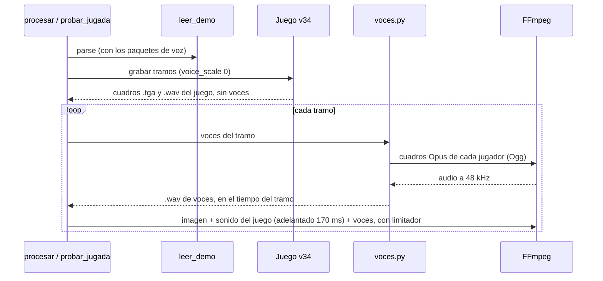
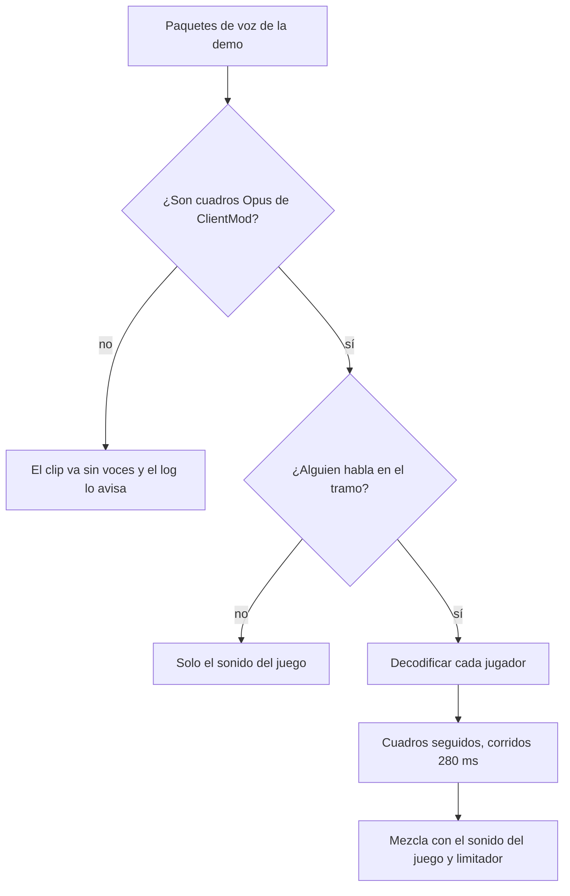

# Las voces de los jugadores en los clips grabados con el v34: documentación

## Qué hace

Con el CS:S v34 normal (`"client": "v34"` en `render/config.json`), los clips no tienen los polígonos deformados de ClientMod, pero el juego no sabe reproducir la voz de los jugadores: sale como interferencia. Este cambio saca las voces de la demo, las decodifica con FFmpeg y las mezcla con el sonido del juego al armar cada tramo del clip. Se escuchan las reacciones de la jugada igual que con ClientMod.

En el juego la voz queda prendida pero sin volumen (`voice_scale 0`): así se siguen viendo abajo a la derecha los íconos de quién habla, sin el ruido.

Además, el sonido del juego del v34 llegaba unos 170 ms tarde respecto de la imagen. Ahora se adelanta al armar cada tramo.

Con ClientMod (`"client": "clientmod"`) no cambia nada: el juego reproduce la voz él mismo.

## Por qué el v34 no reproduce la voz

ClientMod manda la voz comprimida con **Opus** dentro de paquetes `svc_VoiceData` que dicen ser Speex: `svc_VoiceInit` declara `vaudio_speex`. La demo la guarda así. Cada paquete trae uno o más cuadros de 28 bytes, y cada cuadro es un cuadro Opus de 10 ms, mono, con la cabecera `0x60` (híbrido) o `0xd0` (CELT). ClientMod la reproduce como Opus; el v34 cree que es Speex y la decodifica mal.

En la demo de cbble del 2026-11-12 hay 99.856 paquetes de voz, todos múltiplos de 28 bytes, y el 97 % de los cuadros empieza con `0x60` (el resto, con `0xd0`).

## Cómo se arma el audio de voces de un tramo

`voces.track` toma los paquetes de voz con tick entre 2 s antes del tramo y su final, los separa por jugador y, por cada uno:

1. Arma un Ogg Opus mínimo con sus cuadros y lo decodifica con FFmpeg (`libopus`) a 48 kHz, mono. Tiene que dar 480 muestras por cuadro; si no, el tramo va sin voces y el log lo avisa.
2. Pone los cuadros uno detrás de otro, cada 10 ms, como los reproduce el juego. Solo los vuelve a ubicar por el tick después de un silencio de más de 200 ms (una frase nueva).
3. Corre todo 280 ms (`voice_delay`): el juego reproduce la voz ese tiempo después del tick en que llega el paquete.

Después suma los jugadores con la ganancia del `volume 0.4` del cfg, como pasa con ClientMod.

| Regla | Valor | Por qué |
|---|---|---|
| Cuadros seguidos, no por tick | Cada 10 ms dentro de una frase | Los paquetes llegan irregulares (de 1 a 3 cuadros, con saltos). Ubicar cada uno en su tick pisaba cuadros y dejaba huecos de milisegundos, y sonaba como chasquidos, sobre todo con varios hablando |
| Nueva frase | Más de 200 ms sin paquetes | Para no acumular corrimiento entre una frase y otra |
| Corrimiento | 280 ms (`voice_delay`) | Medido contra el audio de ClientMod del clip de siege: la mejor coincidencia |
| Ganancia | 0,4 | El `volume 0.4` de `cmleague_render.cfg`, que en ClientMod también baja la voz |

`ffmpeg_segment` lleva las voces al formato del sonido del juego (44,1 kHz, estéreo), las mezcla sin normalizar y pasa la mezcla por un limitador, para que no sature cuando hablan varios.

## Si la voz no es Opus

`voces.is_opus` revisa los primeros 2.000 paquetes: al menos el 95 % tiene que medir un múltiplo de 28 bytes, y al menos el 95 % de los cuadros tiene que empezar con una cabecera Opus de un solo cuadro mono (los 3 bits bajos en 0). Speex de verdad (un servidor sin la voz de ClientMod) no cumple esto: el clip va sin voces y el log lo dice. Si FFmpeg no puede decodificar un tramo, ese tramo va sin voces y la jugada se graba igual.

## El sonido del juego del v34

El `.wav` que escribe `startmovie` en el v34 queda unos 170 ms atrasado respecto de la imagen. Se midió con el 4k de spr en cbble: al sonido del clip del v34 se le restaron las voces mezcladas y se comparó con el del mismo clip grabado con ClientMod, en el que los disparos suenan en el tick de la kill. En los tres tramos, la mejor coincidencia fue a −170, −160 y −180 ms. `ffmpeg_segment` lo adelanta 0,17 s (`game_audio_advance`), y después la mejor coincidencia queda en 0 ms.

## Claves de `config.json`

| Clave | Por defecto | Para qué |
|---|---|---|
| `voice_delay` | 0,28 | Segundos que se corren las voces respecto del tick del paquete |
| `game_audio_advance` | 0,17 con `"v34"` y 0 con ClientMod | Segundos que se adelanta el sonido del juego |

## Qué cambia para cada rol

Nada para los usuarios: los clips siguen teniendo las voces de la jugada, como con ClientMod.

## Términos y privacidad

`/privacidad` decía que los clips "no incluyen voz". No era cierto ni con ClientMod. Ahora dice que en los clips se escucha lo que los jugadores dijeron por el chat de voz durante la jugada, y que la demo incluye el chat escrito y el de voz. Cambió en la web (`PrivacyPage.tsx`) y en `terms/privacidad.html`, con la fecha de actualización al 14 de noviembre de 2026 (`LEGAL_UPDATED` y los dos `.html`).

## Dónde está cada cosa

| Qué | Archivo |
|---|---|
| Los paquetes de voz de la demo | `render/leer_demo.py` (`Demo.voice`, `Demo.voice_codec`, `Bits.bytes`) |
| Detección, decodificación y armado de las voces | `render/voces.py` |
| `voice_scale 0`, la mezcla y el adelanto del sonido del juego | `render/render_clip.py` (`Game.prepare`, `ffmpeg_segment`, `encode`) |
| Pasarle las voces a `encode` | `render/procesar.py` y `render/probar_jugada.py` |
| Configuración del portátil | `render/CONFIGURAR_PORTATIL.md`, paso 3b |
| Pruebas | `pruebas/` |
