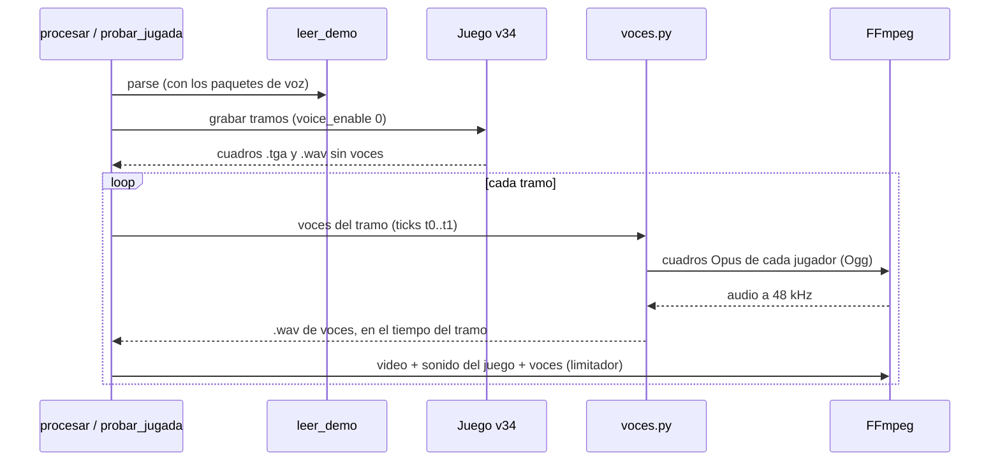

# Plan: las voces de los jugadores en los clips grabados con el v34

> Planeación original. Estado: **aprobado** por Daniel el 2026-11-14 ("ahora se escucha bien, intégralo al render"), después de la prueba con el 4k de siege en cache.

## Decisiones tomadas

| Tema | Decisión |
|---|---|
| El problema | Con el CS:S v34 normal (`"client": "v34"`, [`2026-11-04-render-sin-launcher`](../2026-11-04-render-sin-launcher/)) los clips no tienen los polígonos deformados, pero las voces de los jugadores suenan como interferencia. A los jugadores les gusta escuchar las reacciones de la jugada |
| La causa | ClientMod manda la voz comprimida con **Opus** dentro de paquetes que dicen ser Speex (`svc_VoiceInit` declara `vaudio_speex`). La demo la guarda así: trozos de 28 bytes, cada uno un cuadro Opus de 10 ms, mono (cabecera `0x60` o `0xd0`). ClientMod la reproduce bien; el v34 la decodifica como Speex y sale ruido |
| La prueba (2026-11-14) | Con la demo de `srv2-20261113T174548-aa29` y el clip `53900f5c`: 637 cuadros de 4 jugadores, decodificados con FFmpeg (`libopus`) sin errores (480 muestras por cuadro). Comparadas cada 10 ms con el audio del clip de ClientMod: correlación 0,70 con 280 ms de corrimiento. Daniel la escuchó: "se escucha bien" |
| El arreglo | Solo con `"client": "v34"`: la voz del juego se apaga (`voice_enable 0`, sin ruido ni íconos de voz) y, al armar cada tramo, las voces de la demo se decodifican y se mezclan con el sonido del juego |
| Cómo se ubican | Los cuadros de cada jugador van uno detrás de otro, cada 10 ms, como los reproduce el juego. Solo se vuelven a ubicar por el tick después de un silencio de más de 200 ms. Ubicar cada paquete en su tick hacía chasquidos (los paquetes llegan irregulares, de 1 a 3 cuadros) |
| El corrimiento | 280 ms después del tick del paquete (el juego no reproduce la voz apenas llega). Configurable con `voice_delay` en `config.json` |
| El volumen | Las voces con ganancia fija (la de `volume` del cfg, 0,4, como pasa con ClientMod) y un limitador al mezclar, para que no sature cuando hablan varios |
| Si no es Opus | Si los trozos no tienen cabeceras de Opus (un servidor sin la voz de ClientMod) o FFmpeg no los decodifica, el tramo va sin voces y el log lo avisa. No se cae la jugada |
| ClientMod | Sin cambios: sigue reproduciendo la voz él mismo |
| Términos y privacidad | `/privacidad` dice que los clips "no incluyen voz", y ya la incluían con ClientMod. Se corrige: los clips y las demos incluyen el chat de voz de la partida. En la web (`PrivacyPage.tsx`) y en `terms/privacidad.html` |

## 1. El flujo

## 2. Cambios

- `render/leer_demo.py`: guarda los paquetes de voz (`svc_VoiceData`: tick, cliente y datos) y el códec de `svc_VoiceInit`.
- `render/voces.py` (nuevo): detecta si es Opus, arma un Ogg Opus por jugador, lo decodifica con FFmpeg y devuelve el audio de un tramo ubicado como en la prueba.
- `render/render_clip.py`: `voice_enable 0` en el cfg con `"v34"`; `encode` y `ffmpeg_segment` mezclan las voces del tramo con el sonido del juego.
- `render/procesar.py` y `render/probar_jugada.py`: le pasan a `encode` los paquetes de voz de la demo.
- `render/CONFIGURAR_PORTATIL.md`: `voice_delay` y qué pasa con la voz en el v34.
- `/privacidad` (web y `terms/`): los clips y las demos incluyen el chat de voz.

## 3. Pruebas

1. Sin el juego: el audio de voces del clip de siege con `voces.py` igual al de la prueba (correlación con el audio de ClientMod).
2. Que el lector de demos siga dando lo mismo (rondas, kills, cámara) y cuánto tarda de más.
3. Con el juego, en la PC (el v34 de `E:\CSS v34 eXpandedCS`): un clip de cbble con voces, y escucharlo.
4. En el portátil: el clip de siege, y que lo escuche Daniel.

## 4. Orden

1. Los cambios y las pruebas 1 a 3.
2. Commit (cuando Daniel lo pida), `git pull` en el portátil y la prueba 4.
3. Pasar la tarea del portátil a `"client": "v34"` (otra decisión de Daniel).
