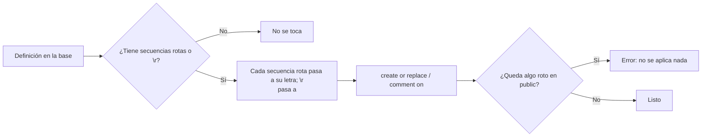

# Los acentos rotos de la 117 en producción: documentación

## Qué pasó

La `117` (rol Soporte) se aplicó en producción el 2026-11-14 leyendo el archivo como WIN1252 y no como UTF-8, y con finales de línea `\r\n`. Cada letra acentuada quedó como dos o tres caracteres: "acción" como "acción", "›" como "›". Así le llegaban al soporte algunos mensajes de error, y así quedaron algunos comentarios de la base.

Lo encontró la prueba de la inversa de la `121` ([`2026-11-14-limites-baneo-soporte`](../2026-11-14-limites-baneo-soporte/)). La `121` reescribió bien `ban_create`, `ban_update` y `ban_support_quota`. La `122` arregla el resto.

## Qué arregla la `122`

| Qué | Dónde estaba roto |
|---|---|
| `ban_lift`, `team_staff_remove_logo` | Toda la función (la `117` la reescribió entera) |
| `clip_reject`, `clip_reprocess`, `clip_review_ok`, `mm_admin_lists`, `profile_comment_delete` | Solo lo que la `117` les agregó (las cambió con reemplazos sobre la definición que había) |
| Comentarios | `support_actions`, `match_clips.video_reprocessed_by` y `support_actions_list` |

- `pg_temp.acentos(texto)` arma, para cada carácter de una lista (á é í ó ú É Ó Ú ñ Ñ ü Ü ¿ ¡ « » ° º ª – — ‘ ’ “ ” … • › ‹ €), su versión rota con `convert_from(convert_to(c, 'UTF8'), 'WIN1252')` y la reemplaza. Los caracteres van como `chr(n)`, así la migración no depende de la codificación con la que se lea el archivo.
- Reemplaza solo las secuencias rotas y no convierte la función entera, porque cinco de las siete mezclaban texto roto con texto que estaba bien.
- Los comentarios los busca todos en `public` con `pg_identify_object` y los reescribe con `comment on`.
- Al final comprueba que ninguna función ni comentario de `public` tenga secuencias rotas. Si queda alguna, falla y no se aplica nada.
- `create or replace` conserva el dueño y los permisos.
- En una base sin nada roto (la local, o una armada desde cero) no cambia nada.

No tiene inversa: volver a romper los acentos no sirve.

## Qué cambia para cada rol

| Rol | Qué cambia | Página del manual |
|---|---|---|
| Soporte y moderador | Los mensajes de error al levantar baneos, revisar clips, borrar comentarios y quitar logos salen con los acentos bien | — |
| Jugador, capitán, organizador, admin, streamer, dueño de un servidor externo | Nada | — |

No cambia ninguna página del manual.

## Términos y privacidad

Sin cambios.

## Dónde está cada cosa

| Qué | Dónde |
|---|---|
| Base | `supabase/replanteo/122_acentos_117.sql`; la inversa (`docs/bitacora/2026-10-14-replanteo-modelo-datos/reversas/122_acentos_117.sql`) solo explica por qué no tiene |
| Pruebas | `pruebas/probar_122.sh` (local: rompe las funciones como en producción, aplica la `122` y comprueba que quedan idénticas) y `pruebas/probar_122.sql` (también para producción, con rollback) |
