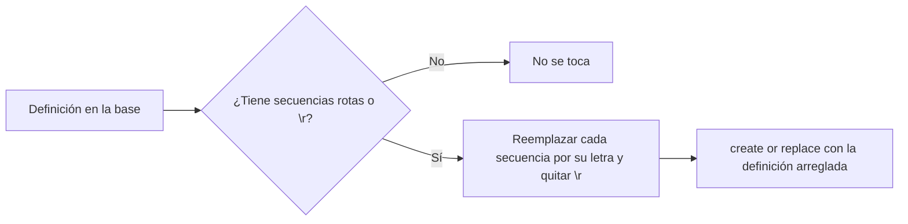

# Plan: los acentos rotos de la 117 en producción

> Planeación original. Estado: **aprobado** por Daniel el 2026-11-15 ("arregla los acentos de las otras siete funciones").

Al desplegar la `117` (rol Soporte, [`2026-11-13-rol-soporte`](../2026-11-13-rol-soporte/)) el 2026-11-14, el archivo se leyó como WIN1252 y no como UTF-8. En producción quedaron textos como "acción" en vez de "acción". La `121` ([`2026-11-14-limites-baneo-soporte`](../2026-11-14-limites-baneo-soporte/)) reescribió bien `ban_create`, `ban_update` y `ban_support_quota`. Este cambio arregla lo que queda.

## Decisiones tomadas

| Tema | Decisión | Por qué |
|---|---|---|
| Qué se arregla | Las siete funciones (`ban_lift`, `clip_reject`, `clip_reprocess`, `clip_review_ok`, `mm_admin_lists`, `profile_comment_delete` y `team_staff_remove_logo`) y dos comentarios (`support_actions` y `match_clips.video_reprocessed_by`) | Es todo lo que encontró la búsqueda en producción: funciones, comentarios, vistas, restricciones, valores por defecto y políticas |
| Cómo | La migración toma la definición que está en la base y reemplaza solo las secuencias rotas ("ó" → "ó", y así con cada letra acentuada, la ñ, ¿, ¡, comillas y rayas). También quita los `\r` de los finales de línea | Varias de esas funciones mezclan texto roto (lo que la `117` les agregó) con texto que ya estaba bien: convertir la función entera rompería lo que está bien. Copiar las definiciones a mano arriesga pisar cambios posteriores |
| Dónde corre | En cualquier base: donde no hay nada roto (local, una base armada desde cero) no cambia nada | Una migración que se puede aplicar siempre |
| Permisos | `create or replace` conserva el dueño y los permisos | No hace falta repetir `grant` ni `revoke` |
| Inversa | No tiene: volver a romper los acentos no sirve. El archivo de la inversa lo explica | — |
| Número | `122` | La `121` es la última en `main` |
| Ramas | Solo `main`, como la `117`: `feat/frontend-fase-1` y `feat/mm-claim-en-sala` siguen en la `105` y no tienen la `117` | `mm_admin_lists` es del matchmaking, pero lo roto vino con la `117` |
| Manual, `/terminos` y `/privacidad` | Sin cambios | Solo cambian los textos de los mensajes de error |

## 1. El flujo

## 2. La base: `122_acentos_117.sql`

- Una función temporal `pg_temp.arreglar(texto)` que reemplaza cada secuencia rota por su carácter: arma la secuencia con `convert_from(convert_to(c, 'UTF8'), 'WIN1252')` para cada carácter de la lista, así no hay que escribir el texto roto en el archivo.
- Para cada una de las siete funciones: si `arreglar(definición)` es distinto, la ejecuta.
- Para los dos comentarios: lo mismo, con `comment on`.
- Al final comprueba que en `public` no quede ninguna función ni comentario con secuencias rotas.

## 3. Pruebas

- **Local:** se rompe a propósito una copia de las siete funciones y de los comentarios (como quedaron en producción), se aplica la `122` y se comprueba que vuelven a ser idénticas a las de antes. En una transacción que se deshace.
- **Producción, con rollback:** aplicar la `122` en una transacción, comprobar que no quedan secuencias rotas y que las funciones siguen andando, y deshacer.

## 4. Orden

1. La `122` y su prueba, en local.
2. La prueba con rollback en producción.
3. La `122` en producción (con `PGCLIENTENCODING=UTF8`).
4. `DOCUMENTACION.md`, `GUIA_IMPLEMENTACION.md`, la fila de `docs/bitacora/README.md` y la del README del replanteo.
