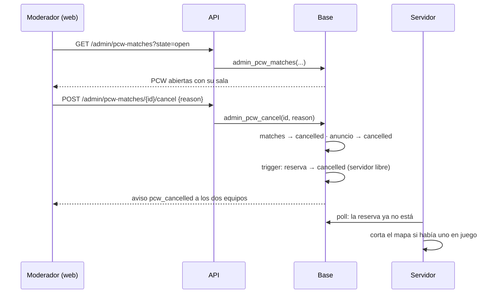
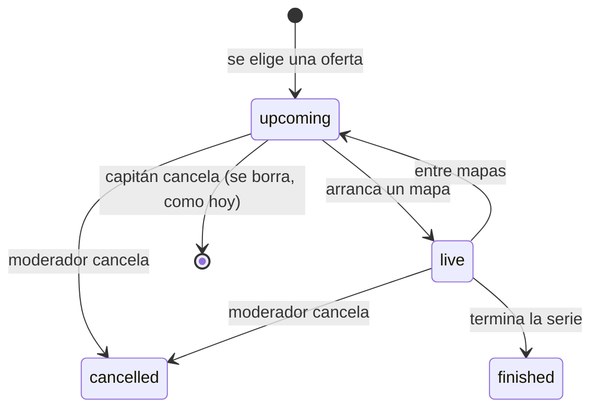

# Plan: menú "PCW" en Administración para cancelar PCW

> Planeación original. Estado: **propuesta**, pendiente de aprobación de Daniel.

Pedido de Daniel (2026-11-15): poder cancelar una PCW desde la web. Hasta ahora, un moderador no tenía cómo hacerlo: el mismo día hubo que cancelar dos a mano en la base (`93b82fc4-…`, ETHEREAL vs GO TO KNOW, con el #3 asignado, y `078a6c52-…`, Pick de kyan vs GO TO KNOW, en el veto). Daniel propuso un menú aparte llamado "PCW".

## Lo que hay hoy

| Qué | Quién | Qué hace | Por qué no alcanza |
|---|---|---|---|
| `cancel_pcw_match` (`POST /pcw/matches/{id}/cancel`) | Capitanes de la PCW o admin | **Borra** la partida y pasa el anuncio a `cancelled` | No deja historial ni avisa a nadie. La reserva se borra en cascada sin pasar por `booking_close`. El moderador no puede usarla, y en Administración no hay botón |
| `match_booking_action('cancel')` y `match_booking_release` | Moderador | Cierran la **reserva** del servidor | La PCW sigue `upcoming`, y los equipos pueden volver a marcar "Listos" |
| Sanciones de PCW | Moderador y admin | Administración › Equipos › Sanciones de PCW | Están en el menú de Equipos |

## Decisiones tomadas

| Tema | Decisión | Por qué |
|---|---|---|
| Menú | Ítem nuevo **"PCW"** en Administración (`/admin/pcw`, sección `pcw`, ícono de la mira como el PCW de Jugar), entre "Equipos" y "Servidores y ELO" | Lo pidió Daniel |
| Quién entra | Moderador y admin | Las sanciones de PCW y el cierre de reservas ya son del moderador |
| Pestañas | **Partidas** (la nueva) y **Sanciones**, que se **mudan** desde Equipos › Sanciones de PCW. En Equipos se quitan | Todo lo de PCW junto. El componente `PcwBansTab` se mueve sin cambios |
| Qué lista "Partidas" | Las PCW con filtro **Abiertas** (`upcoming` o `live`; por defecto), **Canceladas**, **Terminadas** y **Todas**, y búsqueda por nombre de equipo | Para encontrar la que hay que cancelar y ver qué se canceló |
| Columnas | Equipos (nombre de cada bando), estado de la sala (sin listos, un equipo listo, veto, en fila, servidor asignado, en juego, entre mapas), servidor, mapas jugados de la serie, creada, y las acciones **Ver** (lleva a `/match/{id}`) y **Cancelar** | Lo que hace falta para decidir sin abrir la partida |
| Cómo se cancela | Función nueva `admin_pcw_cancel(p_match, p_reason)`: la partida pasa a `cancelled` con `cancel_reason = 'admin'` y `cancelled_by` = el nick de quien la cancela (como en los mix). **No la borra** | Queda el historial y quién la canceló, igual que la cancelación manual de hoy |
| La reserva | No se toca a mano: el trigger `booking_on_match` la cierra al pasar la partida a `cancelled` (`match_cancelled`) y libera el servidor | Es lo que pasó con las dos cancelaciones manuales |
| El anuncio | `pcw_posts.status = 'cancelled'`, como hace `cancel_pcw_match` | Hoy lo hubo que corregir a mano |
| Con un mapa en juego | **Se puede**, con una advertencia en la confirmación ("hay un mapa en juego: el servidor lo corta"). Al implementar se verifica en el plugin qué hace con una reserva cerrada en vivo (`match_booking_release` dice que el servidor lo corta en el poll) | Es justo cuando más hace falta (por ejemplo, un equipo que no se presenta y el otro esperando) |
| Mapas ya jugados | Quedan como están. La serie pasa a `cancelled` | Las PCW no mueven el ELO (replanteo 88). Lo que se jugó, se jugó |
| Sanción | **Ninguna**. Cancelar no es abandonar (`booking_abandon` sí sanciona) | Si el moderador quiere sancionar, para eso están las sanciones |
| Motivo | Opcional, hasta 200 caracteres. Va en el aviso a los dos equipos | Que los jugadores sepan por qué |
| Aviso | `pcw_cancelled` a los planteles de los dos bandos (`match_side_users`), con `reason = 'admin'` y el motivo. La web muestra "Un moderador canceló la PCW" y el motivo, con link a la partida | Hoy el aviso solo existe para "ya no estamos listos" |
| Número | Replanteo **`123`** | `main` llega a la `116`, y `feat/rol-soporte` ya usa de la `117` a la `122` |
| Rama | `main` (base, API y web) | Es PCW, no matchmaking: no va a `feat/mm-claim-en-sala` |
| Términos y privacidad | Se suma en `/terminos` (sección 9) que un moderador puede cancelar una PCW, que no cuenta para nadie y que no sanciona. `/privacidad`: sin cambios (el nick de quien cancela no se muestra a los jugadores) | Es una regla nueva sobre las PCW |

## 1. El flujo completo

## 2. Base de datos (replanteo `123_admin_pcw.sql`)

- `admin_pcw_matches(p_state text, p_q text, p_sort text, p_order text, p_limit int, p_offset int)`: devuelve `jsonb` con `items` y `total`, con `is_moderator()`, como `admin_pcw_bans`. Cada fila: `id`, `status`, `side1`/`side2` (nombre), `booking` (estado, servidor, `map_no`), `maps_played`, `best_of`, `created_at`, `starts_at`, `cancel_reason`, `cancelled_by`.
- `admin_pcw_cancel(p_match uuid, p_reason text default null)`: `is_moderator()`; `kind = 'pcw'` y `status in ('upcoming', 'live')` (si no, error claro); `for update`; actualiza `matches` y `pcw_posts`; manda `notify(..., 'pcw_cancelled', {match_id, title, reason: 'admin', note})`.
- `revoke` a `public` y `anon`, `grant` a `authenticated`. La inversa en `docs/bitacora/2026-10-14-replanteo-modelo-datos/reversas/123_admin_pcw.sql` y una fila en `supabase/replanteo/README.md`.
- Pruebas SQL en `pruebas/`: cancelar abierta sin reserva, con reserva `assigned`, en vivo, ya cancelada o terminada (error), siendo jugador (error 42501), y que el servidor quede libre y lleguen los avisos.

## 3. API (`web/backend/src/routes/bookings.ts`, junto a `pcw-bans`)

- `GET /api/v1/admin/pcw-matches` (`requireModerator`), con `listQuery`, `state` (`open`, `cancelled`, `finished`, `all`) y `q`.
- `POST /api/v1/admin/pcw-matches/{id}/cancel` (`requireModerator`), cuerpo `{ reason?: string (≤200) }`, `204`.
- Pruebas unitarias como `mm-admin-lobby.test.ts`.

## 4. Web

- `auth/permissions.ts`: sección `pcw` en `ADMIN_SECTIONS`, con acceso para el moderador.
- `shell/lib/nav.ts`: el ítem "PCW" y su título en las migas.
- `routes/_app/admin.pcw.tsx` y `features/admin/pcw/`: la página con las pestañas Partidas y Sanciones (`PcwBansTab` se mueve desde `admin/teams/components/` y sale de `AdminTeamsPage`).
- `PcwMatchesTab`: la tabla (`AdminTable` + `useServerTable`, filtros con `FilterChips`, `SearchBox`) y un `ConfirmDialog` con el campo de motivo y la advertencia si hay un mapa en juego.
- `shell/notifications/lib/model.ts`: `pcw_cancelled` con `reason = 'admin'` muestra "Un moderador canceló la PCW", el motivo y el link.
- Pruebas en Vitest: permisos, menú, aviso y la pestaña.

## 5. Documentación y manual

- `docs/manual/moderador/sanciones-pcw.md`: la ruta nueva (Administración › PCW › Sanciones).
- `docs/manual/moderador/cancelar-pcw.md` (nueva): cómo cancelar una PCW.
- `docs/manual/capitan/jugar-pcw.md`: que un moderador puede cancelarla y qué aviso llega.
- `/terminos` (`TermsPage.tsx` y `terms/terminos.html`, sección 9).
- `DOCUMENTACION.md`, `GUIA_IMPLEMENTACION.md`, la fila en `docs/bitacora/README.md` y `docs/PENDIENTES.md`.

## 6. Requisitos antes de empezar

- Ojo con el árbol de `main`: tiene cambios sin commit de [`2026-11-13-nombre-de-la-ficha-en-mix`](../2026-11-13-nombre-de-la-ficha-en-mix/) (`TermsPage.tsx`, `terminos.html`, el README de la bitácora y el de replanteo). El commit de este requerimiento tiene que llevar solo lo suyo.
- Para probar contra la base: la copia local de producción (Docker). Si no está levantada, la `123` se prueba dentro de una transacción con `rollback`.
- `feat/rol-soporte` trae un sistema de permisos nuevo (`118_permisos`). Al juntarlo, la sección `pcw` se tiene que sumar ahí.

## 7. Orden de implementación

1. Replanteo `123`, su inversa y las pruebas SQL.
2. Rutas de la API y sus pruebas.
3. Web: permisos, menú, página con las dos pestañas, la mudanza de Sanciones y el aviso.
4. Vitest y revisión en el navegador (modo demo).
5. Manual, `/terminos`, documentación, guía, la fila en la bitácora y los pendientes.
6. Despliegue cuando Daniel lo pida: la `123` en el VPS, después la API y la web.
