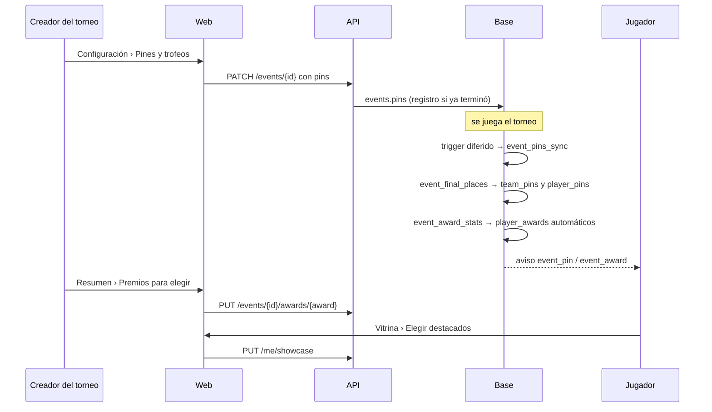
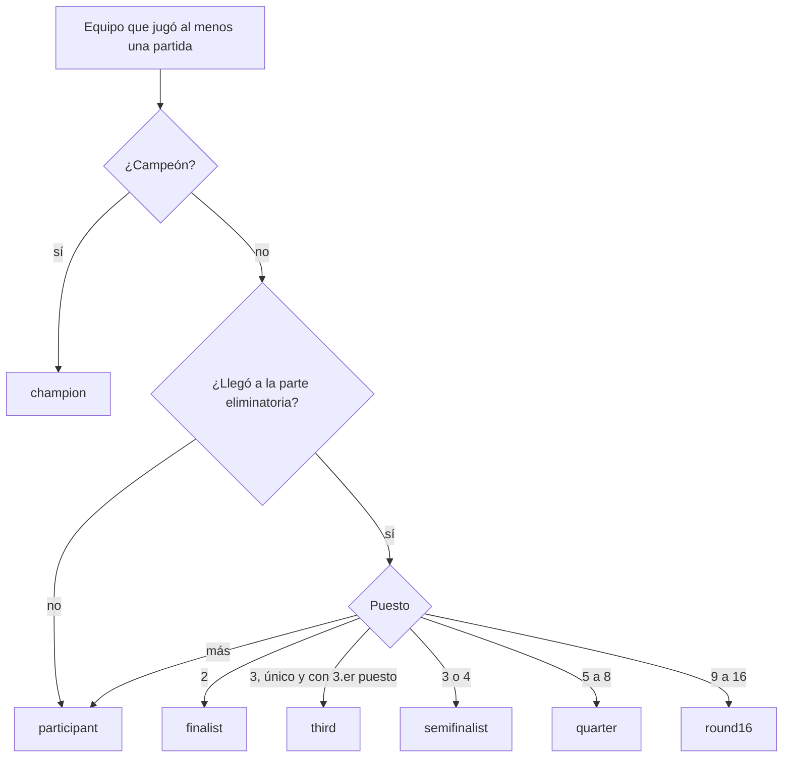

# Pines y trofeos de torneo: documentación

## Qué hace

Cada torneo reparte **pines** según el puesto final de cada equipo, de Campeón a Participante, y **premios individuales** (MVP, top fragger, mejor AWP, rey del clutch, mejor puntería, más daño, entry y jugada del torneo). Cada equipo recibe **un solo pin**, el de su puesto final. Quien creó el torneo (organizador o moderador) y cualquier admin eligen el diseño, qué puestos dan pin (con su metal y un mínimo de equipos) y cómo se da cada premio. La configuración se puede cambiar también con el torneo terminado: se recalcula y queda registrada.

Los pines llegan al equipo y a sus jugadores, que los ven en la **Vitrina** de su perfil. El Resumen muestra hasta 6 destacados, que el jugador elige o que se eligen solos, y la pestaña **Vitrina** los muestra todos. La vitrina del equipo y la página del torneo también muestran los pines.

Los pines **reemplazan** a las medallas automáticas de campeón y finalista de la `114`. Las que ya se habían dado (también las manuales que la `114` adoptó) se convirtieron en pines. Las dos medallas vuelven a ser **manuales**, para los torneos de fuera de la plataforma.

## El puesto de cada equipo

`event_final_places(evento)` mira solo la parte eliminatoria: los playoffs (`ko` y `third`, en la última fase) o, en doble eliminación, las llaves `upper`, `lower` y `grand`. A cada partida le da una clave: más alta, más tarde en el torneo.

- En `ko`, la clave es 2 × la ronda. El partido por el 3.º va entre semis y la final.
- En doble eliminación, `upper` vale 0 (perder ahí no elimina), `lower` vale su ronda y `grand` vale 1000 + su ronda.

El equipo se queda con la clave de la última partida que jugó, más 0,5 si la ganó. El campeón tiene la clave máxima. **Puesto = 1 + los equipos con una clave mayor.** Los empatados comparten el número.

- **Liga** (grupos de un solo clasificado, sin playoffs): el puesto es el de la tabla (`event_group_order`). 1.º campeón, 2.º finalista, 3.º tercer puesto y el resto, participante.
- **Tercer puesto** existe solo con partido por el 3.º, en doble eliminación o en una liga. Sin eso, el 3.º es semifinalista.
- **Participante** es quien no llegó a la parte eliminatoria (grupos o suizo) o quedó afuera antes de octavos.

Después se aplica la configuración. Si el escalón está apagado o no se llega a su mínimo de equipos (`min_teams`, que cuenta los equipos que jugaron), ese equipo no recibe pin. Única excepción: con «Tercer puesto» apagado, el 3.º recibe «Semifinalista».

**Quién recibe el pin del equipo:** los inscritos con ese equipo (`tournament_registration_players`), salvo los suplentes que no jugaron ningún mapa del torneo. En un histórico, todo el plantel inscrito. Los invitados sin ficha (`guest_names`) no lo reciben.

**Qué torneos reparten:** los terminados, aprobados y fuera de testing, como hacía la `114`.

## Premios individuales

`event_award_stats(evento)` suma las stats de los mixes vinculados (y aprobados) a las partidas del torneo, y de cada jugador según el equipo con el que está inscrito.

| Premio | Cifra | Mínimo |
|---|---|---|
| `mvp` | Rating promedio (ponderado por rondas) | La mitad de los mapas de su equipo |
| `top_fragger` | Kills | La mitad de los mapas |
| `hs` | % de headshots | 50 kills |
| `adr` | Daño / rondas | La mitad de los mapas |
| `entry` | Primeras kills | La mitad de los mapas |
| `awp` | Kills con AWP (`match_player_extra`) | 10 |
| `clutch` | Clutches ganados 1v1 a 1v5 (`match_player_extra`) | 2 |
| `play` | — | Solo a mano, con un clip del torneo |

- **Automático** (`mode = auto`): gana el de mejor cifra. El empate se desempata por kills, ADR y rating, y si sigue, ganan todos los empatados. Si nadie llega al mínimo, el premio queda desierto.
- **Lo elijo yo** (`mode = pick`): queda pendiente hasta que el organizador lo elige.
- `event_award_candidates` devuelve **todo el plantel inscrito**: primero los 10 mejores por la cifra del premio, entre los que llegan al mínimo (`suggested`), y después el resto. El organizador puede elegir a cualquiera, y la web le da un buscador para el resto.
- Si el torneo no tiene stats para el premio (`event_award_calculable`), nadie sale como sugerido y solo se puede elegir a mano.
- Una elección a mano (`manual`) pisa al automático y se mantiene en los recálculos, mientras el jugador siga inscrito.

## Recálculo

`event_pins_sync(evento)` deja los pines y los premios automáticos iguales al resultado y a la configuración. Se dispara con triggers diferidos (`event_pins`, al confirmar la transacción):

- en `events`, al cambiar `status`, `champion`, `approval`, `testing`, `name` o `pins`;
- en `tournament_registrations` y `tournament_registration_players`;
- en `matches`, al cambiar `status`, `winner`, `team1`, `team2`, `bye` o `parent_approved`, si el torneo (o el de la partida padre de un mix vinculado) está terminado.

Cada pin de jugador y cada premio avisa **una sola vez** (`notified`): un recálculo no vuelve a avisar. No avisan los torneos históricos ni lo que corre con `cmleague.pins_quiet = 'on'`, como el retroactivo.

Cada cambio de `events.pins` con el torneo terminado queda en `event_pins_log`: quién, cuándo, antes y después.

## Vitrina

- `player_showcase_prefs.mode`: `auto` o `manual`.
- `player_showcase`: los destacados (`pin` o `award`, hasta 6, en orden).
- `player_showcase_shown`: en `manual`, los elegidos; en `auto`, los 6 mejores pines por puesto y después los premios (el MVP antes que los demás), del más reciente al más viejo.
- `player_showcase_set(modo, items)`: lo llama el dueño. Solo acepta pines y premios propios.

## Datos

| Objeto | Qué es |
|---|---|
| `events.pins` | Configuración (`enabled`, `style`, `tiers`, `awards`). `null` o lo que falte = `pins_default()`. `pins_valid` la valida y `pins_config` la completa |
| `team_pins` | Un pin por equipo y torneo: `tier`, `place`, `year` |
| `player_pins` | Los jugadores que lo reciben, con `notified` |
| `player_awards` | Los premios: `award`, `value`, `manual`, `clip_id`, `picked_by`, `notified` |
| `event_pins_log` | Cambios de la configuración con el torneo terminado |
| `player_showcase`, `player_showcase_prefs` | Destacados del jugador |
| `team_pin_list`, `player_pin_list`, `player_award_list` | Vistas con el torneo, el equipo, el estilo y el metal resueltos |
| `player_medals_123_respaldo` | Las medallas de torneo que se reemplazaron, para la inversa. Se puede borrar después del 2026-12-15 |

## API

| Ruta | Qué hace |
|---|---|
| `POST` / `PATCH /api/v1/events` | Aceptan `pins` (`PinsConfigInput`) |
| `GET /api/v1/events/{id}/pins` | Configuración efectiva y propia, pines por puesto, premios, pendientes y qué premios se pueden calcular |
| `GET /api/v1/events/{id}/awards/{award}/candidates` | Todo el plantel para elegir a mano, con los 10 sugeridos primero (creador o admin) |
| `PUT` / `DELETE /api/v1/events/{id}/awards/{award}` | Elegir o borrar la elección |
| `GET /api/v1/events/{id}/clips` | Clips del torneo para la jugada (creador o admin) |
| `GET /api/v1/players/{id}/showcase` | Vitrina del jugador: destacados, pines y premios |
| `PUT /api/v1/me/showcase` | Guardar los destacados |
| `GET /api/v1/teams/{id}/pins` | Vitrina del equipo |

## Web

- `features/pins/`: `TournamentPin` y los dibujos del prototipo de Kyan, más `PinTile` (el pin con su leyenda), `PinsFields` (la sección del formulario), `EventPinsSection` (el podio del torneo y la elección de premios), `config.ts` (los valores por defecto y qué escalones existen en cada formato) y `api.ts`.
- **Perfil:**
  - Resumen: la Vitrina, en la columna izquierda, debajo de Partidas recientes.
  - **Logros** (pedido por Daniel, 2026-11-15): en la columna izquierda, debajo de la Vitrina, hasta 10, el alto de «Jugadas clave» (600 px medidos en escritorio; cada logro ocupa 54 px), con «Ver todos los logros». Como la vitrina, se eligen solos (los de más veces conseguidos y los más recientes) o los marca el dueño en la pestaña Logros › **Elegir logros del Resumen** (`player_medal_featured`, `player_showcase_prefs.medals_mode`, `player_medals_featured_set`; `GET /players/{id}/medals/featured` y `PUT /me/medals/featured`). `/medals/summary` suma `definition_id` y `rank`, que con el título identifican cada logro.
  - **Mejores mapas** (pedido por Daniel, 2026-11-15): en la columna derecha, arriba de Jugadas clave, los 3 mapas más jugados con partidas, victorias, derrotas, % de victorias y rating, y «Ver todos los mapas». Sale de la misma consulta de la pestaña Mapas. Equilibra las dos columnas del Resumen.
  - La pestaña **Vitrina** nueva, con **Elegir destacados**.
  - En la pestaña Logros, la sección «Vitrina» de medallas pasa a llamarse «Destacadas», para no repetir el nombre.
- **Formulario del torneo:** la sección **Pines y trofeos**, debajo del formato. `pins` viaja solo si se tocó la sección, para no recalcular sin querer.
- **Torneo › Resumen:** al terminar, «Pines y premios» con el podio y, para quien gestiona el torneo, «Premios para elegir».
- **Equipo › Vitrina:** los pines del equipo.
- **Avisos:** `event_pin` y `event_award`, con el pin dibujado.
- El demo `/demo/pines` sigue disponible, solo en desarrollo.

## Qué cambia para cada rol

| Rol | Qué cambia | Página del manual |
|---|---|---|
| Jugador | Recibe pines y premios en vez de las medallas de torneo (las que tenía pasaron a pines). Ve la Vitrina en su perfil y elige sus destacados. Logros del Resumen muestra 5 | `jugador/vitrina-y-pines.md`, `jugador/logros.md` |
| Capitán | La vitrina del equipo muestra los pines | `jugador/vitrina-y-pines.md` |
| Organizador | Configura pines, diseño y premios al crear o editar su torneo, también terminado, y elige los premios a mano | `organizador/pines-y-premios.md`, `organizador/crear-torneo.md`, `organizador/resultados-y-llave.md`, `organizador/subir-torneo-historico.md` |
| Moderador | Lo mismo que el organizador en los torneos que creó | Las de organizador (la sección también la ven los moderadores) |
| Admin | Lo mismo en cualquier torneo. Campeón y Finalista de torneo vuelven a ser medallas a mano, para torneos de afuera | `admin/medallas.md` |
| Streamer, dueño de un servidor externo | Nada | — |

## Términos y privacidad

Sin cambios. El pin y los premios publican el jugador, el equipo, el torneo, el puesto y cifras de sus stats, que ya son públicos en los resultados y en las stats del torneo. `/terminos` y `/privacidad` no nombraban las medallas de torneo: `/privacidad` habla de "las medallas" en general, como parte de lo que se calcula con las partidas.

## Dónde está cada cosa

| Qué | Archivo / ubicación |
|---|---|
| Replanteo | `supabase/replanteo/123_pines_de_torneo.sql` |
| Inversa | `docs/bitacora/2026-10-14-replanteo-modelo-datos/reversas/123_pines_de_torneo.sql` |
| Prueba de la base | `docs/bitacora/2026-11-15-pines-y-trofeos/pruebas/probar_123.sh` y `.sql` |
| API | `web/backend/src/routes/pins.ts`, `src/schemas/pins.ts`, `src/schemas/events.ts` (`pins`) |
| Prueba de la API | `web/backend/test/integration/pins.test.ts` |
| Web | `web/frontend/src/features/pins/`, `features/player/components/tabs/ShowcaseTab.tsx`, `SummaryTab.tsx`, `features/admin/events/components/EventForm.tsx` y `ManageTabs.tsx`, `features/events/components/SummaryTab.tsx`, `features/teams/components/Showcase.tsx`, `features/shell/notifications/` |
| Manual | `docs/manual/jugador/vitrina-y-pines.md`, `organizador/pines-y-premios.md` y las páginas que se actualizaron |
