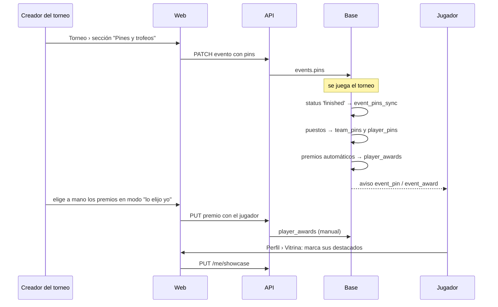
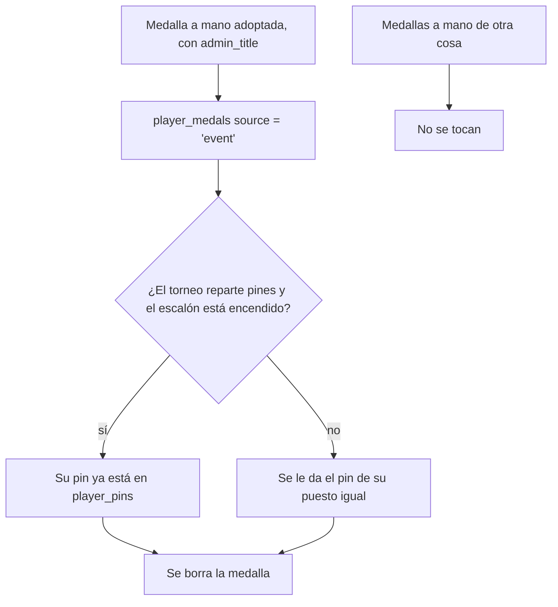

# Plan: pines y trofeos de torneo

> Planeación original. Estado: **propuesta**, pendiente de aprobación.

Parte de la propuesta de Kyan ([`2026-11-14-pines-de-torneo`](../2026-11-14-pines-de-torneo/PLAN.md), con el prototipo en `/demo/pines`) y le suma lo que pidió Daniel el 2026-11-15:

1. La **Vitrina** del jugador: una corta en el Resumen, en la columna izquierda, y una pestaña "Vitrina" con todo. La tarjeta "Logros" del Resumen muestra como mucho 5 logros y un enlace "Ver todos los logros…".
2. En el formulario del torneo, una sección para **elegir el diseño** de los pines y trofeos y **qué puestos los reciben**. La configura quien creó el torneo, sea organizador, moderador o admin.
3. **Reemplazar las medallas automáticas de torneo** (replanteo `114`: «Campeón de torneo» y «Finalista de torneo») por pines y trofeos, **retroactivo**: las medallas que ya se dieron se convierten en pines.

Lo que no cambia de la propuesta de Kyan está en su plan: los escalones, la tabla de cómo se calcula el puesto según el formato, los estilos y el componente `TournamentPin`. Este plan resume esas partes y detalla solo lo nuevo.

## Decisiones tomadas

| Tema | Decisión | Por qué |
|---|---|---|
| Un pin por equipo y torneo | El del puesto final, sin acumular los escalones anteriores (el campeón no recibe también el de finalista) | Plan de Kyan |
| Escalones | Campeón, Finalista, Tercer puesto, Semifinalista, Cuartofinalista, Octavos y Participante. El 4.º recibe Semifinalista | Plan de Kyan. Pregunta abierta 1 de su plan, con la respuesta propuesta |
| Quién recibe el pin | El equipo (`team_pins`) y sus jugadores con ficha que jugaron al menos un mapa del torneo. En un torneo histórico, el plantel inscrito con ficha. Los invitados sin cuenta (`guest_names`, replanteo `113`) no reciben pin | Son las mismas reglas que usa hoy la `114` para las medallas, así nadie pierde lo que ya tenía |
| Qué torneos reparten | Los terminados, públicos o históricos aprobados, que no están en testing (lo mismo que la `114`) | Un torneo de prueba no deja premios |
| Configuración | `events.pins` (`jsonb`): el estilo, los escalones (encendido, metal y mínimo de equipos) y los premios individuales (encendido y modo). `null` = valores por defecto | Plan de Kyan |
| Quién configura | Quien puede editar el torneo: su creador (`organizer_id`, organizador o moderador) y el admin. No hace falta un permiso nuevo | Pedido de Daniel |
| Cambiar la configuración con el torneo terminado | **El creador también puede**, no solo el admin. Al guardar, los pines y premios del torneo se recalculan en el momento. Cada cambio con el torneo terminado queda registrado (quién, cuándo, antes y después) | Decisión de Daniel (2026-11-15). El registro deja ver quién movió un pin después del resultado |
| El diseño se guarda en el torneo | El pin guarda el escalón y el puesto. El estilo y el metal salen de `events.pins` al dibujarlo: si se cambia el diseño, cambia en todas las vitrinas | Una sola fuente y nada que migrar al cambiar un estilo |
| Medallas de torneo actuales | Se apaga `event_medals_sync` (la `114`) y en su lugar entra `event_pins_sync`. Cada medalla `source = 'event'` pasa a ser el pin de ese jugador en ese torneo y se borra. **También las que dio un admin a mano y la `114` adoptó** («CAMPEON TORNEO TITAN»): pasan a pin y no vuelven a ser medallas. Las definiciones `campeon_torneo` y `finalista_torneo` se archivan, no se borran | Decisión de Daniel (2026-11-15). Archivarlas permite deshacer el cambio |
| Medallas a mano que no son de torneo | No se tocan | Solo se reemplaza lo que daba la `114` |
| Avisos del retroactivo | El reparto retroactivo no manda avisos. Desde ahí, `event_pin` y `event_award` avisan una sola vez por pin o premio | Igual que la `114` (`cmleague.medals_quiet`) |
| Premios individuales | **Entran en este requerimiento.** Los que se pueden calcular con las stats tienen dos modos que elige el organizador: **automático** (gana el de mejor cifra) o **lo elige él** (de una lista ordenada por esa cifra). Los que no se pueden calcular, **solo a mano** | Decisión de Daniel (2026-11-15). Ver sección 4 |
| Vitrina del Resumen | **La arma el jugador**: marca hasta 6 pines o premios destacados. Si no marcó ninguno, se muestran 6 automáticos (primero el mejor puesto, después el más reciente) | Decisión de Daniel (2026-11-15). Igual que los clips destacados (replanteo `76`: modo `auto` o `manual`) |
| Logros en el Resumen | Hasta 5, los de más veces conseguidos y después los más recientes, con "Ver todos los logros…" que lleva a la pestaña Logros | Sugerencia de Daniel: la columna derecha es mucho más larga que la izquierda |
| Vitrina del equipo | `Showcase.tsx` pasa de mostrar títulos (`titles`) a pines. `titles` sigue en la API mientras algo lo use | Que la vitrina del equipo y la del jugador digan lo mismo |
| Rama y replanteo | `main`, que es la referencia de producción desde el 2026-11-04. Replanteo **`123`** (en `origin/main` el último es el `122`) | Hay que confirmarlo al empezar, por si entra otro antes |

## 1. El flujo completo

`event_pins_sync(evento)` reemplaza a `event_medals_sync` y se dispara en los mismos lugares que hoy: los triggers diferidos de la `114` sobre `events`, `tournament_registrations` y `tournament_registration_players`. También corre al guardar `events.pins`. Deja los pines y los premios automáticos iguales al resultado actual del torneo, o sea al palmarés.

## 2. Pines por puesto

El puesto, los escalones y qué rondas existen según el formato son los de las secciones 2 y 3 del plan de Kyan. `event_final_places(evento)` devuelve `(team_id, place, tier)` y `event_pins_sync` aplica la configuración.

Si el escalón de un equipo está apagado o no llega al mínimo de equipos, ese equipo no recibe pin. Única excepción: con "Tercer puesto" apagado, el 3.º recibe "Semifinalista".

## 3. Reemplazo retroactivo de las medallas de torneo

1. Se cargan los pines de **todos** los torneos terminados con los valores por defecto (`event_pins_sync`, sin avisos).
2. **Que nadie pierda nada:** quien hoy tiene «Campeón de torneo» o «Finalista de torneo» de un torneo queda con el pin de ese puesto, aunque con los valores por defecto ese escalón estuviera apagado. Con los valores por defecto, campeón y finalista siempre están encendidos, así que no debería pasar. Si pasa, el replanteo lo cuenta y lo informa.
3. Se borran las filas `player_medals` con `source = 'event'`, incluidas las adoptadas (`admin_title`).
4. Las definiciones `campeon_torneo` y `finalista_torneo` pasan a `status = 'archived'`: dejan de verse en el catálogo y en el editor de medallas.
5. Se borran `event_medals_sync`, `tg_event_medals` y sus triggers, y `event_pins_sync` toma su lugar.
6. Antes y después, el replanteo informa cuántas medallas había, cuántos pines quedaron y si algún jugador quedó sin el pin de una medalla que tenía. En ese caso la migración falla.

La inversa vuelve a crear las medallas desde `player_pins` (campeón y finalista), con `admin_title` guardado en una tabla de respaldo para las adoptadas, y devuelve la `114` como estaba.

## 4. Premios individuales

Qué se puede calcular con lo que ya guarda la base:

| Premio | Cifra | De dónde sale | Modo |
|---|---|---|---|
| MVP del torneo | Rating promedio | `match_player_stats.rating` | Automático o lo elige el organizador |
| Top fragger | Kills | `match_player_stats.kills` | Automático o lo elige el organizador |
| Mejor % HS | Headshots / kills | `match_player_stats.headshots`, `kills` | Automático o lo elige el organizador |
| Más daño | ADR (daño / rondas) | `match_player_stats.damage`, `rounds` | Automático o lo elige el organizador |
| Entry del torneo | Primeras kills de ronda | `match_player_stats.first_kills` | Automático o lo elige el organizador |
| Mejor AWP | Kills con AWP | `match_player_extra.weapon_kills->'awp'` (reporter 2.7.0 en adelante) | Automático o lo elige el organizador |
| Rey del clutch | Clutches ganados (1v1 a 1v5) | `match_player_extra.clutch_1v1` … `clutch_1v5` (reporter 2.7.0 en adelante) | Automático o lo elige el organizador |
| Jugada del torneo | — | Se elige entre los clips de las partidas del torneo (`match_clips`) | **Solo a mano** |

- **Solo cuentan las partidas del torneo jugadas en el servidor**, igual que las stats de la página del torneo. Un torneo histórico, o uno sin stats, no puede calcular ningún premio: en ese caso todos pasan a "solo a mano" y el organizador elige entre los jugadores del plantel.
- **Mínimos para entrar en la lista:** la mitad de los mapas de su equipo (MVP, Top fragger, Más daño y Entry), 50 kills (% HS), 10 kills con AWP (Mejor AWP) y 2 clutches ganados (Rey del clutch). Para AWP y clutch solo cuentan los mapas que tienen `match_player_extra`.
- **Automático:** al terminar el torneo gana el de mejor cifra. Un empate se desempata por kills, después por ADR y después por rating. Si el empate sigue, ganan los dos. Si nadie llega al mínimo, el premio queda desierto.
- **Lo elige el organizador:** al terminar el torneo, el premio queda **pendiente**. En el panel del torneo, el organizador ve una lista con los 10 primeros por esa cifra (jugador, equipo, cifra y mapas) y elige uno. Mientras no elija, no se muestra. Puede pasar el premio a automático en cualquier momento.
- **Solo a mano** (la Jugada, o cualquier premio de un torneo sin stats): elige entre los clips o entre los jugadores del plantel.
- Un jugador puede ganar varios premios en el mismo torneo.
- **Cambia el resultado** (corrección o reinicio del torneo): se recalculan los automáticos. Los elegidos a mano se mantienen si el jugador sigue en el torneo.

La función `event_award_candidates(evento, premio)` arma la lista y `event_award_players(evento)` calcula los automáticos.

## 5. Base de datos (replanteo `123`)

| Objeto | Qué es |
|---|---|
| `events.pins jsonb` | La configuración: `{enabled, style, tiers: {champion: {on, metal, min_teams}, …}, awards: {mvp: {on, mode: 'auto' \| 'pick'}, …, play: {on}}}`. Un `check` valida las claves, los metales, los modos y que `min_teams` esté entre 2 y 128 |
| `event_pins_log` | Los cambios de `events.pins` con el torneo terminado: `event_id`, `changed_by`, `changed_at`, `before`, `after` |
| `team_pins` | `event_id`, `team_id`, `tier`, `place`, `year`, `awarded_at`, `notified`. `unique (event_id, team_id)` |
| `player_pins` | `team_pin_id` (`on delete cascade`), `player_id`. `unique (team_pin_id, player_id)` |
| `player_awards` | `event_id`, `award`, `player_id`, `team_id`, `value`, `manual`, `clip_id`, `awarded_at`, `notified`. `unique (event_id, award, player_id)` |
| `player_showcase` | Los destacados de cada jugador: `player_id`, `kind` (`pin` \| `award`), `ref_id`, `position` (1 a 6). Más `player_showcase_prefs.mode` (`auto` \| `manual`), igual que los clips (replanteo `76`) |
| `player_showcase_shown` (vista) | Los 6 que se ven en el Resumen: los elegidos si el modo es `manual`, y si no, los automáticos |
| `event_final_places(evento)` | El puesto de cada equipo (sección 2 del plan de Kyan) |
| `event_pins_sync(evento)` | Deja `team_pins`, `player_pins` y los premios automáticos iguales al resultado y a la configuración. Manda los avisos solo la primera vez |
| `event_award_players(evento)` y `event_award_candidates(evento, premio)` | Sección 4 |
| `event_award_pick(evento, premio, jugador \| clip)` | La elección a mano. Pueden usarla el creador del torneo y el admin |
| Avisos | Tipos nuevos `event_pin` y `event_award` (categoría `event`) |
| RLS | Todos leen los pines y premios de los torneos visibles (`event_visible()`). Solo escriben las funciones (`security definer`). `player_showcase` lo escribe solo su dueño |

## 6. API

| Ruta | Cambio |
|---|---|
| `POST` / `PATCH` de eventos (admin y organizador) | Aceptan `pins`, con el mismo esquema que el `check` de la base |
| `GET /api/v1/events/{id}` | Suma `pins` (la configuración), `results` (el puesto y el pin de cada equipo) y `awards` |
| `GET /api/v1/events/{id}/awards/{award}/candidates` | La lista para elegir a mano (solo el creador y el admin) |
| `PUT` / `DELETE /api/v1/events/{id}/awards/{award}` | Elegir o borrar la elección a mano |
| `GET /api/v1/players/{id}/showcase` | Toda la vitrina del jugador: pines (con equipo, torneo, escalón, estilo y metal) y premios |
| `GET /api/v1/players/{id}` | Suma `showcase`: los 6 destacados del Resumen |
| `PUT /api/v1/me/showcase` | El jugador guarda sus destacados y el modo |
| `GET /api/v1/teams/{id}` | Suma `pins`. `titles` se mantiene |
| Medallas | Dejan de devolver las de torneo, porque ya no existen. Las pruebas de medallas que las usan se actualizan |

## 7. Web

| Lugar | Qué cambia |
|---|---|
| `features/pins/` | `TournamentPin` y los dibujos del prototipo pasan a producción. El demo `/demo/pines` sigue disponible solo en desarrollo |
| Perfil › Resumen (`SummaryTab.tsx`) | Columna izquierda: "Partidas recientes" y debajo **"Vitrina"** (los 6 de `showcase`, con "Ver toda la vitrina"). Columna derecha: la tarjeta **"Logros" muestra hasta 5** y "Ver todos los logros…" |
| Perfil › pestaña **"Vitrina"** (nueva, al lado de "Logros") | Todos los pines y premios, agrupados por año. El dueño ve un botón "Elegir destacados" (hasta 6, en orden) |
| Formulario del torneo (`EventForm`) | Sección **"Pines y trofeos"**: el estilo (con la vista previa del prototipo), el switch, metal y mínimo de equipos de cada escalón, y cada premio individual con su switch y su modo (automático o "lo elijo yo"). Los escalones que no existen con el formato y la cantidad de equipos actuales salen apagados con la razón. Con el torneo terminado, aviso: "Los cambios recalculan los pines ya repartidos" |
| Panel del torneo | Con el torneo terminado: "Premios pendientes de elegir", con la lista de candidatos de cada uno |
| Torneo › Resumen (`EventView`) | Al terminar: el podio con los pines y los premios individuales |
| Equipo › Vitrina (`Showcase.tsx`) | Los pines del equipo. "Todavía no ganó un torneo" pasa a "Todavía no tiene pines" |
| Avisos | `event_pin` y `event_award` con el pin dibujado |
| Admin › Medallas | Las dos medallas de torneo ya no aparecen, porque quedan archivadas |

El perfil del jugador lo lleva Killuaz (Esteban): hay que avisarle antes de tocar `SummaryTab` y `PlayerTabs`.

## 8. Qué cambia para cada rol

| Rol | Qué cambia |
|---|---|
| Jugador | Recibe pines y premios en vez de las medallas de torneo, con las que tenía convertidas. Ve la Vitrina en su perfil y elige sus destacados |
| Capitán | La vitrina del equipo muestra los pines |
| Organizador y moderador | Configuran los pines, los trofeos y los premios de sus torneos, también después de terminados. Eligen a mano los premios en modo "lo elijo yo" y la Jugada |
| Admin | Lo mismo en cualquier torneo. Las medallas de torneo desaparecen del editor de medallas |

Páginas del manual a crear o actualizar: `jugador/` (la vitrina y los destacados), `capitan/` (la vitrina del equipo), `organizador/` y `moderador/` (crear un torneo y elegir los premios) y `admin/` (las medallas que se reemplazan).

## 9. Términos y privacidad

El pin y los premios publican el nombre del jugador, el equipo, el torneo, el puesto y cifras de sus stats, que ya son públicas en los resultados y en las stats del torneo. Hay que revisar si `/terminos` menciona las medallas de torneo automáticas. Si las menciona, se cambian por pines y trofeos en la página de la web y en su `.html`. En principio, `/privacidad` no cambia.

## 10. Requisitos antes de empezar

- Que Daniel apruebe este plan y Kyan, el dibujo del prototipo.
- Avisarle a Killuaz (Esteban) por el perfil del jugador.
- Confirmar el número de replanteo y renumerar el `114_nombre_de_la_ficha.sql` sin commit del worktree principal: el `114` ya es el de las medallas de torneo.
- Una copia de producción para probar el retroactivo: contar las medallas `source = 'event'` antes y los pines después.

## 11. Orden de implementación

1. Replanteo `123`: tablas, `events.pins`, `event_final_places`, `event_pins_sync`, los premios, `player_showcase` y los avisos. Prueba en la copia de producción con un torneo de cada formato (`single`, `double`, `groups`, `swiss` y todos contra todos) y uno histórico.
2. En el mismo replanteo: el reemplazo retroactivo de las medallas (sección 3) con sus controles, y la inversa.
3. API: eventos, candidatos y elección, vitrina del jugador y del equipo, destacados, con pruebas.
4. Web: `features/pins` a producción, la sección del formulario, los premios pendientes, el podio del torneo y la vitrina del equipo.
5. Web del perfil (con Killuaz): Vitrina en el Resumen, la pestaña Vitrina, elegir destacados y Logros con límite de 5.
6. Avisos `event_pin` y `event_award`.
7. Manual, términos, `DOCUMENTACION.md`, `GUIA_IMPLEMENTACION.md`, `CHANGELOG_DISCORD.txt` y la fila de la bitácora.
