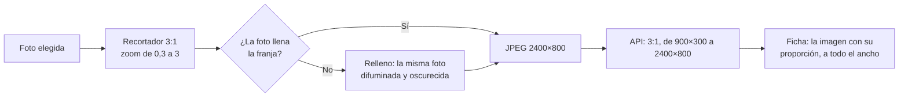

# La portada se encuadra más fácil (3:1 y se puede alejar): documentación

## Qué hace

La portada del perfil pasa de 4:1 a **3:1** y se guarda a 2400×800. De una foto vertical de celular (3:4) ahora entra el 25 % del alto en lugar del 19 %, y de una horizontal (4:3), el 44 % en lugar del 33 %.

Además, **se puede alejar**: en el recortador de la portada, el zoom baja hasta 0,3 y la foto puede quedar más chica que el marco y moverse fuera de él. Lo que sobra se rellena con la misma foto agrandada, difuminada y oscurecida, así que una foto vertical entra entera sin bandas negras.

La ficha muestra la portada con su proporción natural, a todo el ancho: las nuevas en 3:1 y las subidas antes del 2026-11-15 en 4:1, sin cortarles nada.

El banner de los torneos y la imagen del MVP no cambian (Daniel quiere ver primero cómo funciona con la portada).

## Cómo se arma la imagen

`cropImage` (`lib/image.ts`) recibe el área que eligió la persona, en píxeles de la foto original. Con la opción `fill` y un área que se sale de la foto:

1. Pinta la foto agrandada para cubrir todo el canvas (un 8 % más por lado, para que el difuminado no aclare los bordes), con `blur` de 1/60 del ancho, y encima una capa negra al 45 %. Safari viejo no difumina el canvas: ahí queda solo oscurecida.
2. Pinta encima solo la parte del área que cae dentro de la foto, en su lugar.

Si el área queda dentro de la foto, recorta como siempre. Después baja la calidad del JPEG de a poco (0,9 a 0,6) hasta pesar 1 MB o menos.

## Piezas

| Pieza | Cambio |
|---|---|
| `features/profile/components/AvatarCropDialog.tsx` | Prop `minZoom` (por defecto 1). Menor a 1: el slider baja hasta ahí y `restrictPosition` se apaga. La foto de perfil, el logo, el banner y la imagen del MVP siguen igual |
| `lib/image.ts` | Opción `fill` de `cropImage`; calidad del JPEG hasta 0,6 (para todas las imágenes) |
| `features/shop/CoverCard.tsx` | Aspecto 3, `minZoom` 0,3, `fill`, 2400×800, vista previa en 3:1 y una descripción que explica el relleno |
| `features/player/pages/PlayerProfile.tsx` | La portada es un `` a todo el ancho con su alto natural (antes, una caja fija en 4:1) |
| `routes/shop.ts` (`COVER_SHAPE`) | 3:1 (tolerancia 5 %), de 900×300 a 2400×800. Una 4:1 nueva se rechaza |
| `schemas/shop.ts`, `players.ts`, `profile.ts`, `schema.d.ts` | Las descripciones dicen 3:1 |

## Qué cambia para cada rol

| Rol | Qué cambia | Página del manual |
|---|---|---|
| Jugador | La portada es 3:1 y se puede alejar para que entre entera | [`jugador/tienda-y-cosmeticos.md`](../../manual/jugador/tienda-y-cosmeticos.md) |
| Capitán, organizador, moderador, soporte, admin, streamer y dueño de un servidor externo | Nada distinto de lo del jugador | — |

## Términos y privacidad

Sin cambios: se guarda lo mismo (una imagen de portada) y la ven los mismos.
